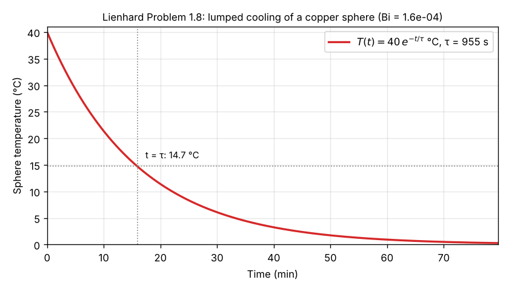

# Module 6, Part II: TEC Process Model and the Simulation

Part II compares the one-lump model of Part I with a two-lump model of the TEC side and
the measured block, using the course simulation (`python/Lab_6_7_modeling_tec.py`) and
the six experimental Goldilocks runs of Part I, Part 7. It supplies A3 Questions 3
and 5.

## Parameters carried forward from Part I

$\chi_h$ = 0.485 and $\chi_c$ = 0.172 °C/PWM (Module 4), $\tau$ = 70 ± 3 s (Part 3),
$V_{\mathrm{TEC}}$ = 10.95 V, $R_M$ = 1.50 Ω. The simulation's `measured` mode turns
these into $C$ = 70.1 J/K, $H$ = 1.00 W/K, $P_{u,c}$ = 0.172 W/PWM, and
$P_{u,h}$ = 0.486 W/PWM (Part I, "Derived constants"). The one-lump results carried
forward: the P droop $(T_{\mathrm{set}} - T_{\mathrm{amb}})/(1+\chi K_p)$ and the speed
$\tau/(1+\chi K_p)$ agree with all three experimental P runs, but the one-lump P model
cannot overshoot, and Run 3 ($K_p$ = 32) overshoots by 0.97 °C and rings once.

## Pre-class

### Lienhard Problem 1.8: a lumped body cooling in air

**System.** A copper sphere, $D$ = 2.5 cm, initially at $T_0$ = 40 °C, in a slow air
stream at $T_\infty$ = 0 °C with $h$ = 15 W/(m² K); radiation neglected.

**Lumped-model approximation.** Copper conducts heat much faster than the air removes
it, so the sphere stays nearly uniform. The Biot number compares the two:

$$
\mathrm{Bi} = \frac{h\thinspace (V/A)}{k} = \frac{h D}{6k}
= \frac{15 \times 0.025}{6 \times 398} = 1.6 \times 10^{-4} \ll 1 ,
$$

with copper $\rho \approx$ 8954 kg/m³, $c \approx$ 384 J/(kg K), and
$k \approx$ 398 W/(m K) (Lienhard, Table A.1).

**Energy balance.** The rate of change of stored energy equals the convective loss:

$$
\rho c V \frac{dT}{dt} = -hA\thinspace (T - T_\infty).
$$

Units: $\rho c V$ in J/K times K/s gives W; $hA$ in W/K times K gives W.

**Solution.** With $\theta = T - T_\infty$, $d\theta/dt = -\theta/\tau$, so

$$
T(t) = T_\infty + (T_0 - T_\infty)\thinspace e^{-t/\tau},
\qquad
\tau = \frac{\rho c V}{hA} = \frac{\rho c D}{6h} = \frac{8954 \times 384 \times 0.025}{6 \times 15}
\approx 955\ \mathrm{s}\ (15.9\ \mathrm{min}).
$$

The sphere is halfway to 0 °C after 11 min, at 4 °C after 37 min, and at 0.4 °C after
73 min; it releases $\rho c V \times 40$ K ≈ 1.1 kJ in total.

**Connection to the TEC block.** This is the one-lump model of Part I with no TEC
power: $C\thinspace dT/dt = -H(T - T_{\mathrm{amb}})$, $\tau = C/H$. For our block,
$C$ = 70 J/K and $H$ = 1.0 W/K give $\tau$ = 70 s. The sphere has a smaller heat
capacity (28 J/K) but a far smaller conductance to the air ($hA$ = 0.030 W/K), hence the
much longer time constant.

### The two-lump equations

$$
C_T\frac{dT}{dt} = P_u(u)\thinspace u - G\thinspace (T - T_m)
$$

$$
C_m\frac{dT_m}{dt} = G\thinspace (T - T_m) - H\thinspace (T_m - T_{\mathrm{amb}})
$$

* $T$: temperature of the TEC-side lump (TEC ceramic, the face of the block next to it);
  not measured.
* $T_m$: temperature of the measured lump, where the thermistor sits; the controller
  uses this one.
* $C_T$, $C_m$ (J/K): heat capacities of the two lumps, $C_T + C_m = C$ = 70 J/K.
* $P_u(u)\thinspace u$ (W): heat delivered by the TEC; $P_u = P_{u,h}$ for $u > 0$,
  $P_{u,c}$ for $u < 0$.
* $G$ (W/K): conductance between the lumps.
* $H$ (W/K): conductance from the measured lump to the room, the only path to the room
  in this model.
* $T_{\mathrm{amb}}$: room temperature.

### Two-lump theory assignment

1. **Heat from the TEC side to the measured side:** $G\thinspace (T - T_m)$. It leaves
   the TEC-side lump ($-G(T - T_m)$ in the first equation) and enters the measured lump
   ($+G(T - T_m)$ in the second).
2. **Heat loss from the measured block to the room:** $H\thinspace (T_m - T_{\mathrm{amb}})$.
3. **Why $T_m$ lags $T$.** The TEC heats only the TEC-side lump. $T_m$ changes only
   when heat flows through $G$, and that flow needs a temperature difference
   $T - T_m$, which itself has to build up first. Right after a step in $u$,
   $T = T_m$, so $dT_m/dt = 0$: the measured temperature starts with zero slope and
   follows $T$ only after the TEC-side lump has warmed. It then has to fill $C_m$ through
   the finite conductance $G$, on the time scale $C_m/G$.
4. **Why a controller that uses $T_m$ reacts too late.** By the time $T_m$ reaches the
   setpoint, $T$ is already above it, and the heat stored in $C_T$ keeps flowing into
   the measured lump after the controller has cut the power. The controller sees the
   effect of its command only after the lag, so at high gain it keeps pushing for too
   long and the measured temperature overshoots; the same happens in reverse on the
   way back. This is the overshoot of Run 3, which the one-lump model cannot produce.
5. **Rate-constant form.** Dividing the measured-lump equation by $C_m$,

   $$
   \frac{dT_m}{dt} = \frac{G}{C_m}\thinspace (T - T_m) - \frac{H}{C_m}\thinspace (T_m - T_{\mathrm{amb}})
   = k_{21}\thinspace (T - T_m) - k_m\thinspace (T_m - T_{\mathrm{amb}}),
   $$

   so $k_{21} = G/C_m$ and $k_m = H/C_m$, both in 1/s (W/K divided by J/K). A larger
   $k_{21}$ makes the two lumps equilibrate faster, so $T_m$ follows $T$ more closely
   and the lag shrinks (as $k_{21} \to \infty$ the model becomes one lump). A larger
   $k_m$ makes the measured lump relax toward room temperature faster, so it loses more
   heat for the same temperature and needs more power to hold a setpoint. With the
   simulation's starting estimates $G$ = 2 W/K and $C_T/C$ = 0.35 ($C_m$ = 45.6 J/K),
   $k_{21}$ = 0.044 s⁻¹ ($1/k_{21}$ = 23 s) and $k_m$ = 0.022 s⁻¹ ($1/k_m$ = 46 s).

### From two first-order equations to one second-order equation

For one direction ($P_u$ constant), no saturation, and P control
$u = K_p(T_{\mathrm{set}} - T_m)$, the deviations $\theta_T$, $\theta_m$ from the
steady state obey

$$
C_T\dot\theta_T = -G\theta_T + (G - P_uK_p)\thinspace \theta_m,
\qquad
C_m\dot\theta_m = G\theta_T - (G + H)\thinspace \theta_m .
$$

The second equation gives the hidden state, $G\theta_T = C_m\dot\theta_m + (G+H)\theta_m$.
Differentiating it, replacing $\dot\theta_T$ with the first equation, and then
$\theta_T$ with this expression gives

$$
C_TC_m\ddot\theta_m + \left[C_T(G+H) + C_mG\right]\dot\theta_m + G(H + P_uK_p)\thinspace \theta_m = 0 ,
$$

a damped oscillator with

$$
\omega_n = \sqrt{\frac{G(H+P_uK_p)}{C_TC_m}},
\qquad
\zeta_{\mathrm{2L,P}} = \frac{C_T(G+H) + C_mG}{2\sqrt{C_TC_mG(H+P_uK_p)}} .
$$

All coefficients are positive, so the two-lump P model is always stable; raising $K_p$
only lowers $\zeta_{\mathrm{2L,P}}$, and $\zeta_{\mathrm{2L,P}} < 1$ gives decaying
oscillations. The P gain at $\zeta_{\mathrm{2L,P}} = 1$ is

$$
K_{p,\mathrm{crit}} = \frac{1}{P_u}\left[\frac{\left(C_T(G+H)+C_mG\right)^2}{4C_TC_mG} - H\right].
$$

With PI control the integral state adds one order:

$$
C_TC_m s^3 + \left[C_T(G+H)+C_mG\right]s^2 + G(H+P_uK_p)\thinspace s + GP_uK_i = 0 ,
$$

which by the Routh–Hurwitz condition $a_2a_1 > a_3a_0$ is stable only for

$$
K_i < K_{i,\mathrm{crit}} = \frac{\left[C_T(G+H)+C_mG\right](H+P_uK_p)}{C_TC_mP_u},
\qquad \rho_I = \frac{K_i}{K_{i,\mathrm{crit}}} .
$$

Unlike the one-lump PI model of Part I, which is stable for every $K_i > 0$, the
two-lump PI model has a finite stability limit.

**Why the one-lump droop still worked.** At steady state both derivatives vanish, so
$P_uu = G(T - T_m) = H(T_m - T_{\mathrm{amb}})$. $G$ cancels from the overall balance
$P_uu = H(T_m - T_{\mathrm{amb}})$, which is the one-lump balance. The internal lag
changes the transient but not the final temperature, which is why the one-lump model
predicted the droop of Runs 1–3 to within 0.08 °C but missed the overshoot of Run 3.
