# Module 6, Part II: TEC Process Model and the Simulation

Part II compares the one-lump model of Part I with a two-lump model of the TEC side and
the measured block, using the course simulation (`python/Lab_6_7_modeling_tec.py`) and
the six experimental Goldilocks runs of Part I, Part 7. It supplies A3 Questions 3
and 5.

## Parameters carried forward from Part I

$\chi_h$ = 0.485 and $\chi_c$ = 0.172 °C/PWM (Module 4), $\tau$ = 70 ± 3 s (Part 3),
$V_{\mathrm{TEC}}$ = 10.95 V, $R_M$ = 1.50 Ω. The simulation's `measured` mode turns
these into $C$ = 70.1 J/K, $H$ = 1.00 W/K, $P_{u,c}$ = 0.172 W/PWM, and
$P_{u,h}$ = 0.486 W/PWM (Part I, "Derived constants"). The one-lump results carried
forward: the P droop $(T_{\mathrm{set}} - T_{\mathrm{amb}})/(1+\chi K_p)$ and the speed
$\tau/(1+\chi K_p)$ agree with all three experimental P runs, but the one-lump P model
cannot overshoot, and Run 3 ($K_p$ = 32) overshoots by 0.97 °C and rings once.

## Pre-class

### Lienhard Problem 1.8: a lumped body cooling in air

**System.** A copper sphere, $D$ = 2.5 cm, initially at $T_0$ = 40 °C, in a slow air
stream at $T_\infty$ = 0 °C with $h$ = 15 W/(m² K); radiation neglected.

**Lumped-model approximation.** Copper conducts heat much faster than the air removes
it, so the sphere stays nearly uniform. The Biot number compares the two:

$$
\mathrm{Bi} = \frac{h\thinspace (V/A)}{k} = \frac{h D}{6k}
= \frac{15 \times 0.025}{6 \times 398} = 1.6 \times 10^{-4} \ll 1 ,
$$

with copper $\rho \approx$ 8954 kg/m³, $c \approx$ 384 J/(kg K), and
$k \approx$ 398 W/(m K) (Lienhard, Table A.1).

**Energy balance.** The rate of change of stored energy equals the convective loss:

$$
\rho c V \frac{dT}{dt} = -hA\thinspace (T - T_\infty).
$$

Units: $\rho c V$ in J/K times K/s gives W; $hA$ in W/K times K gives W.

**Solution.** With $\theta = T - T_\infty$, $d\theta/dt = -\theta/\tau$, so

$$
T(t) = T_\infty + (T_0 - T_\infty)\thinspace e^{-t/\tau},
\qquad
\tau = \frac{\rho c V}{hA} = \frac{\rho c D}{6h} = \frac{8954 \times 384 \times 0.025}{6 \times 15}
\approx 955\ \mathrm{s}\ (15.9\ \mathrm{min}).
$$

The sphere is halfway to 0 °C after 11 min, at 4 °C after 37 min, and at 0.4 °C after
73 min; it releases $\rho c V \times 40$ K ≈ 1.1 kJ in total.


**Connection to the TEC block.** This is the one-lump model of Part I with no TEC
power: $C\thinspace dT/dt = -H(T - T_{\mathrm{amb}})$, $\tau = C/H$. For our block,
$C$ = 70 J/K and $H$ = 1.0 W/K give $\tau$ = 70 s. The sphere has a smaller heat
capacity (28 J/K) but a far smaller conductance to the air ($hA$ = 0.030 W/K), hence the
much longer time constant.

### The two-lump equations

$$
C_T\frac{dT}{dt} = P_u(u)\thinspace u - G\thinspace (T - T_m)
$$

$$
C_m\frac{dT_m}{dt} = G\thinspace (T - T_m) - H\thinspace (T_m - T_{\mathrm{amb}})
$$

* $T$: temperature of the TEC-side lump (TEC ceramic, the face of the block next to it);
  not measured.
* $T_m$: temperature of the measured lump, where the thermistor sits; the controller
  uses this one.
* $C_T$, $C_m$ (J/K): heat capacities of the two lumps, $C_T + C_m = C$ = 70 J/K.
* $P_u(u)\thinspace u$ (W): heat delivered by the TEC; $P_u = P_{u,h}$ for $u > 0$,
  $P_{u,c}$ for $u < 0$.
* $G$ (W/K): conductance between the lumps.
* $H$ (W/K): conductance from the measured lump to the room, the only path to the room
  in this model.
* $T_{\mathrm{amb}}$: room temperature.

### Two-lump theory assignment

1. **Heat from the TEC side to the measured side:** $G\thinspace (T - T_m)$. It leaves
   the TEC-side lump ($-G(T - T_m)$ in the first equation) and enters the measured lump
   ($+G(T - T_m)$ in the second).
2. **Heat loss from the measured block to the room:** $H\thinspace (T_m - T_{\mathrm{amb}})$.
3. **Why $T_m$ lags $T$.** The TEC heats only the TEC-side lump. $T_m$ changes only
   when heat flows through $G$, and that flow needs a temperature difference
   $T - T_m$, which itself has to build up first. Right after a step in $u$,
   $T = T_m$, so $dT_m/dt = 0$: the measured temperature starts with zero slope and
   follows $T$ only after the TEC-side lump has warmed. It then has to fill $C_m$ through
   the finite conductance $G$, on the time scale $C_m/G$.
4. **Why a controller that uses $T_m$ reacts too late.** By the time $T_m$ reaches the
   setpoint, $T$ is already above it, and the heat stored in $C_T$ keeps flowing into
   the measured lump after the controller has cut the power. The controller sees the
   effect of its command only after the lag, so at high gain it keeps pushing for too
   long and the measured temperature overshoots; the same happens in reverse on the
   way back. This is the overshoot of Run 3, which the one-lump model cannot produce.
5. **Rate-constant form.** Dividing the measured-lump equation by $C_m$,

   $$
   \frac{dT_m}{dt} = \frac{G}{C_m}\thinspace (T - T_m) - \frac{H}{C_m}\thinspace (T_m - T_{\mathrm{amb}})
   = k_{21}\thinspace (T - T_m) - k_m\thinspace (T_m - T_{\mathrm{amb}}),
   $$

   so $k_{21} = G/C_m$ and $k_m = H/C_m$, both in 1/s (W/K divided by J/K). A larger
   $k_{21}$ makes the two lumps equilibrate faster, so $T_m$ follows $T$ more closely
   and the lag shrinks (as $k_{21} \to \infty$ the model becomes one lump). A larger
   $k_m$ makes the measured lump relax toward room temperature faster, so it loses more
   heat for the same temperature and needs more power to hold a setpoint. With the
   simulation's starting estimates $G$ = 2 W/K and $C_T/C$ = 0.35 ($C_m$ = 45.6 J/K),
   $k_{21}$ = 0.044 s⁻¹ ($1/k_{21}$ = 23 s) and $k_m$ = 0.022 s⁻¹ ($1/k_m$ = 46 s).

### From two first-order equations to one second-order equation

For one direction ($P_u$ constant), no saturation, and P control
$u = K_p(T_{\mathrm{set}} - T_m)$, the deviations $\theta_T$, $\theta_m$ from the
steady state obey

$$
C_T\dot\theta_T = -G\theta_T + (G - P_uK_p)\thinspace \theta_m,
\qquad
C_m\dot\theta_m = G\theta_T - (G + H)\thinspace \theta_m .
$$

The second equation gives the hidden state, $G\theta_T = C_m\dot\theta_m + (G+H)\theta_m$.
Differentiating it, replacing $\dot\theta_T$ with the first equation, and then
$\theta_T$ with this expression gives

$$
C_TC_m\ddot\theta_m + \left[C_T(G+H) + C_mG\right]\dot\theta_m + G(H + P_uK_p)\thinspace \theta_m = 0 ,
$$

a damped oscillator with

$$
\omega_n = \sqrt{\frac{G(H+P_uK_p)}{C_TC_m}},
\qquad
\zeta_{\mathrm{2L,P}} = \frac{C_T(G+H) + C_mG}{2\sqrt{C_TC_mG(H+P_uK_p)}} .
$$

All coefficients are positive, so the two-lump P model is always stable; raising $K_p$
only lowers $\zeta_{\mathrm{2L,P}}$, and $\zeta_{\mathrm{2L,P}} < 1$ gives decaying
oscillations. The P gain at $\zeta_{\mathrm{2L,P}} = 1$ is

$$
K_{p,\mathrm{crit}} = \frac{1}{P_u}\left[\frac{\left(C_T(G+H)+C_mG\right)^2}{4C_TC_mG} - H\right].
$$

With PI control the integral state adds one order:

$$
C_TC_m s^3 + \left[C_T(G+H)+C_mG\right]s^2 + G(H+P_uK_p)\thinspace s + GP_uK_i = 0 ,
$$

which by the Routh–Hurwitz condition $a_2a_1 > a_3a_0$ is stable only for

$$
K_i < K_{i,\mathrm{crit}} = \frac{\left[C_T(G+H)+C_mG\right](H+P_uK_p)}{C_TC_mP_u},
\qquad \rho_I = \frac{K_i}{K_{i,\mathrm{crit}}} .
$$

Unlike the one-lump PI model of Part I, which is stable for every $K_i > 0$, the
two-lump PI model has a finite stability limit.

**Why the one-lump droop still worked.** At steady state both derivatives vanish, so
$P_uu = G(T - T_m) = H(T_m - T_{\mathrm{amb}})$. $G$ cancels from the overall balance
$P_uu = H(T_m - T_{\mathrm{amb}})$, which is the one-lump balance. The internal lag
changes the transient but not the final temperature, which is why the one-lump model
predicted the droop of Runs 1–3 to within 0.08 °C but missed the overshoot of Run 3.

## Part 1: Guided simulation and oscillation study

### One-lump PI: three controlled comparisons

The one-lump PI damping ratio is $\zeta = (H + P_uK_p)/(2\sqrt{CP_uK_i})$. Each
comparison changes one quantity; all other settings are as in Part I, Part 6
(`one_lump`, `pi`, $T_0$ = 19.84 °C, $T_{\mathrm{set}}$ = 30 °C, $u_{\max}$ = 255,
anti-windup on, $\Delta t$ = 0.05 s). $T_{\max}$ was read from the simulation.

**1. $K_p$ fixed, $K_i$ increased.** Already done in Part I, Part 6 (group F): at
$K_p$ = 8, raising $K_i$ from 0.08 to 2.0 lowers $\zeta$ from 1.48 to 0.30
($\zeta \propto 1/\sqrt{K_i}$) and raises the overshoot from 0 to 4.33 °C.

**2. $K_i$ fixed at 0.36, $K_p$ increased** (`measured`; $T_{\mathrm{amb}}$ was 20.0 °C
and the $\chi_c$ field 0.170 in these runs, which the course model reproduces exactly):

Prediction: $\zeta \propto H + P_uK_p$, so $\zeta$ rises with $K_p$.

| $K_p$ (PWM/°C) | Displayed $\zeta$ | $T_{\max}$ (°C) | Overshoot (°C) |
| ---: | ---: | ---: | ---: |
| 4 | 0.42 | 32.85 | 2.85 |
| 8 | 0.70 | 31.40 | 1.40 |
| 16 | 1.25 | 30.35 | 0.35 |

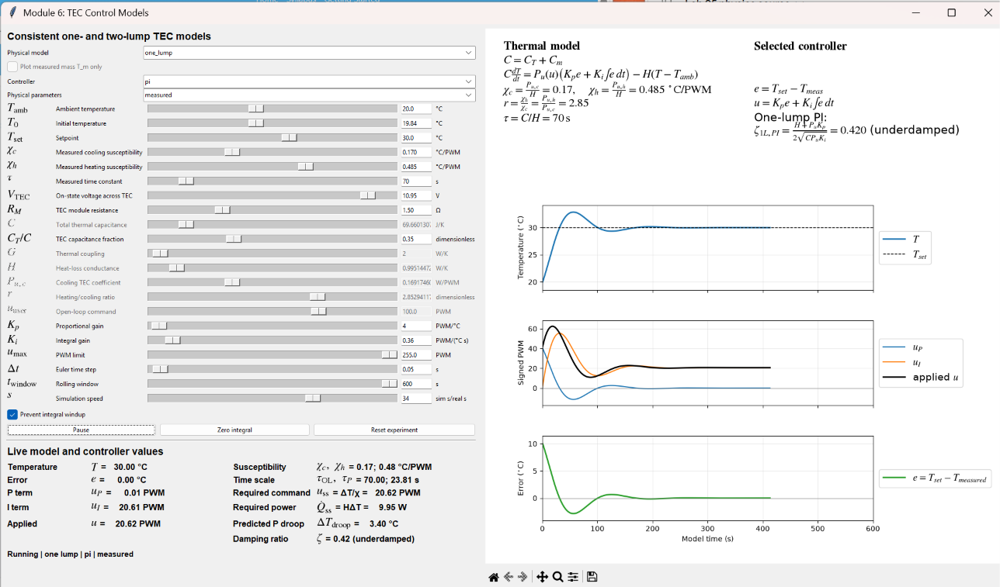

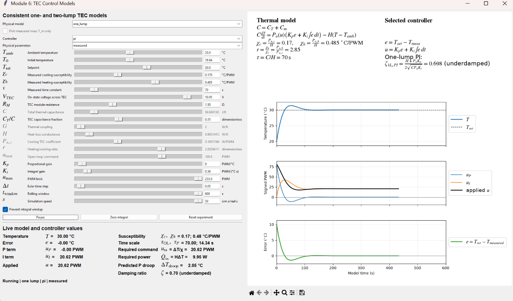

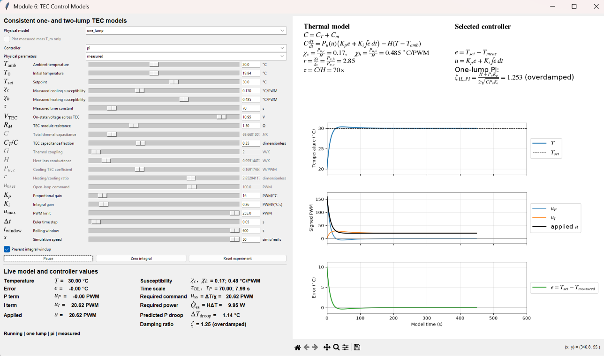

A larger $K_p$ adds damping and suppresses the overshoot. $K_p$ = 16 still overshoots
by 0.35 °C although $\zeta$ = 1.25 > 1, because $K_i$ = 0.36 is above
$K_p/\tau$ = 0.23: the PI zero, not $\zeta$, decides whether the one-lump response
overshoots (Part I, Part 6).

**3. $C$ increased with $H$ = 1.00 W/K, $P_{u,c}$ = 0.172 W/PWM, $r$ = 2.82, $K_p$ = 8,
and $K_i$ = 0.36 held fixed** (`direct constants`, $T_{\mathrm{amb}}$ = 19.84 °C):

Prediction: $\zeta \propto 1/\sqrt{C}$, so $\zeta$ falls as $C$ rises.

| $C$ (J/K) | $\tau = C/H$ (s) | Displayed $\zeta$ | $T_{\max}$ (°C) | Overshoot (°C) |
| ---: | ---: | ---: | ---: | ---: |
| 5 | 5 | 2.61 | 30.00 | none |
| 35 | 35 | 0.99 | 30.44 | 0.44 |
| 70 | 70 | 0.70 | 31.39 | 1.39 |
| 140 | 140 | 0.49 | 32.52 | 2.52 |

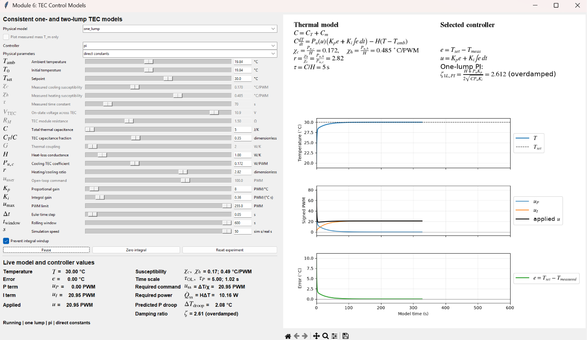

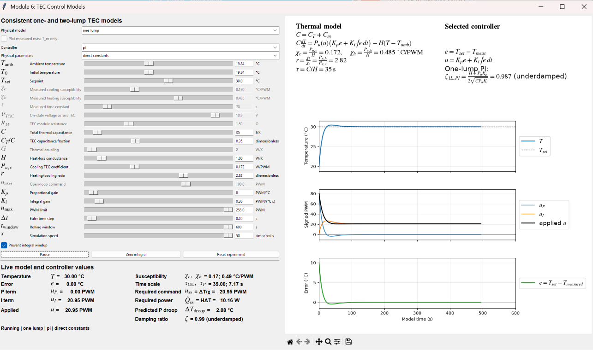

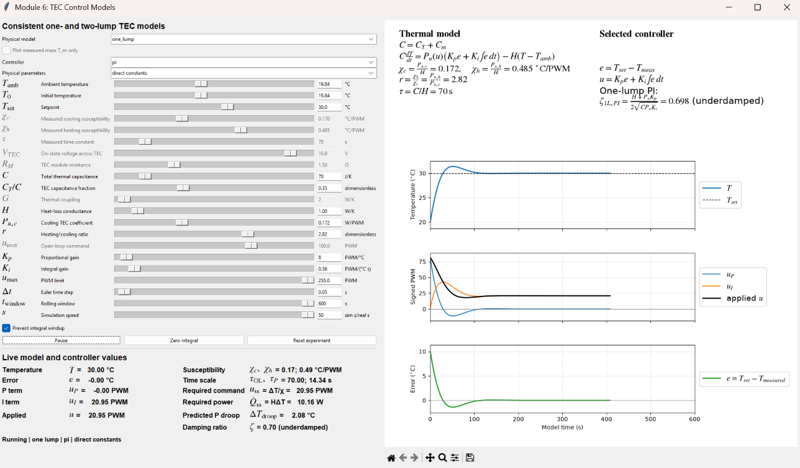

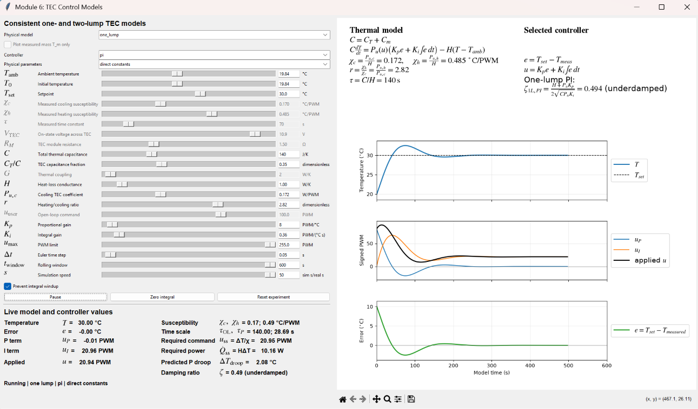

$\zeta \propto 1/\sqrt{C}$: with the gains unchanged, a larger heat capacity makes the
same $K_i$ more aggressive, because the block responds more slowly and more error
accumulates in $q$ before the temperature catches up. At $C$ = 5 J/K
($\tau$ = 5 s) the overshoot disappears entirely: $K_i$ = 0.36 is then below
$K_p/\tau$ = 1.6. The steady command (20.95 PWM) and the predicted P droop (2.08 °C)
do not depend on $C$, since $C$ affects only the transient.

All three comparisons are monotonic and none of them oscillates more than once: the
one-lump PI model can overshoot, but it remains stable for every positive gain. The
parameters are returned to `measured` before the two-lump runs.

### Two-lump P: the overdamped-to-underdamped transition

**Settings** (the handout's common set): `two_lump`, `direct constants`, `p`;
$T_{\mathrm{amb}} = T_0$ = 29 °C, $T_{\mathrm{set}}$ = 30 °C; $C$ = 91 J/K,
$C_T/C$ = 0.35, $G$ = 50 W/K, $H$ = 1.14 W/K, $P_{u,c}$ = 0.26 W/PWM, $r$ = 2.0;
$u_{\max}$ = 255; $\Delta t$ = 0.05 s. The 1 °C step keeps the command below the limit
(at most 160 PWM). In P mode the $K_i$ field is disabled and has no effect. Every value
was typed into its field (a first pass had let the sliders move $H$ to 1.15 W/K and $C$
to 90 J/K, and a second pass had left $C_T/C$ at 0.80; both were repeated). Each run
started from **Reset experiment**. $T_m$ and $T$ peaks are from the course model at the
same settings; both temperatures are plotted in the screenshots.

| Run | Varied | Displayed $\zeta_{\mathrm{2L,P}}$ | Handout | $T_m$ peak (°C) | TEC-side $T$ peak (°C) | Response of $T_m$ |
| --- | --- | ---: | ---: | ---: | ---: | --- |
| B1 | $K_p$ = 60 | 1.314 | 1.31 | 29.965 (= final) | 29.987 | monotonic |
| B1 | $K_p$ = 105 | 1.001 | 1.00 | 29.980 (= final) | 30.016 | monotonic, nearly critical |
| B1 | $K_p$ = 160 | 0.814 | 0.81 | 30.001 (+0.015) | 30.235 | small overshoot |
| B2 | $G$ = 35 | 0.840 | 0.84 | 29.988 (+0.009) | 30.188 | small overshoot |
| B2 | $G$ = 50 | 1.001 | 1.00 | final | 30.016 | nearly critical |
| B2 | $G$ = 70 | 1.181 | 1.18 | final | 29.995 | monotonic |
| B3 | $C_T/C$ = 0.20 | 1.189 | 1.19 | final | 30.039 | monotonic |
| B3 | $C_T/C$ = 0.35 | 1.001 | 1.00 | final | 30.016 | nearly critical |
| B3 | $C_T/C$ = 0.50 | 0.958 | 0.96 | final | 30.004 | least damped, still no visible overshoot |
| B3 | $C_T/C$ = 0.80 | 1.205 | 1.21 | final | 30.002 | monotonic |

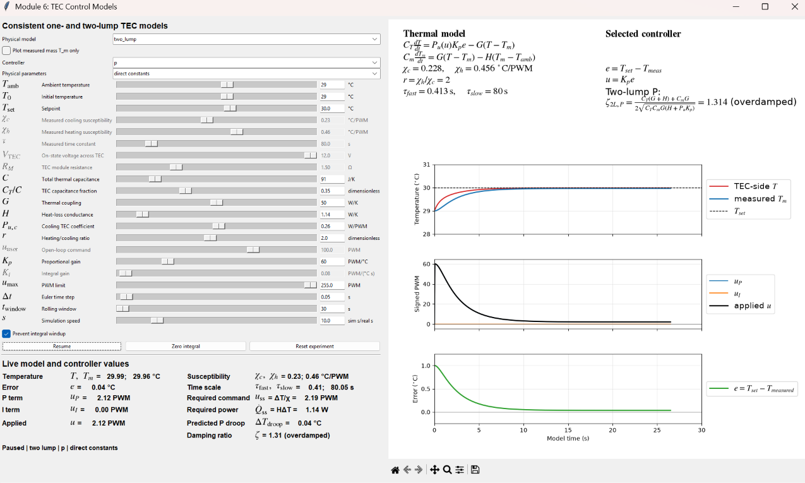

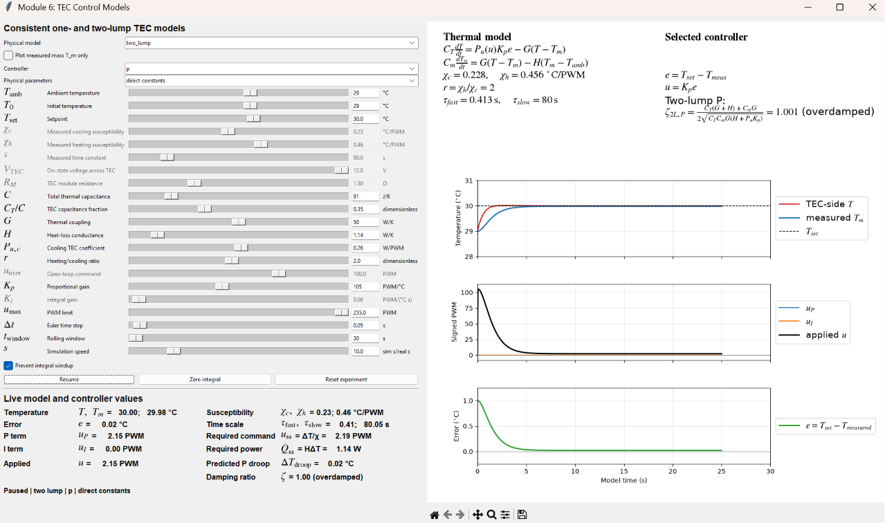

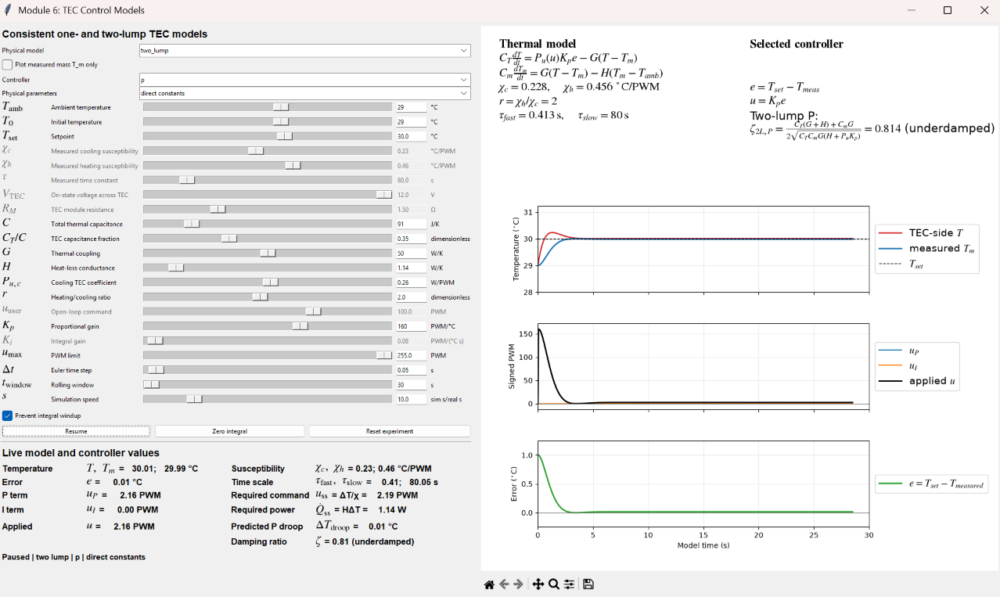

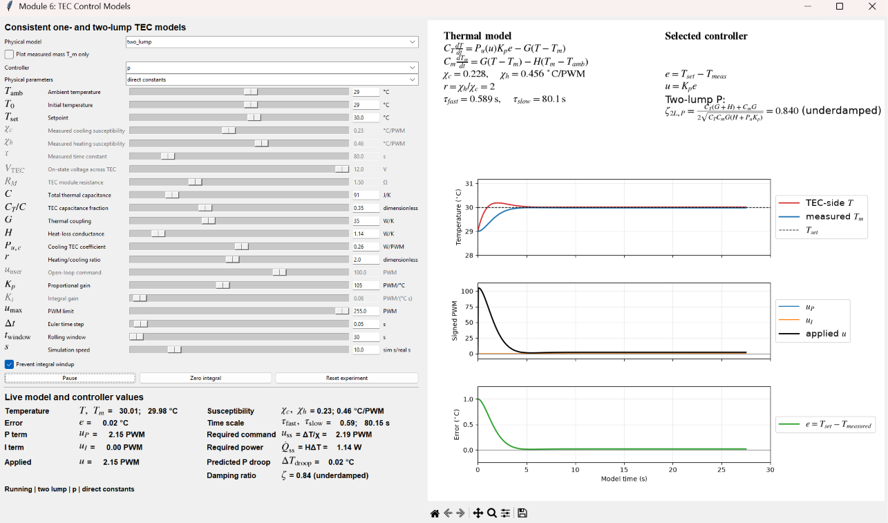

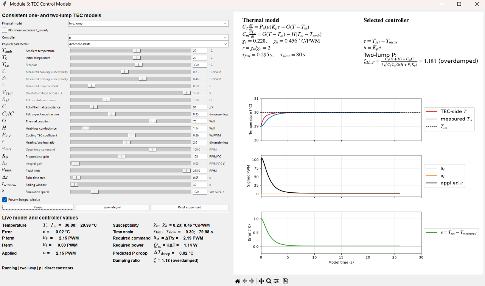

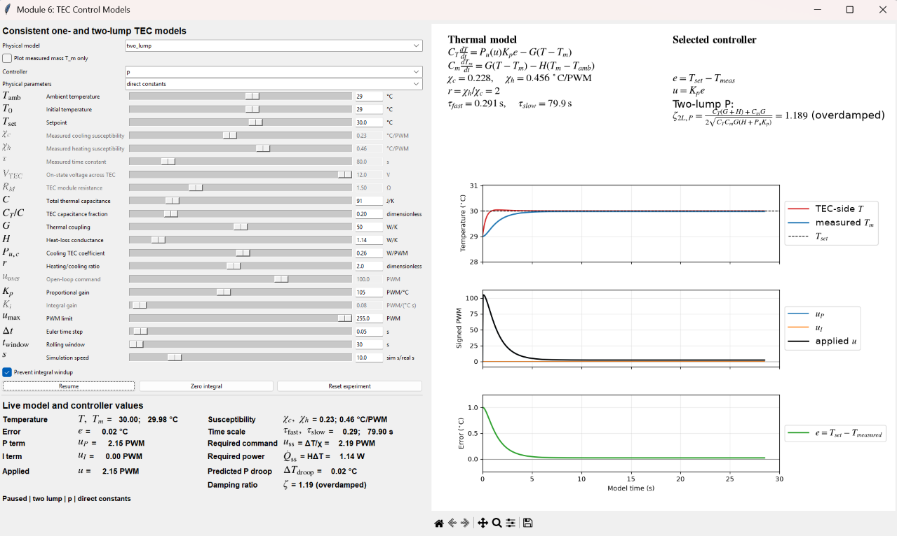

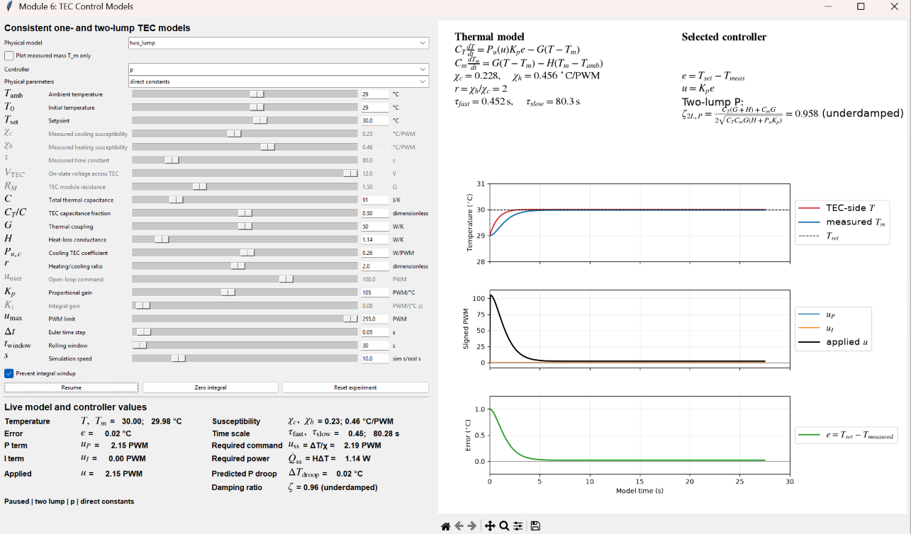

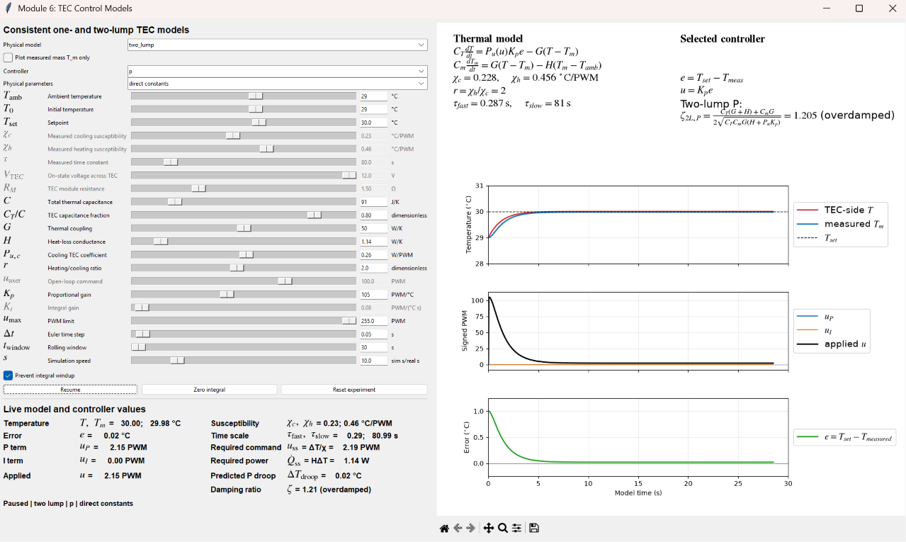

* **$K_p$ moves the response across $\zeta_{\mathrm{2L,P}}$ = 1.** Raising $K_p$ raises
  $\omega_n$ (0.93 → 1.22 → 1.50 rad/s) and lowers $\zeta_{\mathrm{2L,P}}$, so the
  response gets faster and, below $\zeta$ = 1, overshoots. With a 1 °C step the
  overshoot of $T_m$ at $\zeta$ = 0.81 is only 0.015 °C (1.5 % of the step, as
  $e^{-\pi\zeta/\sqrt{1-\zeta^2}}$ predicts); the TEC side overshoots 16 times more
  (0.24 °C), which is the stored heat that is still on its way to the measured lump.
  The one-lump P model has no such state and would stay monotonic at any $K_p$.
* **A weaker internal link lowers the damping in this range.** $G$ = 35 → 50 → 70 W/K
  gives $\zeta$ = 0.84 → 1.00 → 1.18. A smaller $G$ means a larger lag between $T$ and
  $T_m$, so the TEC side runs further ahead (peak 30.19 °C at $G$ = 35). This is a local
  trend: the damping is lowest at $G = C_TH/(C_T + C_m)$, far below these values, and
  a nearly disconnected measured mass would respond slowly, not ring.
* **Two appreciable heat stores are needed.** $C_T/C$ = 0.20, 0.35, 0.50, 0.80 gives
  $\zeta$ = 1.19, 1.00, 0.96, 1.21: least damped near an equal split
  ($C_T/C = G/(H + 2G) \approx 0.49$) and more damped when either lump holds most of
  the capacity, because the system then approaches one lump.
* **The same sweep with the capacity in the TEC lump.** The second pass, run by mistake
  with $C_T/C$ = 0.80, repeats the $K_p$ and $G$ sweeps closer to one lump. Every
  damping ratio is higher than at $C_T/C$ = 0.35, and even $K_p$ = 160 is only just
  underdamped:

  | $C_T/C$ = 0.80 | $K_p$ = 60 | $K_p$ = 105 | $K_p$ = 160 | $K_p$ = 105, $G$ = 35 | $K_p$ = 105, $G$ = 70 |
  | --- | ---: | ---: | ---: | ---: | ---: |
  | Displayed $\zeta_{\mathrm{2L,P}}$ | 1.583 | 1.205 | 0.980 | 1.016 | 1.419 |
  | At $C_T/C$ = 0.35 | 1.314 | 1.001 | 0.814 | 0.840 | 1.181 |

  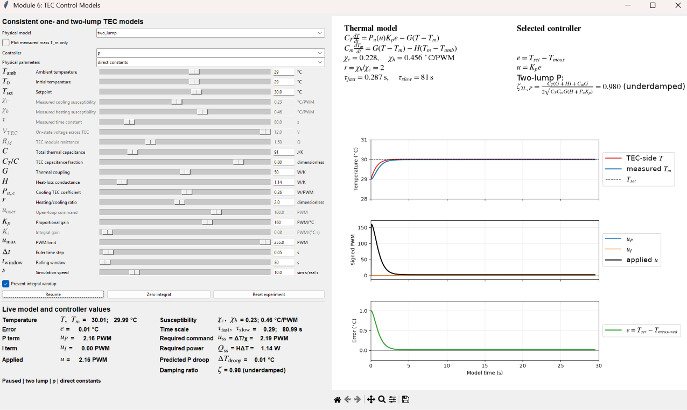

* **The droop is tiny here.** With $L = P_{u,h}K_p/H$ = 27–73, the steady error is
  0.01–0.04 °C, and it does not depend on $G$ or $C_T/C$: the steady state is set by
  $P_uu = H(T_m - T_{\mathrm{amb}})$ alone.

### Two-lump PI: the stability limit

**Settings.** As above but with $G$ = 2 W/K, $K_p$ = 18 PWM/°C, controller `pi`,
anti-windup on, a 600 s window, and the same 29 → 30 °C step, so the command stays far
below the PWM limit (at most 28 PWM in every stable run) and the linear criterion
applies. The slider again set $H$ to 1.15 W/K (it was 1.14 W/K only in the $K_i$ = 0
reference run), and the $K_i$ field moves in steps of 0.02, so 0.25 was run as 0.26; the
displayed $K_{i,\mathrm{crit}}$ and $\rho_I$ follow from these values. Rise time
(10–90 %), overshoot, settling time (last exit from ±0.02 °C, 2 % of the step), period,
and the ratio of successive peaks of $T_m$ are from the course model at the same
settings.

**Varying $K_i$ at $G$ = 2 W/K** (displayed $K_{i,\mathrm{crit}}$ = 2.35 PWM/(°C s)):

| $K_i$ | Displayed $\rho_I$ | Rise (s) | Overshoot (°C) | Settles (s) | Period (s) | Peak ratio | Classification |
| ---: | ---: | ---: | ---: | ---: | ---: | ---: | --- |
| 0 (P only) | 0 | 16.4 | 0.11 above its final 29.89 °C | 55 | — | — | stable; droop 0.11 °C |
| 0.26 | 0.111 | 16.4 | 0.18 | 61 | — | 0.06 | stable, well damped |
| 1.00 | 0.426 | 12.7 | 0.55 | 169 | 76 | 0.17 | stable, underdamped |
| 2.10 | 0.895 | 10.4 | 0.92 | 1330 | 71 | 0.79 | stable, weakly damped |
| 2.50 | 1.066 | 9.8 | 1.02 first peak, growing | never | 68 | 1.04 | unstable |

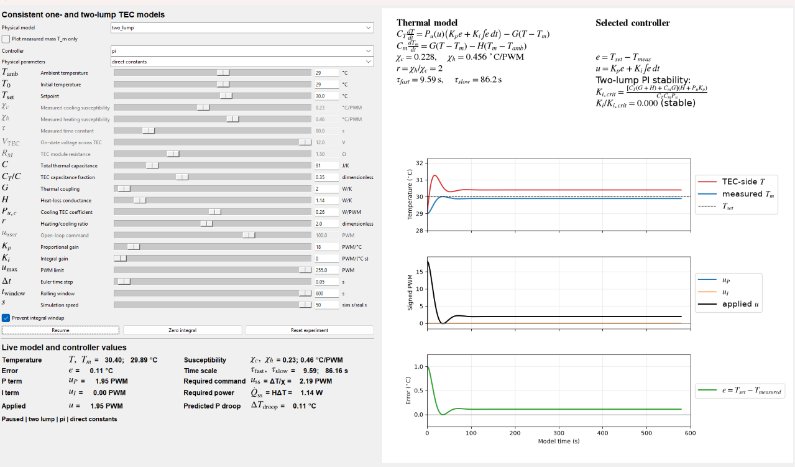

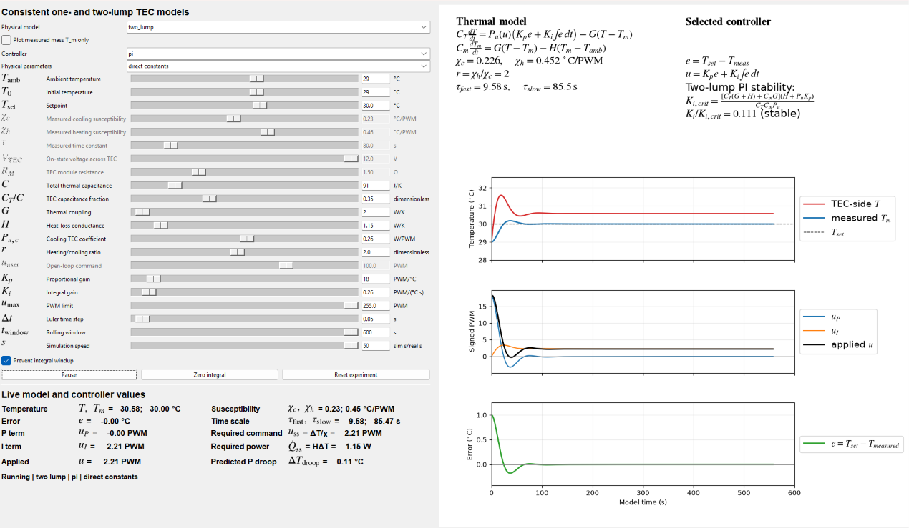

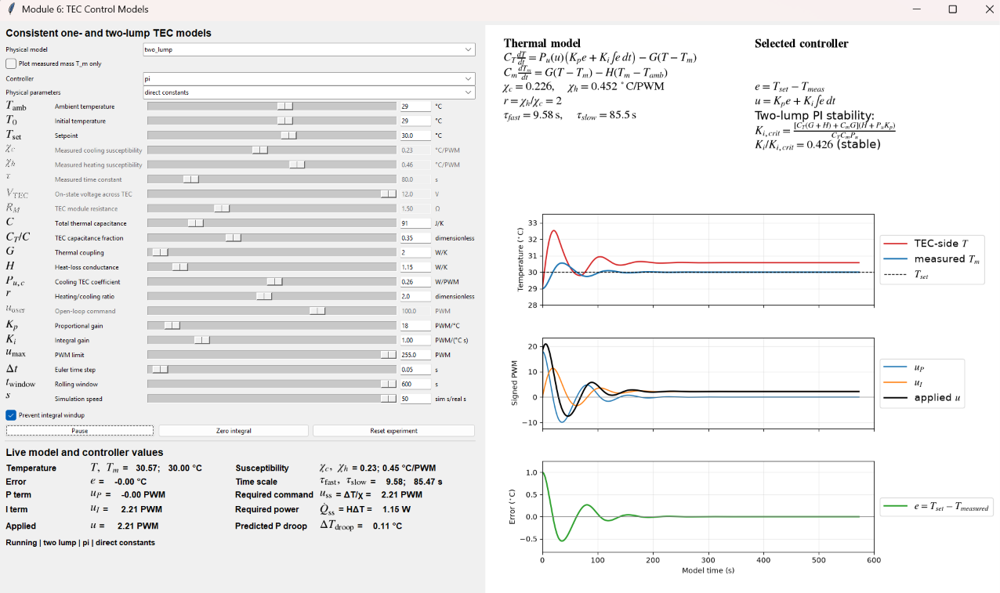

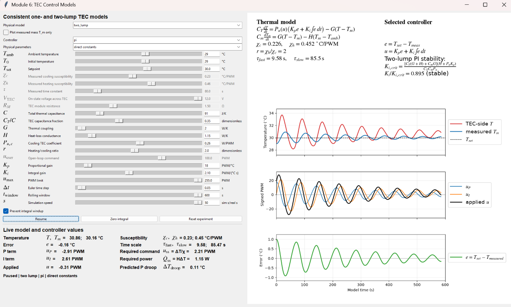

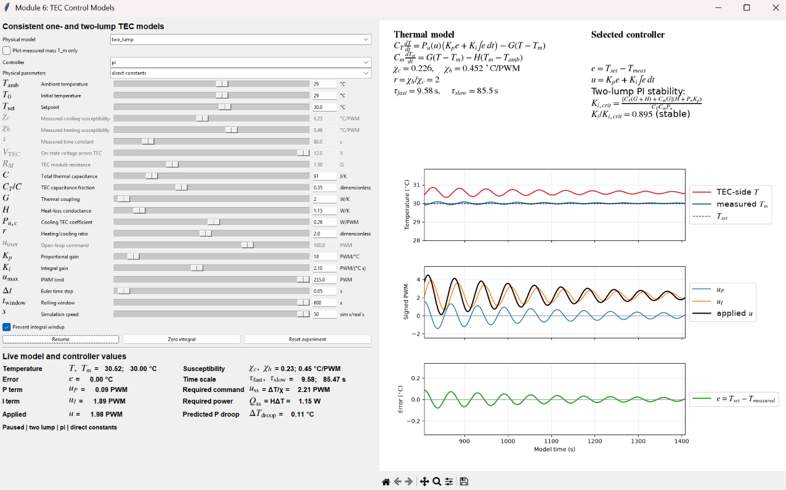

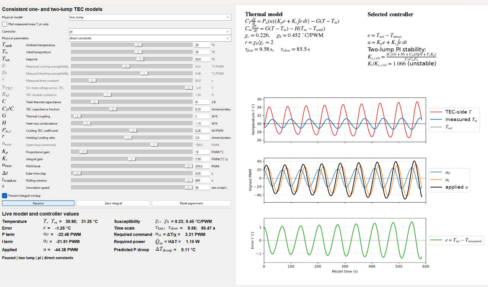

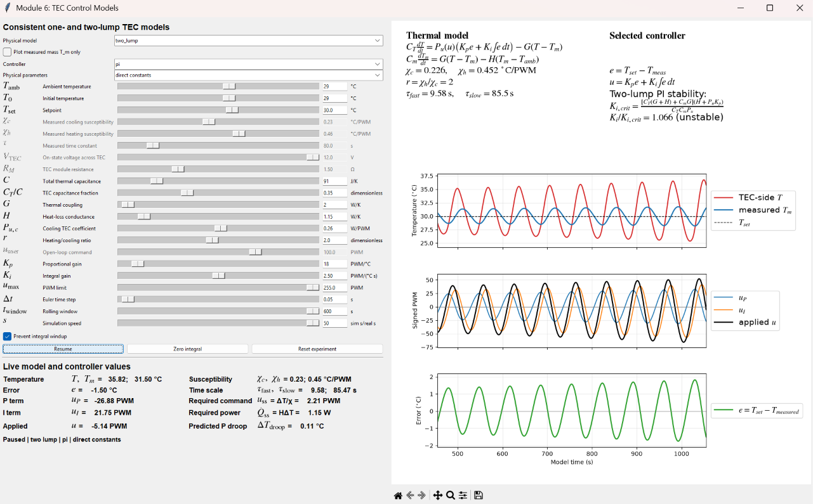

Raising $K_i$ shortens the first correction (rise 16 → 10 s) but lengthens the final
settling (61 s → 22 min → never), as the handout predicts. At $\rho_I$ = 0.90 each peak
is still 0.79 of the previous one, so the oscillation is visible for over 20 min
(it is ±0.05 °C at 1400 s). At $\rho_I$ = 1.07 each peak is 4 % larger than the last:
the envelope grows although the command (up to 80 PWM by 1400 s) has not yet reached
the limit, so this is linear instability, not saturation. The reference run with
$K_i$ = 0 shows the plain two-lump P response at $\zeta_{\mathrm{2L,P}}$ = 0.55: one small
overshoot and a 0.11 °C droop, which every $K_i > 0$ removes.

**Varying $G$ at $K_i$ = 1.00:**

| $G$ (W/K) | Displayed $K_{i,\mathrm{crit}}$ | Displayed $\rho_I$ | Overshoot (°C) | Settles (s) | Period (s) | Peak ratio | Classification |
| ---: | ---: | ---: | ---: | ---: | ---: | ---: | --- |
| 0.5 | 0.88 | 1.135 | 1.05 first peak, growing | never | 135 | 1.15 | unstable |
| 1 | 1.37 | 0.730 | 0.80 | 672 | 100 | 0.54 | stable, weakly damped |
| 2 | 2.35 | 0.426 | 0.55 | 169 | 76 | 0.17 | stable, underdamped |
| 5 | 5.27 | 0.190 | 0.29 | 54 | — | 0.00 | stable, well damped |

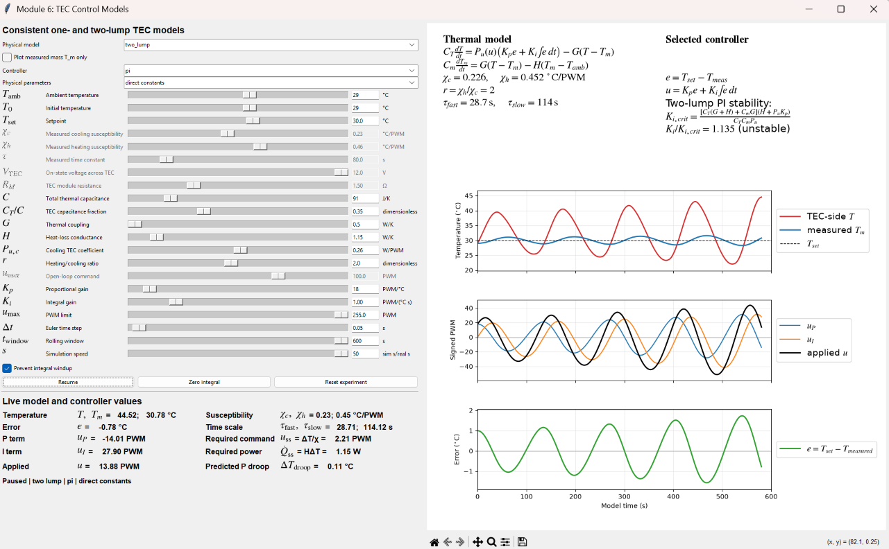

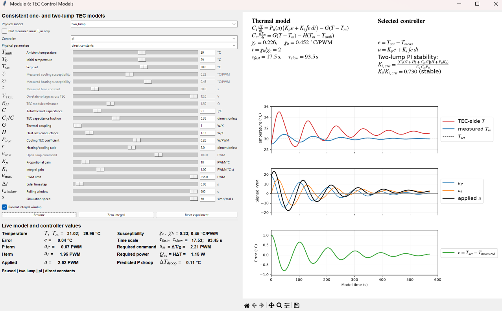

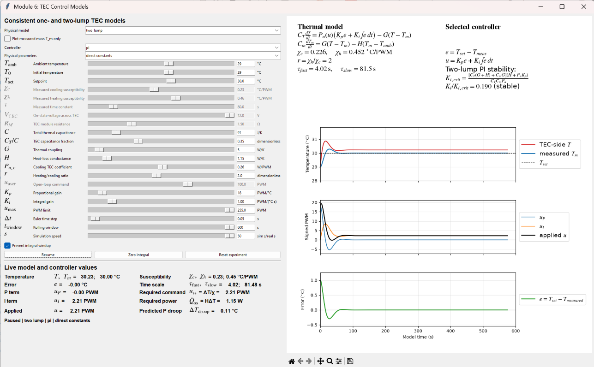

$K_{i,\mathrm{crit}}$ grows almost in proportion to $G$ here, so the same $K_i$ crosses
the stability limit when the internal link is weakened: at $G$ = 0.5 W/K the TEC side
swings to 44.5 °C within 600 s while $T_m$ oscillates around the setpoint with a slowly
growing amplitude. A weak link also slows the oscillation (period 135 s instead of
76 s), because the heat takes longer to reach the measured lump.

**Varying $C_T/C$ at $K_i$ = 1.00, $G$ = 2 W/K:**

| $C_T/C$ | Displayed $K_{i,\mathrm{crit}}$ | Displayed $\rho_I$ | Overshoot (°C) | Settles (s) | Peak ratio |
| ---: | ---: | ---: | ---: | ---: | ---: |
| 0.05 | 9.62 | 0.104 | 0.20 | 60 | — |
| 0.25 | 2.71 | 0.369 | 0.49 | 149 | 0.11 |
| 0.35 | 2.35 | 0.426 | 0.55 | 169 | 0.17 |
| 0.50 | 2.29 | 0.437 | 0.56 | 203 | 0.18 |
| 0.70 | 2.97 | 0.337 | 0.47 | 143 | 0.09 |
| 0.95 | 14.46 | 0.069 | 0.24 | 107 | 0.01 |

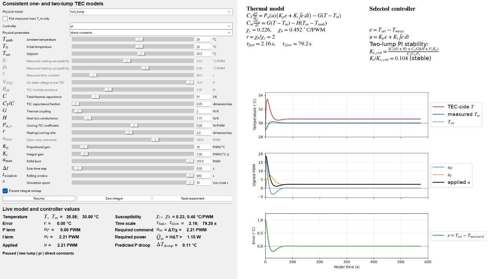

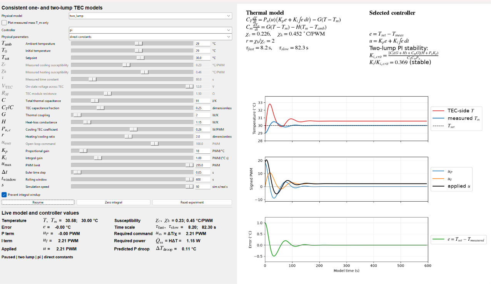

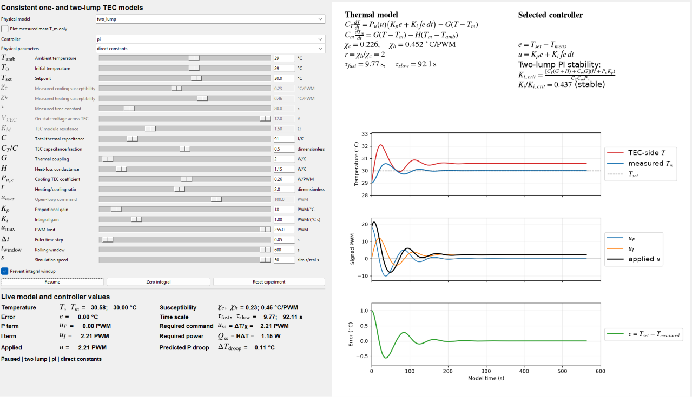

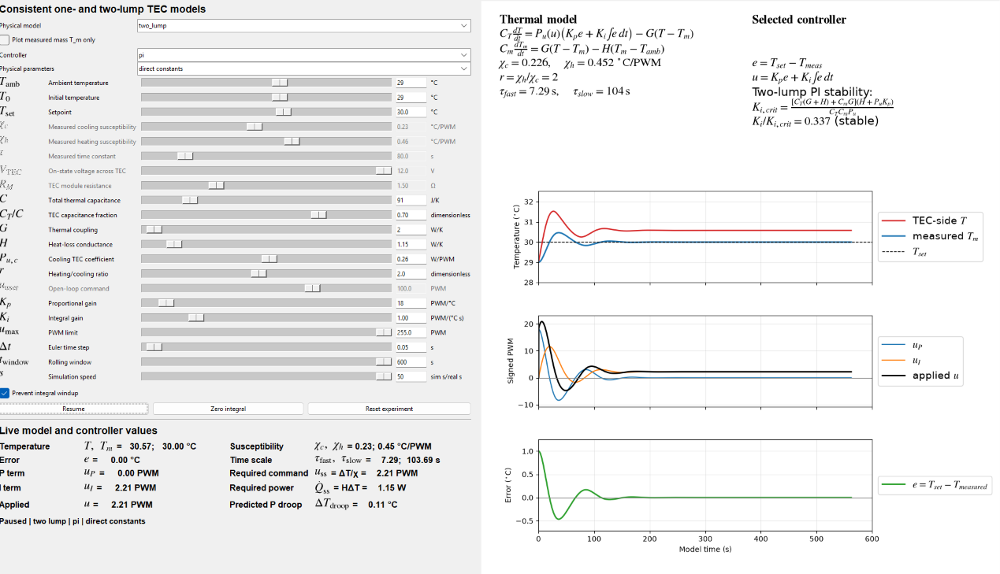

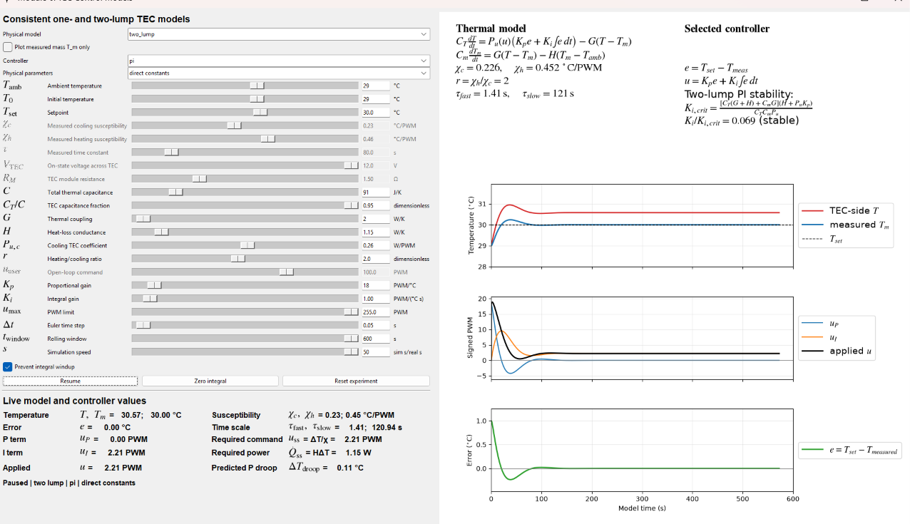

The stability margin is smallest ($\rho_I$ largest) near an equal split and grows quickly
when either lump holds nearly all the capacity: at $C_T/C$ = 0.05 or 0.95 the response
has one overshoot and no ringing, close to the one-lump PI response. As in the P runs,
two appreciable heat stores joined by a finite $G$ are what produce the oscillatory pair
of eigenvalues.

**Summary.** The two-lump PI model, unlike the one-lump model, has a finite stability
limit $K_{i,\mathrm{crit}}$, and $\rho_I = K_i/K_{i,\mathrm{crit}}$ ranks every run
correctly: the larger $\rho_I$, the slower the oscillation decays, and the two runs with
$\rho_I > 1$ grow. A smaller $G$ or a more even capacity split lowers
$K_{i,\mathrm{crit}}$, so a gain that is safe for one apparatus can be unstable for
another with more internal lag.

## Part 2: The six two-lump Goldilocks plots

### Step 2: one shared $G$ and $C_T/C$ from the high-gain P run

**Settings.** `two_lump`, `measured`, `p`; $T_{\mathrm{amb}} = T_0$ = 21.05 °C (the Run 3
baseline), $\chi_c$ = 0.172 and $\chi_h$ = 0.485 °C/PWM, $\tau$ = 70 s,
$V_{\mathrm{TEC}}$ = 10.95 V, $R_M$ = 1.50 Ω, $u_{\max}$ = 255, $\Delta t$ = 0.05 s, and
$K_p$ = 32 PWM/°C, the gain of Run 3. As in Run 3, the setpoint was 30 °C from room
temperature, then 35 °C, then 30 °C again, switched during the run without a reset. All
setpoints are above $T_{\mathrm{amb}}$, so the displayed $\zeta_{\mathrm{2L,P}}$ uses the
heating coefficient $P_{u,h}$. That is the direction of the upward step.

Overshoots are measured from the final value of each step: 29.38, 34.15, and 29.46 °C
measured (Part I, Run 3), and the droop values 29.46, 34.16, and 29.46 °C in the model.
Times are from the setpoint switch, or from the start of control for the first step.
The "rebound" is the first extreme after the peak, also measured from the final value.
Model values are from the course model at the same settings and setpoint schedule
(82.8 s at 30 °C, 225.9 s at 35 °C, 158.1 s at 30 °C, as in Run 3).

| $G$ (W/K) | $C_T/C$ | Displayed $\zeta_{\mathrm{2L,P}}$ | $K_{p,\mathrm{crit}}$ (PWM/°C) | From room: overshoot (°C) at (s) | Up step: overshoot (°C) at (s) | Up step: rebound (°C) at (s) | Up step: peak to peak (s) | Down step: undershoot (°C) |
| ---: | ---: | ---: | ---: | ---: | ---: | ---: | ---: | ---: |
| measured | (Run 3) | — | — | 1.74 at 11.8 | 0.97 at 11.8 | −0.42 at 21.5 | 19.4 | 0.09 |
| 2 | 0.35 | 0.428 | 4.19 | 2.16 at 22.2 | 1.09 at 20.4 | −0.24 at 41.0 | 40.8 | 0.50 |
| 3 | 0.35 | 0.499 | 6.40 | 1.52 at 18.4 | 0.79 at 17.1 | −0.13 at 34.2 | 34.2 | 0.32 |
| 2 | 0.30 | 0.436 | 4.42 | 2.08 at 21.4 | 1.05 at 19.6 | −0.23 at 39.4 | 39.3 | 0.48 |
| **2** | **0.25** | **0.452** | **4.89** | 1.93 at 20.2 | **0.98 at 18.6** | −0.20 at 37.3 | 37.2 | 0.43 |
| 2 | 0.20 | 0.478 | 5.72 | 1.69 at 18.8 | 0.87 at 17.3 | −0.16 at 34.7 | 34.7 | 0.37 |

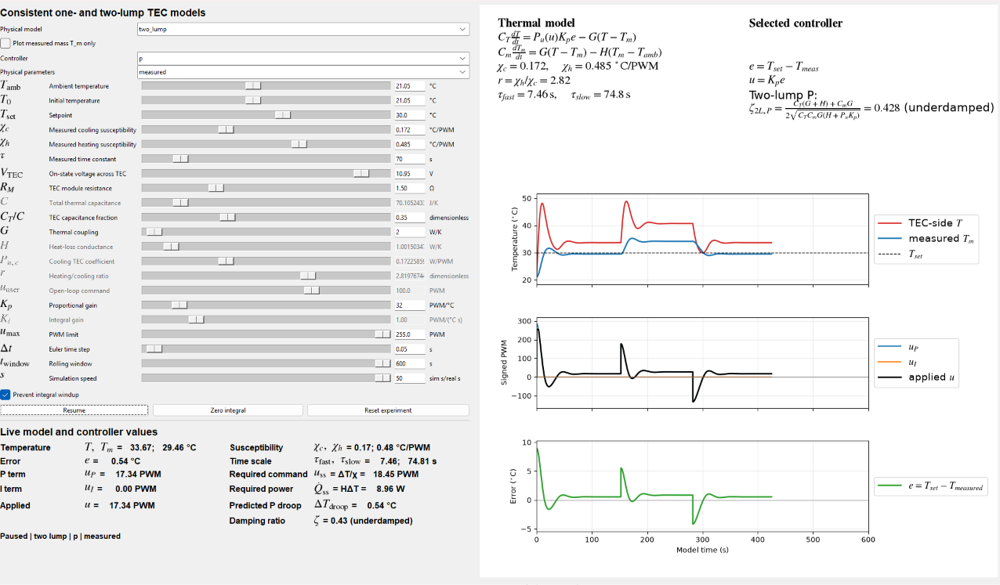

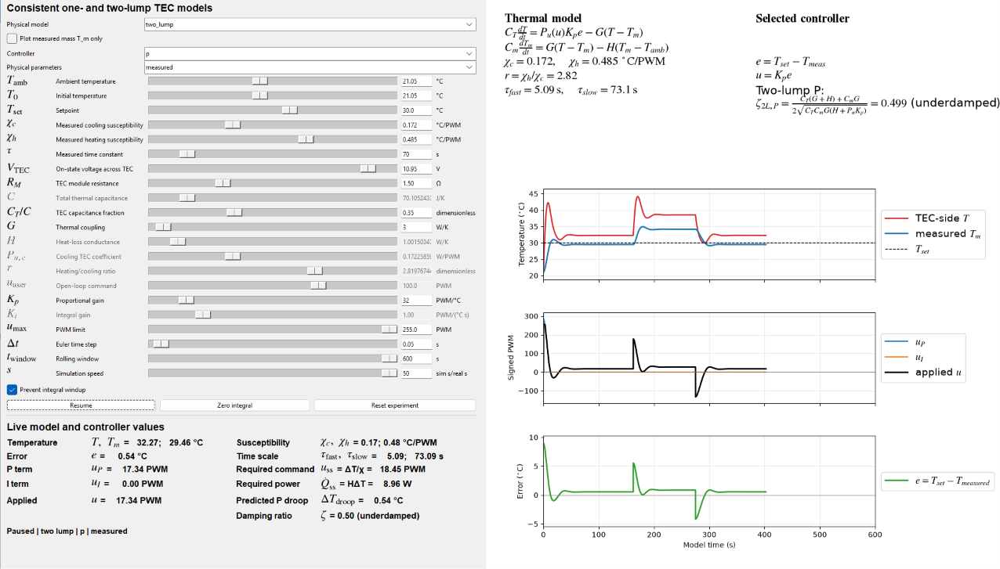

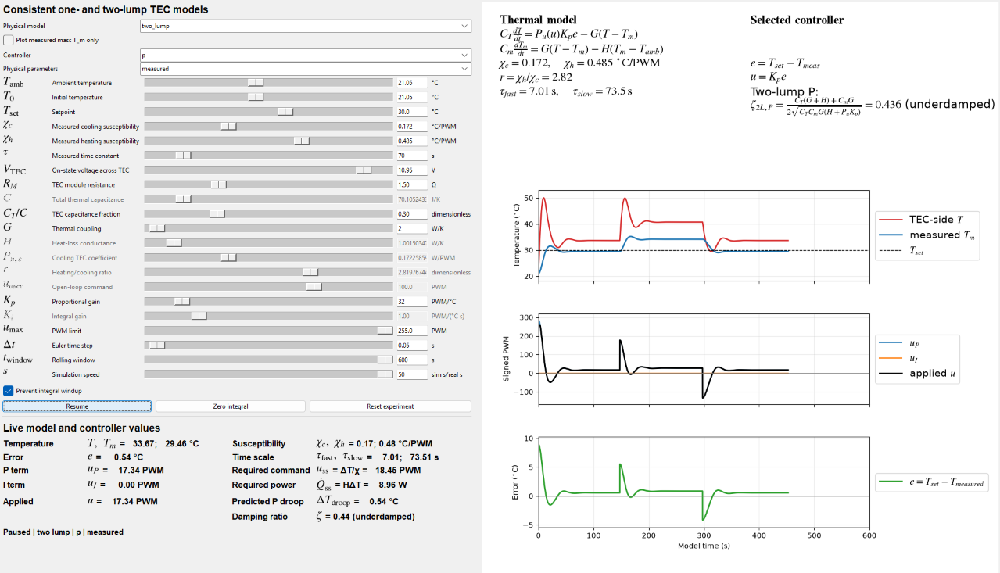

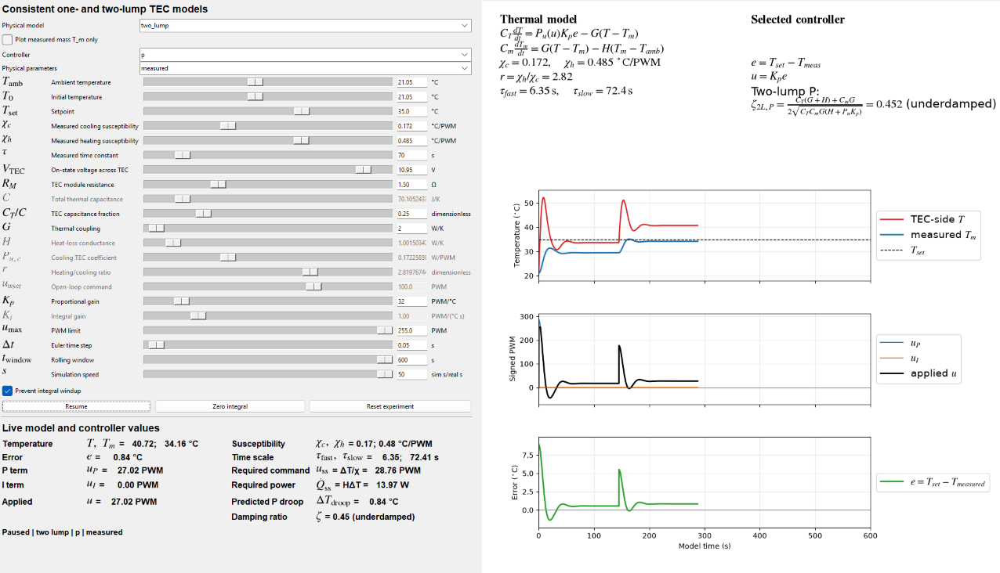

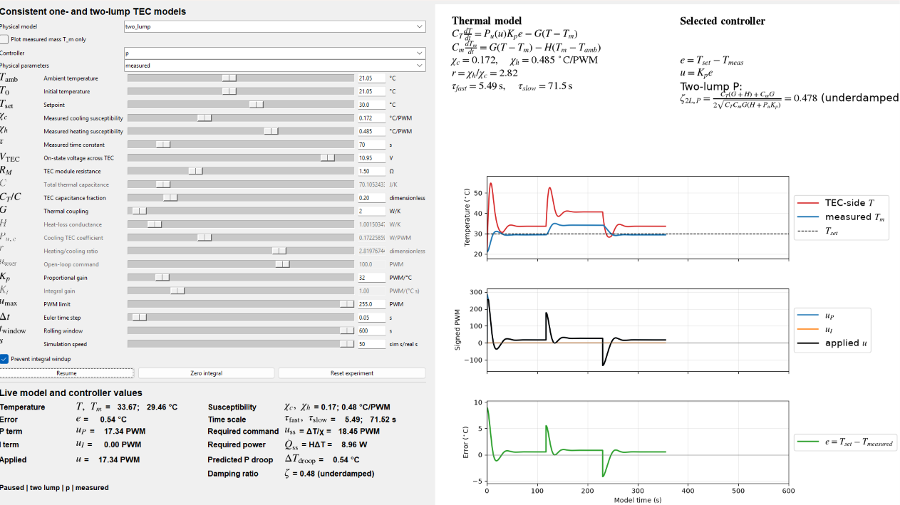

The $G$ = 2 W/K, $C_T/C$ = 0.25 run was done three times, because the sliders had moved
$T_{\mathrm{amb}}$ to 21.0 °C in one pass and $\chi_c$ to 0.170 °C/PWM in another
(displayed $\zeta_{\mathrm{2L,P}}$ 0.452 and 0.453). The screenshot kept has the exact
values and ends after the upward step. The $C_T/C$ = 0.20 run was repeated once for the
same reason ($V_{\mathrm{TEC}}$ at 10.9 V, $\zeta_{\mathrm{2L,P}}$ 0.480 instead of 0.478).

**How the pair was chosen.** The upward step is the cleanest comparison. It starts from
a settled state, and the command stays below the PWM limit (at most 178 PWM), so the
loop is in the linear regime that $\zeta_{\mathrm{2L,P}}$ describes. The step from room
temperature starts at the 255 limit for three readings. The downward step is driven
mostly by cooling (down to −133 PWM), and the displayed heating $\zeta_{\mathrm{2L,P}}$
does not describe cooling.

1. **Starting values** ($G$ = 2 W/K, $C_T/C$ = 0.35). $\zeta_{\mathrm{2L,P}}$ = 0.428
   predicts an underdamped response, and the simulation shows the measured pattern: one
   overshoot and a small rebound. The overshoot is too large, though: 1.09 °C against
   0.97 °C on the upward step, and 2.16 °C against 1.74 °C from room temperature.
2. **$G$ alone.** A stronger link damps the loop. $G$ = 3 W/K raises
   $\zeta_{\mathrm{2L,P}}$ to 0.499, but the upward-step overshoot drops to 0.79 °C,
   now too small. The $G$ field takes whole numbers only, so $G$ = 2 and 3 W/K bracket
   the measurement. $G$ = 2 W/K is closer on the upward step (0.12 °C too large, against
   0.18 °C too small), so it was restored.
3. **$C_T/C$ at $G$ = 2 W/K.** Moving heat capacity from the TEC side to the measured
   block also raises the damping: $\zeta_{\mathrm{2L,P}}$ = 0.436, 0.452, and 0.478 at
   $C_T/C$ = 0.30, 0.25, and 0.20. The upward-step overshoot falls to 1.05, 0.98, and
   0.87 °C. $C_T/C$ = 0.25 matches the measured 0.97 °C to 0.01 °C.

**Locked parameters.** $G$ = 2 W/K and $C_T/C$ = 0.25, so $C_T$ = 17.5 J/K and
$C_m$ = 52.6 J/K. Together with $C$, $H$, $P_{u,c}$, and $P_{u,h}$ from `measured`
mode, these are not changed again for the six simulations. They give
$K_{p,\mathrm{crit}}$ = 4.89 PWM/°C (heating). The choice is made from Run 3 alone, as
the handout asks. Steps 3–4 test it against the other five runs.

**What the tuning cannot fix: timing.** Every pair that reproduces the overshoot peaks
too late and rings too slowly. Matching the overshoot alone is not enough. I scanned
the upward step with the course model, starting from the settled 30 °C state, over
$G$ = 1–15 W/K and $C_T/C$ = 0.05–0.95. Overshoots within 0.12 °C of the measured
0.97 °C occur only at $G$ = 1–2 W/K. All of them peak at 17–28 s and have a
peak-to-peak time of 35–56 s, against 11.8 s and 19.4 s measured. No pair in the scan
peaks earlier than 13.6 s, and that one ($G$ = 3 W/K, $C_T/C$ = 0.10) overshoots by
only 0.16 °C.

The reason is that in this model fast ringing and large overshoot work against each
other. Faster ringing needs a larger natural frequency,
$\omega_n^2 = G(H + P_uK_p)/(C_TC_m)$, which means a larger $G$ or smaller lumps, and
both raise $\zeta_{\mathrm{2L,P}}$ and remove the overshoot. The measured ringing is both
fast and large. That points to a lag the two heat stores do not contain. The most
likely source is the dead time of the loop itself: 1 s readings, averaged over the
interval, with each command applied one line later (Part I, Part 7).

The downward step disagrees in size as well. Every pair over-predicts the undershoot
(0.32–0.50 °C against 0.09 °C), although the model, like the apparatus, uses the
smaller cooling coefficient while the command is negative. Both disagreements belong
in A3 Question 5.

### Step 4 demonstration: crossing the PI stability limit

**Settings** (the handout's demonstration set, not the locked apparatus set):
`two_lump`, `direct constants`, `pi`, anti-windup on; $T_{\mathrm{amb}} = T_0$ = 29 °C,
$T_{\mathrm{set}}$ = 30 °C; $C$ = 100 J/K, $C_T/C$ = 0.50, $G$ = 2 W/K, $H$ = 1.14 W/K,
$P_{u,c}$ = 0.26 W/PWM, $r$ = 2.0; $K_p$ = 10 PWM/°C; $u_{\max}$ = 255;
$\Delta t$ = 0.05 s. The display gives $K_{i,\mathrm{crit}}$ = 1.253 PWM/(°C s) (from
the heating coefficient $P_{u,h}$ = 0.52 W/PWM), as the handout states. The $K_i$ field
moves in steps of 0.02, so the marginal case was run at $K_i$ = 1.26 instead of 1.25.

Rise time (10–90 %), overshoot, settling time (last exit from ±0.02 °C, 2 % of the
step), period, and the ratio of successive oscillation amplitudes of $T_m$ are from the
course model at the same settings. Here the amplitude is half the peak-to-trough
swing, because near the limit the centre of the oscillation also drifts slowly.

| $K_i$ | Displayed $\rho_I$ | Rise (s) | Overshoot (°C) | Settles (s) | Period (s) | Amplitude ratio per cycle | Largest $\lvert u \rvert$ (PWM) |
| ---: | ---: | ---: | ---: | ---: | ---: | ---: | ---: |
| 0.10 | 0.080 | 33.7 | 0.04 | 94 | — | — | 10 |
| 0.60 | 0.479 | 19.6 | 0.58 | 314 | 118 | 0.26 | 14 |
| 1.10 | 0.878 | 15.8 | 0.88 | 1730 | 105 | 0.76 | 20 |
| 1.26 | 1.005 | 15.0 | 0.96 | never | 102 | 0.93, rising to 0.975 | 22 |
| 1.40 | 1.117 | 14.4 | 1.02, growing | never | 99 | 1.07, settling at 1.056 | 38 by 600 s |

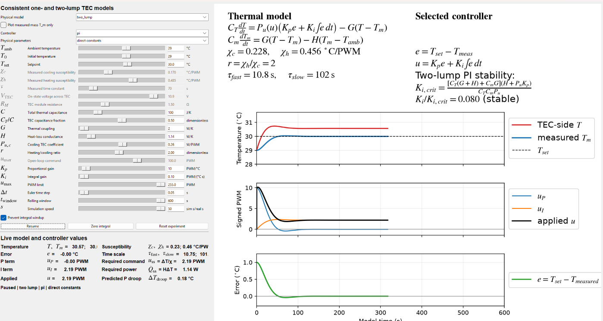

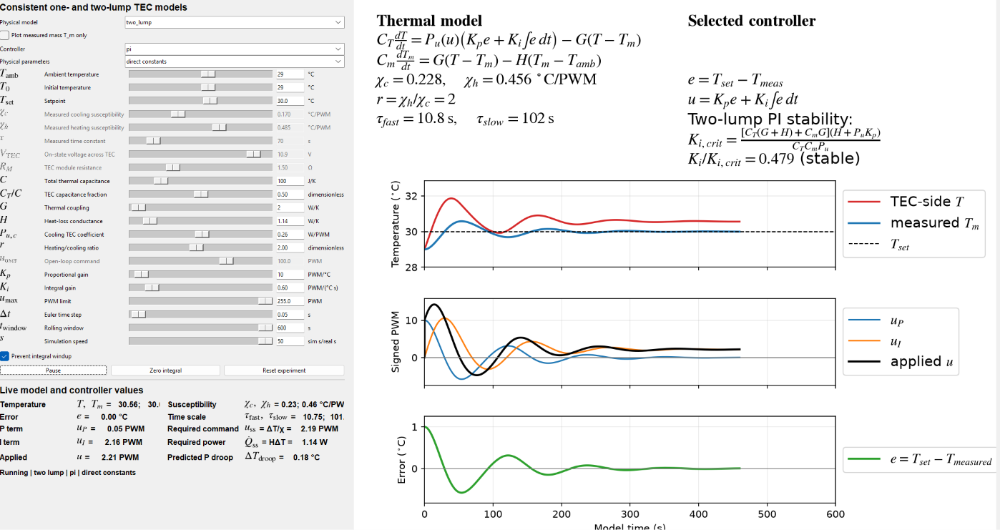

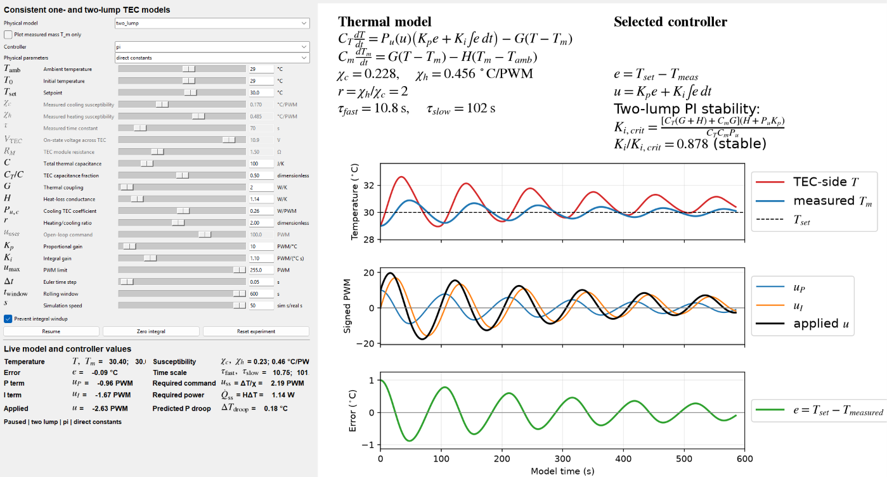

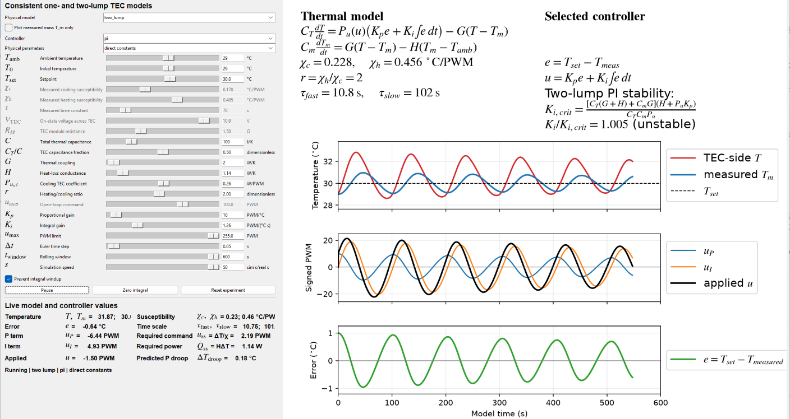

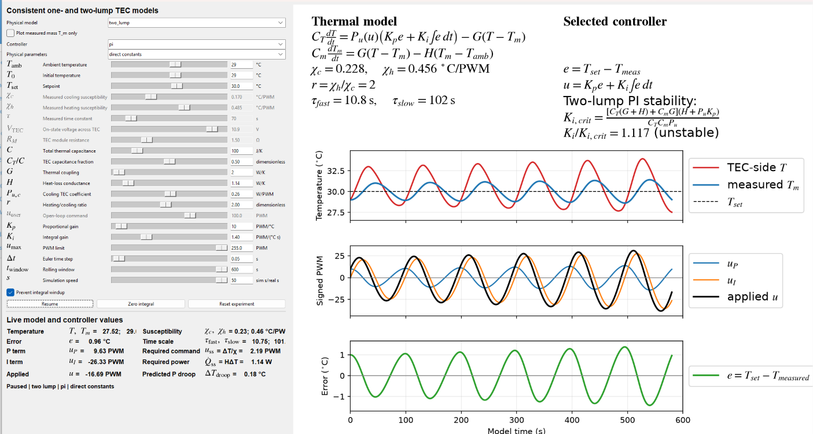

The four regions of the handout appear in order:

1. **$\rho_I \ll 1$** ($K_i$ = 0.10, 0.60): stable. The oscillation, if any, dies within
   a few cycles.
2. **$\rho_I$ just below 1** ($K_i$ = 1.10): stable but underdamped. Each swing keeps 76 %
   of the previous one, so settling takes almost half an hour.
3. **$\rho_I \approx 1$** ($K_i$ = 1.26): nearly constant amplitude. Over the 600 s on
   screen the swing falls only from 0.95 to 0.71 °C.
4. **$\rho_I > 1$** ($K_i$ = 1.40): the swing grows by about 6 % per cycle. The command
   stays far below the limit (38 PWM at 600 s), so this growth is linear instability,
   not saturation.

Raising $K_i$ shortens the rise (34 → 14 s) and the period (118 → 99 s). The overshoot
and the settling time grow.

**Why $\rho_I$ = 1.005 still decays slightly.** The displayed criterion uses the
heating coefficient. In this demonstration the steady command is only 2.2 PWM, so an
oscillation of ±20 PWM makes the command negative for close to half of each cycle. The
GUI then uses the cooling coefficient, which is half as large. The average loop gain is
therefore lower than the criterion assumes.

Three checks with the course model confirm this:

- **Symmetric actuator.** With $P_u$ = 0.52 W/PWM in both directions ($r$ = 1), the
  amplitude ratio per cycle is 0.988 at $K_i$ = 1.24 and 1.012 at $K_i$ = 1.26. The
  boundary falls exactly at $K_{i,\mathrm{crit}}$ = 1.253.
- **The demonstration's actuator** ($r$ = 2). The boundary moves to $K_i \approx$ 1.33
  (ratio 0.995 at 1.32, 1.005 at 1.34), about 6 % higher.
- **Period.** The observed period, 102 s, lies between the linear values for heating
  only (88 s) and for cooling only (122 s).

The criterion is exact for the linear model. The small heating/cooling nonlinearity
moves the boundary only when the oscillation is large compared with the steady command.

**Growth followed by saturation** ($K_i$ = 3.0, displayed $\rho_I$ = 2.394, other
settings unchanged):

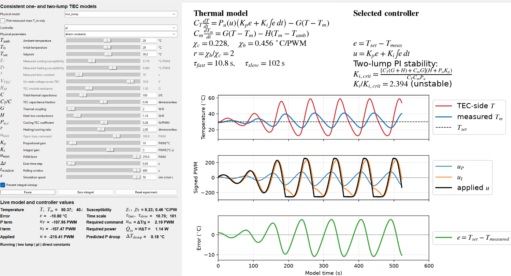

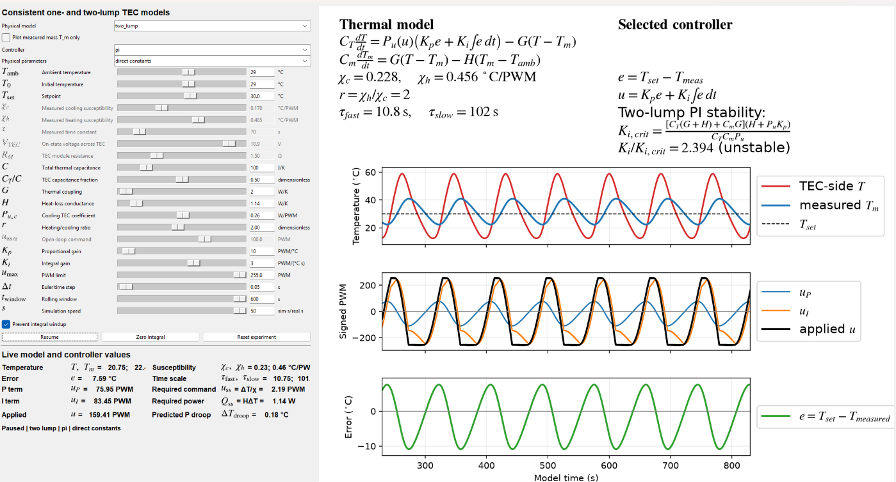

The run has three intervals:

1. **Linear growth, 0–190 s.** The half swing of $T_m$ grows 1.9 → 3.1 → 4.9 → 7.8 °C,
   by a factor of about 1.6 every half cycle, while the command is still inside
   ±255 PWM. The linear model predicts a growth of 2.2–2.8 per cycle, depending on
   whether the cooling or the heating coefficient applies. This interval is evidence of
   linear instability: no limit is active, yet each swing is larger than the last.
2. **The limit, 192 s.** The applied command first reaches the limit (−255 PWM,
   cooling).
3. **Bounded oscillation, after about 240 s.** The swing stops growing. $T_m$ cycles
   between 22.4 and 40.9 °C and the TEC side between 12.4 and 58.9 °C, with an 84 s
   period. The command sits at a limit for 21 % of the time. The actuator limit, not
   the linear dynamics, now sets the amplitude: once the command is clipped, a larger
   error no longer produces a larger correction.

On the apparatus such a cycle would drive the TEC side to nearly 60 °C. In these two
screenshots both temperatures are plotted ("mass temperature only" was not selected).

**Extension: the demonstration set at $K_p$ = 6.** The three experimental $K_i$ values
were also run with the demonstration constants at $K_p$ = 6 PWM/°C. These are not the
locked apparatus parameters. The locked-parameter versions are the Run 4–6 simulations
below, with $\rho_I$ = 0.029, 0.058, and 0.362. Here the display gives
$K_{i,\mathrm{crit}}$ = 0.842 PWM/(°C s):

| $K_i$ | Displayed $\rho_I$ | Rise (s) | Overshoot (°C) | Settles (s) | Period (s) | Amplitude ratio per cycle |
| ---: | ---: | ---: | ---: | ---: | ---: | ---: |
| 0.04 | 0.047 | 83 | 0 | 343 | — | — |
| 0.08 | 0.095 | 51 | 0.06 | 208 | — | — |
| 0.50 | 0.594 | 23 | 0.68 | 626 | 138 | 0.43 |

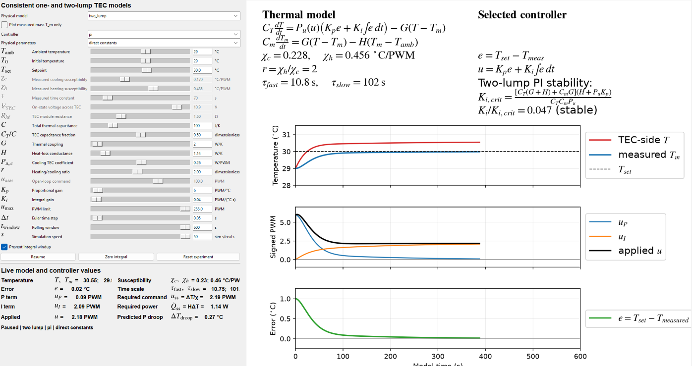

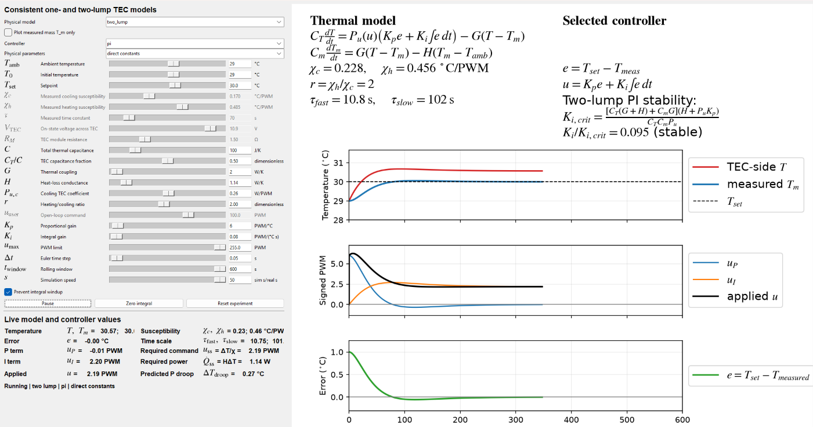

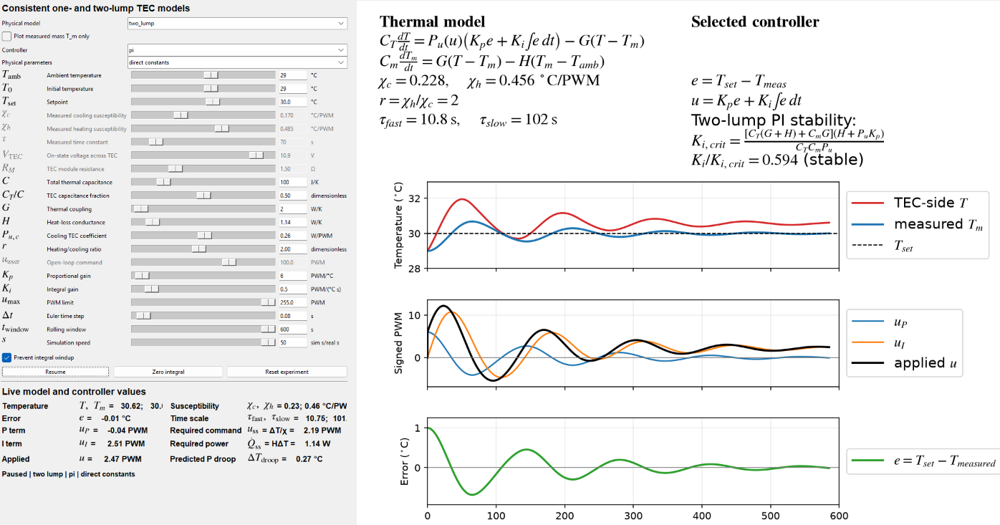

The $\Delta t$ slider had moved to 0.08 s in the $K_i$ = 0.5 run (and in a repeat of the
$K_i$ = 0.08 run). The course model gives the same rise, overshoot, and settling to
within 0.2 s and 0.001 °C at $\Delta t$ = 0.08 s, and 0.08 s is still below the
model's step limit (one fifth of the fastest time scale, 3.2 s). The ordering is the
same as in the experiment: $K_i$ = 0.08 is the fastest to settle, and $K_i$ = 0.5 rises
fastest but overshoots and rings.

### Steps 3–5: the six simulation plots

All six simulations use one physical parameter set: the `measured` mode values from
$\chi_c$ = 0.172 °C/PWM, $\chi_h$ = 0.485 °C/PWM, $\tau$ = 70 s,
$V_{\mathrm{TEC}}$ = 10.95 V, and $R_M$ = 1.50 Ω ($C$ = 70.1 J/K, $H$ = 1.00 W/K,
$P_{u,c}$ = 0.172 W/PWM, $r$ = 2.82), with $G$ = 2 W/K and $C_T/C$ = 0.25 from Step 2,
$u_{\max}$ = 255, anti-windup on, and $\Delta t$ = 0.05 s. Only the gains change.

The plots are made by `python/module6_part2_goldilocks.py`, which calls the course
model's own `advance_model` with these values:

```bash
python python/module6_part2_goldilocks.py            # all six; or --run N for one
```

Each simulation uses its run's baseline $T_{\mathrm{amb}}$ and first controlled reading
as $T_0$. The setpoint switches at the measured times without resetting the integral,
as in the experiments. The model controller acts on $T_m$ at every 0.05 s step. It has
no 1 s sampling and no one-line command delay.

The axes and labels follow the experimental plots (`part7_runN.png`): the setpoint, the
simulated $T_m$, the signed applied PWM, and the error, against the time since control
started. The measured run is drawn in grey for comparison. Only $T_m$ is shown, because
the TEC-side temperature (up to 52 °C in Run 3) would stretch the temperature axis. The
$\zeta_{\mathrm{2L,P}}$, $K_{i,\mathrm{crit}}$, and $\rho_I$ values are computed by the
same functions the GUI uses for its display. For the PI runs, the one-lump damping
ratio $\zeta_h$ of Part I is also given.

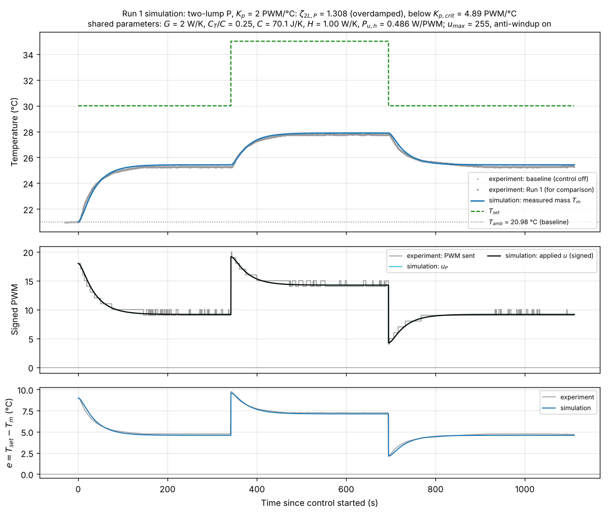

*Run 1 simulation. Two-lump P, $K_p$ = 2 PWM/°C, $\zeta_{\mathrm{2L,P}}$ = 1.308
(overdamped), below $K_{p,\mathrm{crit}}$ = 4.89 PWM/°C.*

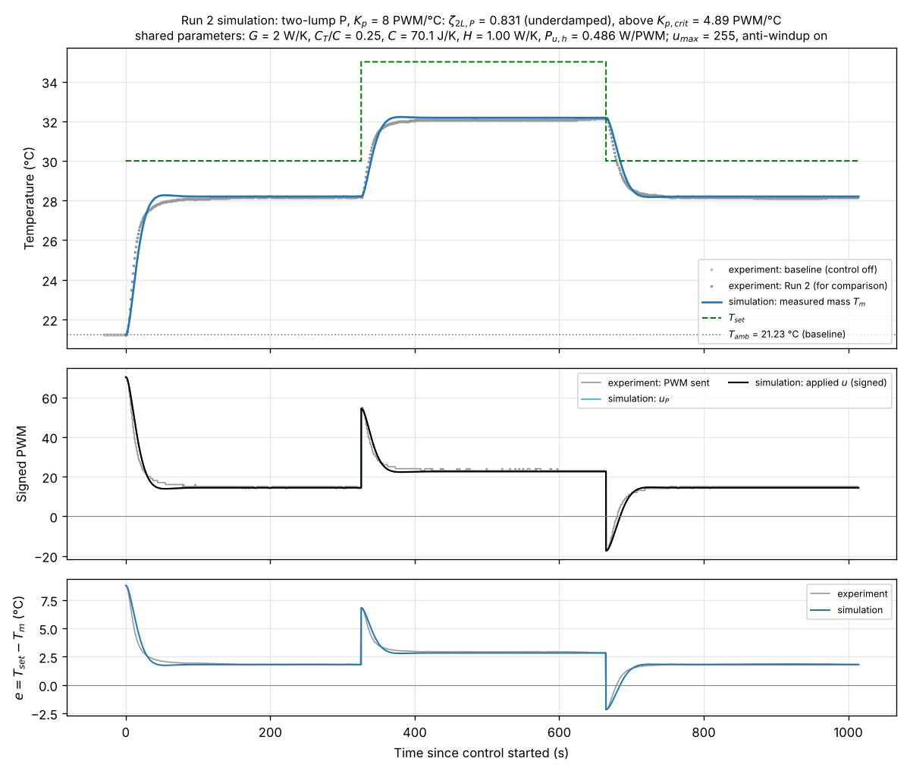

*Run 2 simulation. Two-lump P, $K_p$ = 8 PWM/°C, $\zeta_{\mathrm{2L,P}}$ = 0.831
(underdamped), above $K_{p,\mathrm{crit}}$.*

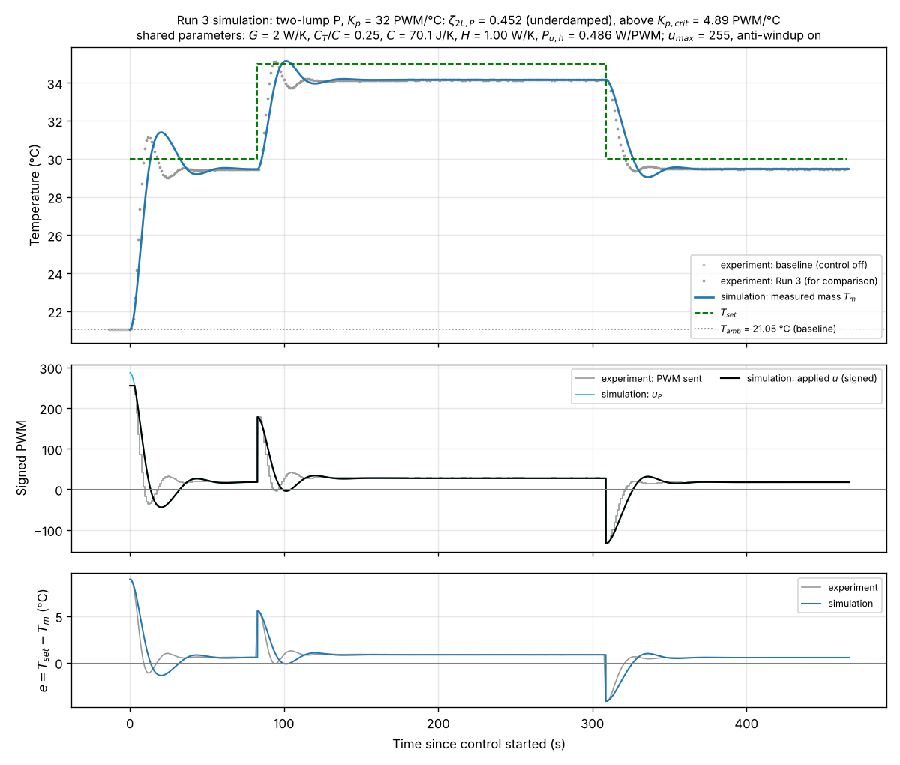

*Run 3 simulation. Two-lump P, $K_p$ = 32 PWM/°C, $\zeta_{\mathrm{2L,P}}$ = 0.452
(underdamped), 6.5 times $K_{p,\mathrm{crit}}$.*

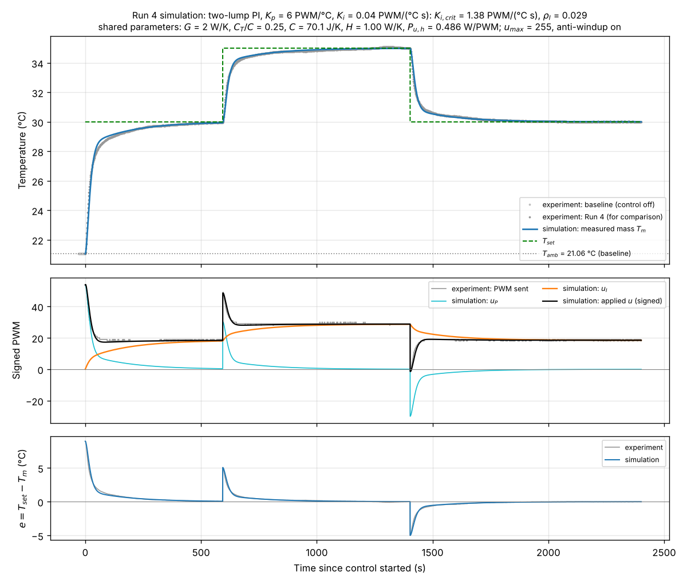

*Run 4 simulation. Two-lump PI, $K_p$ = 6 PWM/°C, $K_i$ = 0.04 PWM/(°C s),
$K_{i,\mathrm{crit}}$ = 1.38 PWM/(°C s), $\rho_I$ = 0.029 (one-lump $\zeta_h$ = 1.68).*


*Run 5 simulation. Two-lump PI, $K_p$ = 6 PWM/°C, $K_i$ = 0.08 PWM/(°C s),
$K_{i,\mathrm{crit}}$ = 1.38 PWM/(°C s), $\rho_I$ = 0.058 (one-lump $\zeta_h$ = 1.19).*


*Run 6 simulation. Two-lump PI, $K_p$ = 6 PWM/°C, $K_i$ = 0.5 PWM/(°C s),
$K_{i,\mathrm{crit}}$ = 1.38 PWM/(°C s), $\rho_I$ = 0.362 (one-lump $\zeta_h$ = 0.47).*

**GUI check of the displayed PI values.** The three PI gains were also entered in the
GUI with the locked parameters (`measured`, $G$ = 2 W/K, $C_T/C$ = 0.25, $K_p$ = 6) on a
29 → 30 °C step. The display gives $\rho_I$ = 0.029, 0.058, and 0.360. The $\chi_c$
slider had moved to 0.170 °C/PWM, which changes the inversion slightly ($C$ = 69.7 J/K,
$H$ = 0.995 W/K, $r$ = 2.85) and gives $K_{i,\mathrm{crit}}$ = 1.388 instead of
1.380 PWM/(°C s). At 0.172 °C/PWM the course model gives the 0.029, 0.058, and 0.362 of
the captions. $\Delta t$ was 0.08 s, which makes no visible difference. On this 1 °C step:

- $K_i$ = 0.04 creeps to the setpoint (settles in 402 s);
- $K_i$ = 0.08 settles in 78 s without overshoot;
- $K_i$ = 0.5 overshoots by 0.48 °C at 48 s and settles in 228 s.

This is the same order as the six-plot simulations and the experiment.


**Step metrics, measured / simulated.** The definitions match Part I, Part 7: $e_{ss}$
is from the mean of the last 60 s of the step; rise is 10 → 90 % of the change; the
overshoot is past that final value; settling is the time to stay within ±0.1 °C of it.
The script prints these values.

| Run | Step | $e_{ss}$ (°C) | Rise (s) | Overshoot (°C) | Settling (s) |
| --- | --- | ---: | ---: | ---: | ---: |
| 1 | from room | +4.74 / +4.58 | 73 / 75 | 0.01 / 0 | 125 / 132 |
| 1 | up | +7.24 / +7.12 | 76 / 75 | 0.02 / 0 | 106 / 113 |
| 1 | down | +4.71 / +4.58 | 118 / 75 | 0.06 / 0 | 176 / 113 |
| 2 | from room | +1.82 / +1.80 | 27 / 25 | 0.02 / 0.06 | 104 / 40 |
| 2 | up | +2.89 / +2.82 | 27 / 25 | 0.05 / 0.04 | 67 / 38 |
| 2 | down | +1.84 / +1.80 | 31 / 29 | 0.05 / 0.03 | 70 / 44 |
| 3 | from room | +0.62 / +0.33 | 4.3 / 8.5 | 1.74 / 1.72 | 38 / not within 83 s |
| 3 | up | +0.85 / +0.84 | 4.3 / 8.0 | 0.97 / 0.98 | 28 / 44 |
| 3 | down | +0.54 / +0.54 | 9.7 / 14.2 | 0.09 / 0.43 | 32 / 37 |
| 4 | from room | +0.05 / +0.07 | 123 / 93 | 0.02 / 0.01 | 425 / 407 |
| 4 | up | −0.02 / +0.01 | 131 / 111 | 0.08 / 0 | 530 / 391 |
| 4 | down | 0.00 / 0.00 | 115 / 102 | 0.02 / 0 | 418 / 392 |
| 5 | from room | 0.00 / 0.00 | 52 / 42 | 0.03 / 0 | 135 / 89 |
| 5 | up | 0.00 / +0.01 | 56 / 42 | 0.01 / 0 | 119 / 76 |
| 5 | down | 0.00 / 0.00 | 55 / 42 | 0.02 / 0 | 116 / 75 |
| 6 | from room | 0.00 / 0.00 | 16 / 18 | 2.36 / 3.87 | 127 / 273 |
| 6 | up | 0.00 / +0.04 | 15 / 18 | 1.48 / 2.46 | 122 / 215 |
| 6 | down | 0.00 / 0.00 | 21 / 22 | 1.81 / 2.63 | 130 / 236 |

The simulated Run 3 step from room temperature is still ringing when the setpoint
switches at 83 s, so its 60 s mean, and hence its $e_{ss}$, is biased. The settled
two-lump P level is 29.46 °C ($e_{ss}$ = +0.54 °C). The overshoots of 0.01–0.08 °C in
the measured non-oscillating runs are at the level of the reading noise.

**Can one $G$ fit both oscillating runs?** Run 3 fixed $G$, and Run 6 overshoots far
less than the simulation predicts. The table shows the upward-step overshoot from the
course model for other $G$ values with the same schedule:

| $G$ (W/K), $C_T/C$ = 0.25 | 1 | 2 | 3 | 4 | 6 | 8 | 12 | 40 | measured |
| --- | ---: | ---: | ---: | ---: | ---: | ---: | ---: | ---: | ---: |
| Run 3 ($K_p$ = 32) overshoot (°C) | 1.45 | 0.98 | 0.66 | 0.45 | 0.18 | 0.05 | 0 | 0 | 0.97 |
| Run 6 ($K_p$ = 6, $K_i$ = 0.5) overshoot (°C) | 3.79 | 2.42 | 1.99 | 1.78 | 1.58 | 1.49 | 1.40 | 1.30 | 1.48 |

$C_T/C$ = 0.35 gives the same picture (Run 6 matches near $G$ = 10 W/K, where Run 3's
overshoot is under 0.1 °C). Run 6 needs a nearly one-lump block ($G \approx$ 8 W/K),
but Run 3 needs a strong lag ($G$ = 2 W/K). No shared pair does both.

#### The four comparison prompts

**1. Best-matched simulations.** Among the P runs, Run 2 ($K_p$ = 8) matches best. The
rise times are 25–29 s against 27–31 s measured, both responses have overshoot at the
noise level, and the droop agrees within 0.07 °C. The simulation settles sooner
(38–44 s against 67–104 s), because the measured approach has a slow final tail.
Run 3 matches the overshoot (the quantity Step 2 tuned) and the droop, but not the
timing. Run 1 matches on the way up but not on the slower measured downward step (rise
118 s against 75 s).

Among the PI runs, Runs 4 and 5 match best. The simulated curves lie on the measured
ones (Run 4 plot), neither overshoots, and both remove the error. The simulation is
10–25 % faster in rise and settles in 75–89 s against 116–135 s for Run 5. Run 6 is the
poorest match: the rise time agrees (18–22 s against 15–21 s), but the overshoot is
1.5–1.7 times too large and settling takes about twice as long.

**2. P runs: $\zeta_{\mathrm{2L,P}}$ and $K_{p,\mathrm{crit}}$.** The three gains fall on
both sides of $K_{p,\mathrm{crit}}$ = 4.89 PWM/°C:

- $K_p$ = 2 lies below it ($\zeta_{\mathrm{2L,P}}$ = 1.31). The response is
  monotonic and slow (rise 75 s) with the largest droop (4.6–7.1 °C).
- $K_p$ = 8 lies just above it ($\zeta_{\mathrm{2L,P}}$ = 0.83). The response is
  three times faster, and the overshoot (0.03–0.06 °C) is just visible in the
  simulation and lost in the noise in the experiment.
- $K_p$ = 32 is 6.5 times $K_{p,\mathrm{crit}}$ ($\zeta_{\mathrm{2L,P}}$ = 0.45). The
  response rises in 8 s, overshoots by about 1 °C, and rings once.

So decreasing $\zeta_{\mathrm{2L,P}}$ trades a smaller droop and a faster rise for
overshoot. The experiment follows the same order: overshoot 0.02, 0.05, 0.97 °C on the
upward step.

**3. PI runs: $\rho_I$.** At $K_p$ = 6, $K_{i,\mathrm{crit}}$ = 1.38 PWM/(°C s), so the
three runs have $\rho_I$ = 0.029, 0.058, and 0.362. Increasing $\rho_I$:

- shortens the rise (93–111 s, then 42 s, then 18 s in the simulation; 115–131, 52–56,
  and 15–21 s measured);
- changes the response from creeping without overshoot (Runs 4 and 5) to a large
  overshoot that rings for several cycles (Run 6);
- gives the shortest settling at the middle value (75–89 s simulated, 116–135 s
  measured).

All three are far below $\rho_I$ = 1, so the two-lump criterion predicts that all
three are stable and that none is near the oscillation that persists at the limit.
Run 6's overshoot comes mainly from the one-lump PI dynamics ($\zeta_h$ = 0.47: the
integral term overshoots even without a second lump, Part I, Part 6). The second lump
adds to it.

**4. Agreement, disagreement, best gains, classification.**

*Agreement.* The steady state agrees, because $G$ cancels there (Pre-class). The P droop
matches within 0.16 °C in every step (apart from the biased first step of Run 3).
Each PI run reaches $e_{ss}$ = 0 with a steady command within about 1 PWM of the
measured one (2 PWM at the end of Run 6's upward step, which is still ringing). The ordering also agrees: the P runs order by
$\zeta_{\mathrm{2L,P}}$ and the PI runs by $\rho_I$, in both speed and overshoot, in the
experiment and in the simulation.

*Disagreement.* The time scale of the high-gain ringing does not agree:

- Run 3 measured: peak 11.8 s after the step, peak to peak 19 s.
- Run 3 simulated: peak 18.7 s, peak to peak 37 s.
- The Step 2 scan found no $(G, C_T/C)$ pair that peaks before 13.6 s.

The size of the overshoot also fails across runs. The $G$ that makes Run 3 overshoot
makes Run 6 overshoot 1.5–1.7 times too much, and the $G$ that fits Run 6 removes Run 3's
overshoot.

*What this falsifies.* This falsifies the two-lump model as the complete source of
the lag. The apparatus behaves as if it had a short, fixed delay: 1 s readings, the
reading averaged over that interval, and each command applied one line later. A delay
like this matters for the fast high-gain loop (Run 3, period about 20 s) but hardly
for the slow PI loop (Run 6, period about 110 s). A heat store with $G$ = 2 W/K slows
both loops alike. The Run 3 downward step (0.09 °C measured against 0.43 °C simulated)
and the slower measured downward steps at low gain are further disagreements.

*Classification.* No run is marginally stable or unstable.

| Run | Classification | Evidence |
| --- | --- | --- |
| 1 | stable non-oscillatory | $\zeta_{\mathrm{2L,P}}$ = 1.31 |
| 2 | stable underdamped | $\zeta_{\mathrm{2L,P}}$ = 0.83; the overshoot is too small to see in the experiment |
| 3 | stable underdamped | $\zeta_{\mathrm{2L,P}}$ = 0.45 |
| 4 | stable non-oscillatory | $\rho_I$ = 0.03, $\zeta_h$ = 1.68 |
| 5 | stable non-oscillatory | $\rho_I$ = 0.06, $\zeta_h$ = 1.19 |
| 6 | stable underdamped | $\rho_I$ = 0.36, $\zeta_h$ = 0.47 |

*Best gains.* For P control, $K_p$ = 32 is the best compromise of the three. It has
the smallest droop (0.5–0.9 °C) and the fastest settling (28–38 s measured), at the
cost of about 1 °C of overshoot and one ring. The delay that the model lacks means
the real margin above $K_{p,\mathrm{crit}}$ is smaller than the simulation suggests,
so a much higher $K_p$ would not be safe on this evidence. P control cannot remove the
droop at any gain.

For PI control, $K_p$ = 6 with $K_i$ = 0.08 PWM/(°C s) (Run 5) is the best compromise.
$K_i$ is just below $K_p/\tau$ = 0.086, and $\rho_I$ is far from the stability limit. It
has no overshoot, the error goes to zero, and it settles in about 2 min. $K_i$ = 0.04 is
about four times slower to settle. $K_i$ = 0.5 rises faster but overshoots by 1.5–2.4 °C
and settles no sooner.
