# Module 6, Part I: P/PI Control and Lumped Modeling

Handout: Phys 39 Fall 2026, Module 6, Part I (`labs/lab-06`). This note builds on
the Module 4 susceptibility and the Module 5 P-control runs. The data files used here
are copied unchanged from the [Module 5 repository](https://github.com/tyin-source/__Lab_Module_5__) into `data/module_04/` and
`data/module_05/`.

## Parameters carried forward

| Quantity | Value | Source |
| --- | --- | --- |
| $\chi_h$ (heating) | 0.485 °C/PWM count | Module 4 steady state vs PWM |
| $\chi_c$ (cooling) | 0.172 °C/PWM count | Module 4 steady state vs PWM |
| $r = \chi_h/\chi_c$ | 2.82 | Module 4 |
| $\tau$ (open loop) | 70 ± 3 s | Open-loop steps, 17 Oct 2026 (Part 3) |
| $R_M$ (TEC module resistance) | 1.50 Ω at 27 °C | Laird data sheet (Module 4, A2) |
| $V_{\mathrm{TEC}}$ (on-state voltage across the TEC) | 10.95 V | multimeter across the TEC terminals at PWM 255 (COOL), 17 Oct 2026 |
| $H$ (heat-loss conductance) | 1.00 W/K | derived, see below |
| $C$ (one-lump thermal capacitance) | 70 ± 3 J/K | derived, see below |
| $P_{u,c}$, $P_{u,h}$ (TEC power per PWM count) | 0.172, 0.486 W/PWM | derived, see below |

**Derived constants.** The course simulation (`python/Lab_6_7_modeling_tec.py`,
`measured` mode) separates $C$, $H$, and $P_u$ with a simplified TEC heat balance.
At full PWM the Joule heat delivered to the block face is
$\dot Q_J = V_{\mathrm{TEC}}^2/(2R_M) = 10.95^2/(2 \times 1.50) = 40.0$ W. The
heating/cooling asymmetry $r = (\dot Q_P + \dot Q_J)/(\dot Q_P - \dot Q_J)$ then gives
the Peltier term $\dot Q_P = \dot Q_J\,(r+1)/(r-1) = 83.9$ W, so the net cooling power at
PWM 255 is $\dot Q_P - \dot Q_J = 43.9$ W, i.e. $P_{u,c} = 43.9/255 = 0.172$ W/PWM and
$P_{u,h} = r\,P_{u,c} = 0.486$ W/PWM. Then $H = P_{u,c}/\chi_c = 1.00$ W/K and
$C = H\tau = 70$ J/K. That is the heat capacity of about 78 g of aluminium
($c_p \approx 900$ J/(kg K)), a plausible size for the block plus the TEC ceramic.
These three numbers rest on the model's assumptions (data-sheet $R_M$ at 27 °C, no
Seebeck back-voltage); for example, $R_M$ = 1.68 Ω at 50 °C would lower all three by
11 %. They scale together, so the one-lump temperature predictions depend only on
$\chi$ and $\tau$.

**Sign convention.** As in the handout, $u$ is the signed PWM command: $u > 0$
heats and $u < 0$ cools. The open-loop relation $T = T_{\mathrm{amb}} + \chi u$ then
holds in both directions with the susceptibility of the active direction, so both
$\chi_h$ and $\chi_c$ are positive. For example, $u = -25$ gives
$T - T_{\mathrm{amb}} = 0.172 \times (-25) = -4.3$ °C. Module 5 sent an unsigned PWM
with a separate HEAT/COOL direction and therefore wrote the cooling value as
$\lvert\chi_c\rvert$. The number is the same.

Data: [`data/module_04/part4_steady_state.csv`](../../data/module_04/part4_steady_state.csv)
(Module 4 steady states) and [`data/module_05/p_runs_summary.csv`](../../data/module_05/p_runs_summary.csv)
(Module 5 run summary).

## Pre-class questions

1. **What physical part of the apparatus stores heat?**

   Mainly the aluminium block, together with the TEC ceramic plates and the thermal
   paste. The heat sink also stores heat, but its heat capacity is much larger, so it
   acts on a longer time scale.

2. **What physical paths let heat leave the measured block?**

   There are three main paths:

   1. conduction through the TEC and its internal conduction path to the heat sink;
   2. natural convection and thermal radiation from the block surface to the air;
   3. conduction through the mounting bracket, the wires, and the thermistor leads.

3. **What evidence from your data suggests a thermal time constant?**

   1. In Module 4, each step needed 370–725 s to reach steady state, which gives
      $\tau \lesssim 100$ s.
   2. In Module 5, the temperature after a setpoint step approaches its final value
      like an exponential; the fitted closed-loop time constants give
      $\tau_{\mathrm{cl}}(1+L) \approx 70$ s (69–77 s).
   3. After the control is stopped, the block relaxes slowly back toward room
      temperature, again like an exponential decay.

   Part 3 then measures $\tau$ directly from open-loop steps: 70 ± 3 s.

4. **Why does the algebraic droop model not predict oscillation?**

   Because the algebraic droop model is a steady-state equation ($dT/dt = 0$): time
   does not appear in it at all. Even the time-dependent one-lump P-control model has
   only one eigenvalue, $\lambda = -(H + P_uK_p)/C$, which is real and negative. The
   temperature can therefore only approach its final value monotonically; it cannot
   overshoot or oscillate.

## Part 1: Algebraic droop model

### Derivation

Starting from the dimensional one-lump energy balance:

$$
C\frac{dT}{dt} = P_u u - H(T - T_{\mathrm{amb}})
$$

At steady state ($dT/dt = 0$), the open-loop temperature is:

$$
T = T_{\mathrm{amb}} + \chi u
$$

where the susceptibility is $\chi = P_u/H$, taken for the active direction
(this run heats, so $\chi = \chi_h$).

For P-only control, the command is $u = K_p(T_{\mathrm{set}} - T)$. Substituting
this into the open-loop relation:

$$
T = T_{\mathrm{amb}} + \chi K_p(T_{\mathrm{set}} - T)
$$

Collecting the terms in $T$ at steady state:

$$
(1 + \chi K_p)T_{\mathrm{ss}} = T_{\mathrm{amb}} + \chi K_p T_{\mathrm{set}}
$$

Subtracting from $T_{\mathrm{set}}$:

$$
\boxed{T_{\mathrm{set}} - T_{\mathrm{ss}} = \frac{T_{\mathrm{set}} - T_{\mathrm{amb}}}{1 + \chi K_p}}
$$

This is the droop formula, where the dimensionless loop gain is defined as
$L = \chi K_p$.

### Comparison with measurement

Run: Module 5, 14 Oct 2026, $K_p$ = 2 PWM/°C
([`p_20261014-113219_Tset30.0_Kp2.csv`](../../data/module_05/p_20261014-113219_Tset30.0_Kp2.csv)). $T_{\mathrm{amb}}$ is the
mean of the baseline before P control started; $T_{\mathrm{ss}}$ is the mean of
the last 120 s.

- $T_{\mathrm{set}}$ = 30.0 °C, $T_{\mathrm{amb}}$ = 22.94 °C,
  $\chi_h$ = 0.485 °C/PWM
- Loop gain $L = 0.485 \times 2 = 0.97$
- **Predicted** droop $= (30.0 - 22.94)/(1 + 0.97) = 3.58$ °C
- **Predicted** $T_{\mathrm{ss}}$ = 26.42 °C
- **Measured** droop = 3.76 °C ($T_{\mathrm{ss}}$ = 26.24 °C)

### Physical reason for the discrepancy

The measured droop is slightly larger than predicted (by 0.18 °C, 5 %). The
primary physical reason is that the baseline $T_{\mathrm{amb}}$ (22.94 °C) was
likely an overestimate. Prior to this run, the baseline was still falling by
0.21 °C/min, meaning the effective ambient temperature the block was seeing was
lower than the baseline mean. (A cooled heat sink was first suspected, but the
open-loop test in Part 3 does not show that effect; a room that was cooling during
the session is the more likely cause.) A
lower $T_{\mathrm{amb}}$ would increase the numerator
$(T_{\mathrm{set}} - T_{\mathrm{amb}})$, thereby increasing the predicted droop
to match the measurement. Extrapolating the falling baseline with
$\tau$ ≈ 75 s gives $T_{\mathrm{amb}}$ ≈ 22.63 °C and a predicted droop of
3.74 °C, within 0.02 °C of the measured value (Module 5 note, Part 6 Q3).

## Part 2: Expressing the one-lump model using measured parameters

### Derivation of the measured parameters ($\chi$ and $\tau$)

We begin with the dimensional one-lump energy balance:

$$
C\frac{dT}{dt} = P_u u - H(T - T_{\mathrm{amb}})
$$

Dividing both sides by $C$, we get:

$$
\frac{dT}{dt} = \frac{P_u}{C}u - \frac{H}{C}(T - T_{\mathrm{amb}})
$$

At steady state, $dT/dt = 0$, which yields the steady-state temperature:

$$
T_{\mathrm{ss}} = T_{\mathrm{amb}} + \frac{P_u}{H}u
$$

Comparing this with the Module 4 open-loop relationship
$T = T_{\mathrm{amb}} + \chi u$, we identify the open-loop temperature
susceptibility:

$$
\boxed{\chi = \frac{P_u}{H}}
$$

To find the thermal time constant, we define the temperature displacement from
steady state as $\theta(t) = T(t) - T_{\mathrm{ss}}$. Since $T_{\mathrm{ss}}$ is
constant for a fixed command $u$, we have $d\theta/dt = dT/dt$. Substituting
$T = \theta + T_{\mathrm{ss}}$ into the energy balance, and using the
steady-state balance $P_u u = H(T_{\mathrm{ss}} - T_{\mathrm{amb}})$, we obtain:

$$
C\frac{d\theta}{dt} = -H\theta \quad\Longrightarrow\quad \frac{d\theta}{dt} = -\frac{H}{C}\theta
$$

The solution to this first-order differential equation is an exponential decay:

$$
\theta(t) = \theta(0)e^{-(H/C)t} = \theta(0)e^{-t/\tau}
$$

Comparing the exponents identifies the open-loop thermal time constant:

$$
\boxed{\tau = \frac{C}{H}}
$$

**Dimensional check:**

$$
[\tau] = \frac{\mathrm{J/K}}{\mathrm{W/K}} = \frac{\mathrm{J}}{\mathrm{J/s}} = \mathrm{s},
\qquad
[\chi] = \frac{\mathrm{W/PWM\ count}}{\mathrm{W/K}} = \frac{\mathrm{K}}{\mathrm{PWM\ count}} = \frac{^\circ\mathrm{C}}{\mathrm{PWM\ count}}
$$

### The measured-parameter model

The two measured quantities determine the two parameter ratios that appear in
the divided energy balance:

$$
\frac{H}{C} = \frac{1}{\tau},
\qquad
\frac{P_u}{C} = \frac{P_u/H}{C/H} = \frac{\chi}{\tau}
$$

Substituting them, the dimensional energy balance can be rewritten entirely in
terms of the measured quantities:

$$
\boxed{\frac{dT}{dt} = \frac{T_{\mathrm{amb}} + \chi u - T}{\tau}}
$$

This is not a different model; it is the one-lump energy balance expressed in a
form that can be simulated using only the measured susceptibility and time
constant. The quantity $(T_{\mathrm{amb}} + \chi u)$ is the steady temperature
toward which the model moves for a constant command $u$, and $\tau$ determines
how quickly it moves there.

With our measured values (Module 4 susceptibilities; $\tau$ from Part 3), using
the susceptibility for the active direction:

$$
\frac{dT}{dt} =
\begin{cases}
\dfrac{T_{\mathrm{amb}} + (0.485\ ^\circ\mathrm{C/PWM})\,u - T}{\tau}, & u > 0 \text{ (heating)}\\[2ex]
\dfrac{T_{\mathrm{amb}} + (0.172\ ^\circ\mathrm{C/PWM})\,u - T}{\tau}, & u < 0 \text{ (cooling)}
\end{cases}
\qquad \tau \approx 70\ \mathrm{s}
$$

Once $T_{\mathrm{amb}}$ and the command $u$ are specified, the model has no free
parameters, so its prediction can be compared directly with a measured trace
rather than fitted to it.

### Sidebar: dimensionless form

We can define dimensionless variables to generalize the model:

$$
\hat{t} = \frac{t}{\tau},
\qquad
\hat{T} = \frac{T - T_{\mathrm{amb}}}{\chi u_0},
\qquad
\hat{u} = \frac{u}{u_0}
$$

where $u_0$ is a reference command. Substituting these into the
measured-parameter model yields the dimensionless open-loop model:

$$
\frac{d\hat{T}}{d\hat{t}} = \hat{u} - \hat{T}
$$

This shows that $\tau$ supplies the time scale, and $\chi u_0$ supplies the
temperature scale. For P control, $u = K_p(T_{\mathrm{set}} - T)$ becomes
$\hat{u} = \chi K_p(\hat{T}_{\mathrm{set}} - \hat{T})$, so the only remaining
parameter is the dimensionless loop gain:

$$
L = \chi K_p
$$

## Part 3: Estimate $\tau$

**Method (63 %).** For a step in the applied PWM,
$T_{63} = T_{\mathrm{initial}} + 0.63\,(T_{\mathrm{final}} - T_{\mathrm{initial}})$, and
$\tau$ is the time from the step until the temperature first reaches $T_{63}$.
`python/module6_tau63.py` does this for a trace. $T_{\mathrm{initial}}$ is the mean of
the 30 s before the step and $T_{\mathrm{final}}$ is the mean of the last 60 s. The
crossing is taken on a 5-reading centred running mean, so that a single noisy reading
does not cross early. The uncertainty is the noise and the $T_{\mathrm{final}}$
uncertainty divided by the slope at $T_{63}$. Every reading in the Module 5 files is
an average of 1,000 thermistor-voltage samples.

**Available traces.** Module 4 saved only the steady temperatures, not the time
series, and the Module 5 GUI logged only P-control runs. No saved trace is a large
open-loop step that was held until it settled. Three estimates are possible from the
Module 5 files:

1. **Closed-loop P steps (main estimate).** In the one-lump model a P step relaxes
   with $\tau_{\mathrm{cl}} = \tau/(1+L)$ (Part 5), so
   $\tau = t_{63}(1+L)$ with $L = \chi_h K_p$. Only runs that started from a settled
   block and did not overshoot are used:

   | $K_p$ (PWM/°C) | $L$ | $t_{63}$ (s) | $\tau = t_{63}(1+L)$ (s) | Run |
   | ---: | ---: | ---: | ---: | --- |
   | 1 | 0.49 | 48.4 | 72 | [`p_20261017-005209_Tset30.0_Kp1.csv`](../../data/module_05/p_20261017-005209_Tset30.0_Kp1.csv) |
   | 2 | 0.97 | 35.5 | 70 | [`p_20261014-113219_Tset30.0_Kp2.csv`](../../data/module_05/p_20261014-113219_Tset30.0_Kp2.csv) |
   | 4 | 1.94 | 22.6 | 66 | [`p_20261014-114135_Tset30.0_Kp4.csv`](../../data/module_05/p_20261014-114135_Tset30.0_Kp4.csv) |
   | 8 | 3.88 | 15.1 | 74 | [`p_20261014-114820_Tset30.0_Kp8.csv`](../../data/module_05/p_20261014-114820_Tset30.0_Kp8.csv) |

   Mean $\tau$ = 70 s, spread ±4 s. $K_p$ = 0.5 is left out because its PWM fell
   from 4 to 3 after 54 s, so it is not a single step. $K_p$ = 16 and 32 are left out
   because they overshoot.
2. **Open-loop cooling step, PWM 0 → −2** (sign test,
   [`p_20261014-110522_Tset18.0_Kp0.5.csv`](../../data/module_05/p_20261014-110522_Tset18.0_Kp0.5.csv)). The applied PWM stayed at −2, so this is
   a true open-loop step, but it is only 0.34 °C deep and lasted 131 s. With
   $T_{\mathrm{final}} = T_{\mathrm{amb}} - \chi_c \cdot 2 = 22.33$ °C, the 63 % time
   is $\tau \approx 80 \pm 20$ s. The trace is still falling almost linearly at
   131 s and is already below 22.33 °C, so it had not settled and $T_{\mathrm{final}}$
   is uncertain.
3. **Constant PWM 3 after 54 s** in the 17 Oct $K_p$ = 0.5 rerun,
   [`p_20261017-003102_Tset30.0_Kp0.5.csv`](../../data/module_05/p_20261017-003102_Tset30.0_Kp0.5.csv) (open loop in
   practice, because rounding held the command at 3; $T_{\mathrm{initial}}$ is taken
   at the switch from PWM 4 to 3). The remaining approach is only
   0.45 °C, and the room wander of about ±0.1 °C at the end gives
   $\tau \approx 87 \pm 56$ s.

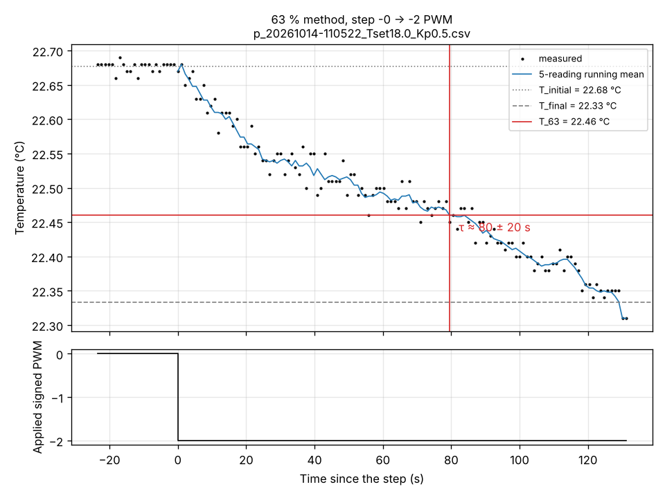

**Result from the Module 5 traces:** $\tau \approx 70$ s (the open-loop steps below
measure it directly and agree). The uncertainty is about ±10 %:

- **Spread:** ±4 s between the four runs.
- **Loop delay:** the delay of about 3 readings at the start of each run adds about
  2 s to $t_{63}$, which becomes $2(1+L)$ s in $\tau$. That is up to about 10 s at
  $K_p$ = 8, so these values are upper estimates.
- **Low-PWM slope:** the slope below PWM 12 is about 7 % smaller than the fitted
  0.485, which changes $1+L$ by 3–6 %.

The estimate is model-dependent because it assumes $\tau_{\mathrm{cl}} = \tau/(1+L)$.
The fitted closed-loop time constants of the same runs give
$\tau_{\mathrm{cl}}(1+L)$ = 69–77 s (Module 5, Part 6). As the handout notes, this
fixes only the ratio $C/H$, not $C$ and $H$ separately.

Reproduce (from the repository root):

```bash
python python/module6_tau63.py data/module_05/p_20261014-110522_Tset18.0_Kp0.5.csv --t-final 22.333 --t-final-err 0.05
python python/module6_tau63.py data/module_05/p_20261017-003102_Tset30.0_Kp0.5.csv --step 2 --moving-start
```

The closed-loop $t_{63}$ values are the `tau63_s` column of
[`data/module_05/p_runs_summary.csv`](../../data/module_05/p_runs_summary.csv).

### Open-loop step measurement (17 Oct 2026)

A large open-loop step gives $\tau$ directly, without $\chi$, $K_p$, or
$\tau_{\mathrm{cl}} = \tau/(1+L)$. The same session supplies the measured open-loop
heating and cooling traces that Part 4 compares with the simulation, and the on-state
TEC voltage.

**Tools.** Use the Module 4 sketch `arduino/module4_tec_control/` with
`python/module4_control_gui.py`. The Module 5 sketch cannot be used here: it stops the
TEC when no command arrives for 3 s, and this GUI sends a command only when the PWM or
direction changes. The GUI logs every reading (a 1,000-sample average) to
`data/module_06/openloop_<date>_<time>.csv`. (The 17 Oct session was run with the
Module 5 repository's copy of the GUI, which names the file
`module4_run_<date>_<time>.csv`.)

**Before the steps.**

1. Upload `arduino/module4_tec_control/module4_tec_control.ino`. The start-up banner
   must show the 60 °C software limit.
2. Set `SERIAL_PORT` at the top of `python/module4_control_gui.py` and close the
   Arduino Serial Monitor.
3. Leave the block at PWM 0 for at least 15 min after any heating run.
4. From the repository root, run `python python/module4_control_gui.py`. Logging
   starts at once. Record at least 2 min at PWM 0; the temperature should drift by
   less than about 0.05 °C/min. Note the room temperature and the clock time.

**Steps.** Type the PWM in the text box and press Enter, so that each change is a
single command. Change the direction only while the PWM is 0.

| Step | Command | Hold | Expected |
| ---: | --- | --- | --- |
| 1 | HEAT, PWM 0 → 25 | ≥ 8 min (about 7 τ) | rise $\chi_h \cdot 25 \approx 12$ °C, to about 34 °C |
| 2 | PWM 25 → 0 | ≥ 15 min | back to room temperature; a heat-sink dip below room temperature is possible |
| 3 | select COOL at PWM 0, then PWM 0 → 25 | ≥ 8 min | fall $\chi_c \cdot 25 \approx 4.3$ °C, to about 17.7 °C |
| 4 | PWM 25 → 0 | ≥ 10 min | back to room temperature |

5. **On-state TEC voltage.** With the block back near room temperature, set COOL,
   PWM 255 for at most 5 s, read the DC voltage across the TEC terminals with the
   multimeter, then set PWM 0. At a lower PWM the multimeter reads the duty-cycle
   average, not the on-state voltage. Expect the block to cool by about 3 °C during
   the 5 s.
6. Close the GUI and record the file name, room temperature, and $V_{\mathrm{TEC}}$.
   Upload the Module 5 sketch again before any P or PI run, because it has the
   command timeout.

Set PWM 0 at once if the temperature moves the wrong way, goes above 45 °C, the
display freezes, or a safety shutdown is reported.

**Analysis.**

```bash
python python/module6_tau63.py data/module_06/module4_run_20261017_164351.csv --step 1   # 0 -> +25
python python/module6_tau63.py data/module_06/module4_run_20261017_164351.csv --step 3   # 0 -> -25
python python/module6_tau63.py data/module_06/module4_run_20261017_164351.csv --step 2   # +25 -> 0
python python/module6_tau63.py data/module_06/module4_run_20261017_164351.csv --step 4   # -25 -> 0
```

Steps 1 and 3 start from a settled block and are the main results. Steps 2 and 4 are
relaxations at PWM 0; the heat-sink dip can bias their $T_{\mathrm{final}}$. The
voltage pulse, if logged, adds two more steps at the end, which are not used. For a 12 °C step,
noise moves the 63 % time by well under 1 s. Whether heating and cooling give the
same $\tau$ is itself a test of the one-lump model, in which $\tau = C/H$ does not
depend on direction.

#### Results

Session of 17 Oct 2026, Module 4 sketch, room about 19.8 °C:
[`data/module_06/module4_run_20261017_164351.csv`](../../data/module_06/module4_run_20261017_164351.csv)
(2,470 readings). The baseline before step 1 was only 23 s (19.83–19.85 °C) instead of
the planned 2 min, and $V_{\mathrm{TEC}}$ was measured separately afterwards (10.95 V, parameter table).

| Step | Command | Held (s) | $T_{\mathrm{initial}}$ (°C) | $T_{\mathrm{final}}$ (°C) | $\Delta T$ (°C) | $\lvert\Delta T\rvert/25$ (°C/PWM) | $\tau$, 63 % (s) |
| ---: | --- | ---: | ---: | ---: | ---: | ---: | ---: |
| 1 | 0 → +25 (heating on) | 573 | 19.84 | 31.70 | +11.86 | 0.474 | 70.4 ± 0.2 |
| 2 | +25 → 0 (heating off) | 808 | 31.69 | 19.93 | −11.76 | 0.470 | 72.7 ± 0.1 |
| 3 | 0 → −25 (cooling on) | 774 | 19.93 | 15.68 | −4.25 | 0.170 | 69.1 ± 0.4 |
| 4 | −25 → 0 (cooling off) | 457 | 15.68 | 19.80 | +4.13 | 0.165 | 65.6 ± 0.3 |

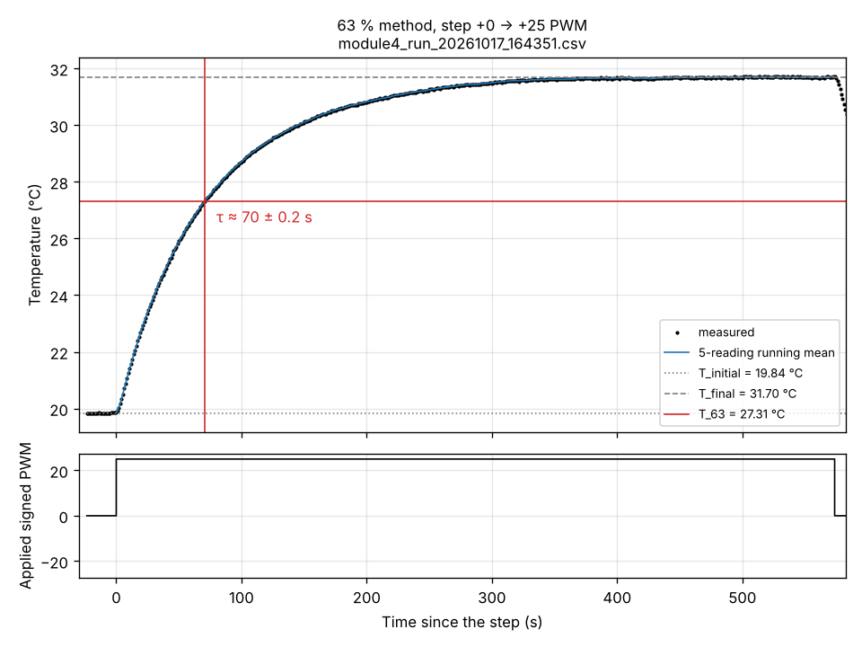

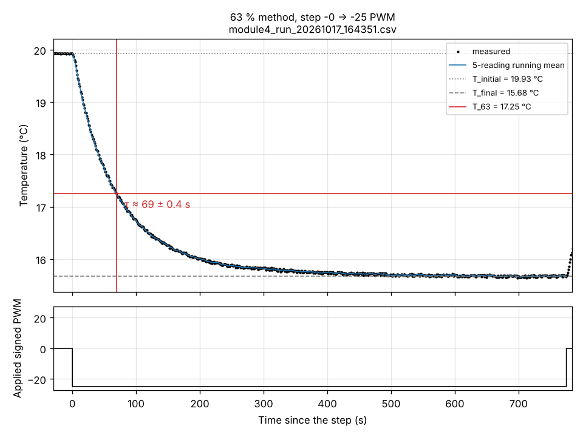

**Time constant.** The four steps give 65.6–72.7 s, mean 69.5 s. The quoted errors
(noise and $T_{\mathrm{final}}$, under 0.5 s) are much smaller than the spread between
steps, so the spread sets the uncertainty: $\boxed{\tau = 70 \pm 3\ \mathrm{s}}$. The
two steps that start from a settled block at PWM 0 give 70.4 s for heating and 69.1 s
for cooling, which agree within 2 %. That is what the one-lump model requires, since
$\tau = C/H$ does not depend on direction. The result agrees with the closed-loop
estimate above (70 ± 4 s), which supports the relation
$\tau_{\mathrm{cl}} = \tau/(1+L)$ used there.

**Susceptibility check.** Steps 1 and 3 give $\chi_h$ = 0.474 and $\chi_c$ = 0.170
°C/PWM at $u = \pm 25$, 2 % and 1 % below the Module 4 fits (0.485 and 0.172), and
$r$ = 2.79 (Module 4: 2.82). The Module 4 values are kept. (For steps 2 and 4,
$\lvert\Delta T\rvert/25$ is a relaxation, not a separate measurement of $\chi$.)

**Shape: close to, but not exactly, one exponential.** Compared with a single
exponential with $\tau$ = 70 s starting at the step, the measured trace is 0.2–0.3 °C
behind during the first 10 s of steps 1 and 2. The first increments are 0.06, 0.11,
and 0.15 °C per reading instead of the 0.17 °C a single lump gives from the start.
That is about 1.5–2 s of lag before the heat reaches the thermistor. Time is counted
from the first reading that reports the new PWM, so the command was already applied
during that reading's average and this lag is thermal, not serial. The trace is also about 0.2 °C behind between 100 and 200 s (a slow tail).
Both deviations are at most 0.3 °C, i.e. at most 2.5 % of the 12 °C step. The early
lag is the internal thermal storage that Part 5 and Part II describe with a second
lump.

**Relaxation after heating and cooling.** After step 2 the block settled at
19.92–19.93 °C, 0.09 °C above the baseline before step 1, and did not dip below it.
After step 4 it settled at 19.80 °C, 0.13 °C below the level before step 3, with no
overshoot above it. The same holds 3 min after switching off, the wait used
between the 14 Oct runs: after heating the block was 0.39 °C *above* the one-lump
relaxation ($\tau$ = 70 s; 21.12 °C measured vs 20.73 °C expected), and after
cooling 0.10 °C *below* it. The slow component therefore has the same sign as the
step. The Module 5 heat-sink explanation predicts the opposite signs (a dip after
heating, an overshoot after cooling), and the 573 s heating step here (about
14,300 count·s) was about three times the heating dose of the 14 Oct $K_p$ = 8–32
runs. So the heat-sink effect does not explain the 0.7–1.5 °C baseline deficits of
14 Oct; a room that cooled during that session is the more likely cause. The Module 5
note has been updated accordingly.

## Part 4: Simulate open-loop and P control

### Measured open-loop steps compared with the one-lump model

**Settings (with units).** One lump, measured parameters, open loop:
$\chi_c$ = 0.172 °C/PWM, $\chi_h$ = 0.485 °C/PWM, $\tau$ = 70 s,
$V_{\mathrm{TEC}}$ = 10.95 V, $R_M$ = 1.50 Ω (which give $C$ = 70 J/K, $H$ = 1.00 W/K,
$P_{u,c}$ = 0.172 W/PWM). $T_{\mathrm{amb}}$ is the measured level before each step:
19.84 °C for the heating step and 19.93 °C for the cooling step. The commands are
$u$ = +25 and −25 PWM, matching the Part 3 steps, and $\Delta t$ = 0.01 s.

**Prediction before running**, from $T_{\mathrm{ss}} = T_{\mathrm{amb}} + \chi u$:
$19.84 + 0.485 \times 25 = 31.96$ °C for heating and
$19.93 + 0.172 \times (-25) = 15.63$ °C for cooling.

`python/module6_part4_open_loop.py` integrates the measured-parameter update
$T_{n+1} = T_n + (\Delta t/\tau)(T_{\mathrm{amb}} + \chi u_n - T_n)$, the same
equation the course simulation uses in this mode, and plots it over the measured
traces. No parameter is fitted to these traces.

| Step | Model $T_{\mathrm{ss}}$ (°C) | Measured $T_{\mathrm{ss}}$ (°C) | Difference | rms of measured − model | Largest deviation |
| --- | ---: | ---: | --- | ---: | --- |
| Heating, +25 PWM | 31.96 | 31.70 | −0.27 °C (step 2.2 % smaller) | 0.09 °C | −0.47 °C at 197 s |
| Cooling, −25 PWM | 15.63 | 15.68 | +0.05 °C (step 1.1 % smaller) | 0.04 °C | +0.15 °C at 313 s |

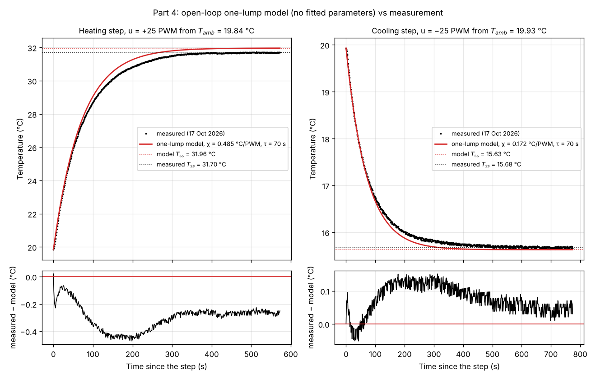

**Time step.** $\Delta t$ = 1 s changes the model curve by at most 0.03 °C relative
to $\Delta t$ = 0.01 s, and $\Delta t$ = 0.1 s by at most 0.003 °C. Any
$\Delta t \ll \tau$ = 70 s, including the simulation default of 0.05 s, gives the same
result.

**Differences between the model and the apparatus.**

1. **Steady state.** The heating step ends 0.27 °C (2.2 %) below
   $T_{\mathrm{amb}} + \chi_h u$. On this day the heating slope at $u$ = 25 was
   0.474 °C/PWM instead of the Module 4 fit of 0.485 (a different day, a room 3 °C
   cooler, and a fit over PWM 0–47). The cooling step agrees within 0.05 °C.
2. **Shape.** The measured trace starts 1.5–2 s late (the thermal lag of Part 3) and
   approaches its final value more slowly than one exponential in the second half: the
   heating residual reaches −0.47 °C near 200 s before settling at the −0.27 °C
   steady-state offset, and the cooling residual reaches +0.15 °C near 300 s. The model
   has one state and one time constant; the apparatus also has a fast internal lag and
   a slow store.
3. **Overall.** With no free parameter, the one-lump model follows the heating step to
   within 0.5 °C (4 % of the 12 °C step) and the cooling step to within 0.15 °C (3.5 %
   of the 4.3 °C step).

### Guided simulation exercise: open loop and thermal mass

**Settings.** `one_lump`, `measured`, `open_loop`, with the simulation defaults
$T_{\mathrm{amb}} = T_0$ = 22 °C, $\chi_c$ = 0.23 °C/PWM, $\chi_h$ = 0.46 °C/PWM
($r$ = 2), $\tau$ = 80 s, $V_{\mathrm{TEC}}$ = 12 V, $R_M$ = 1.50 Ω, $\Delta t$ = 0.05 s.
The simulation derives $C$ = 130.9 J/K, $H$ = 1.637 W/K, and $P_{u,c}$ = 0.3765 W/PWM.
Each run was started with **Reset experiment** and run until the error
$e = T_{\mathrm{ss}} - T$ was 0.00 °C.

| Command | Predicted $T_{\mathrm{ss}} = T_{\mathrm{amb}} + \chi u$ | Simulated $T_{\mathrm{ss}}$ | Required power $H\Delta T$ |
| ---: | ---: | ---: | ---: |
| $u$ = +25 PWM | 22 + 0.46 × 25 = 33.50 °C | 33.50 °C | +18.82 W |
| $u$ = −25 PWM | 22 + 0.23 × (−25) = 16.25 °C | 16.25 °C | −9.41 W |
| $u$ = −50 PWM | 22 + 0.23 × (−50) = 10.50 °C | 10.50 °C | −18.82 W |

The approach is a single exponential with $\tau$ = 80 s. For example, at
$t$ = 168 s of the +25 run the error was 1.39 °C, and
$11.5\ ^\circ\mathrm{C} \times e^{-168/80} = 1.41$ °C.

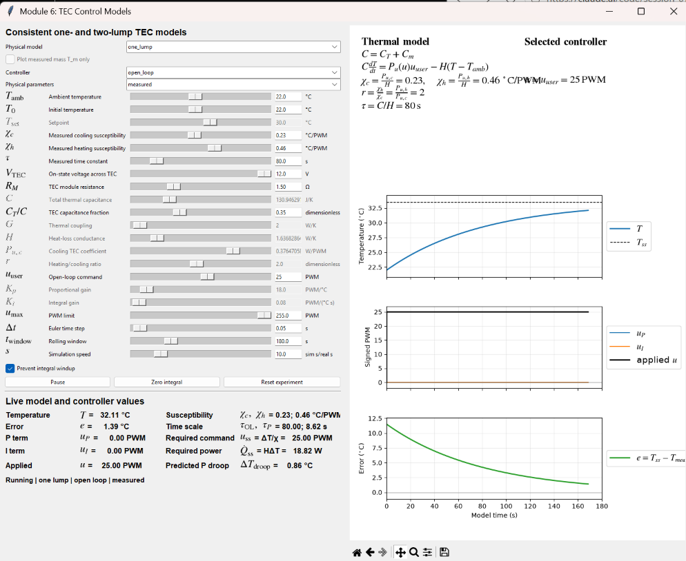

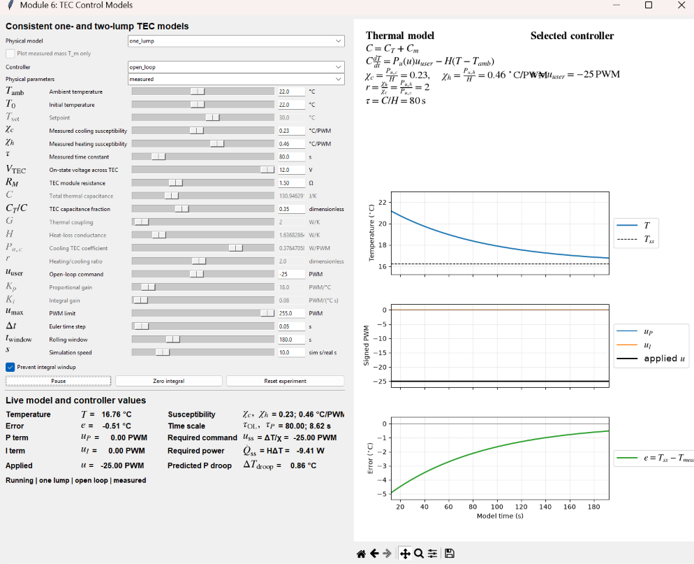

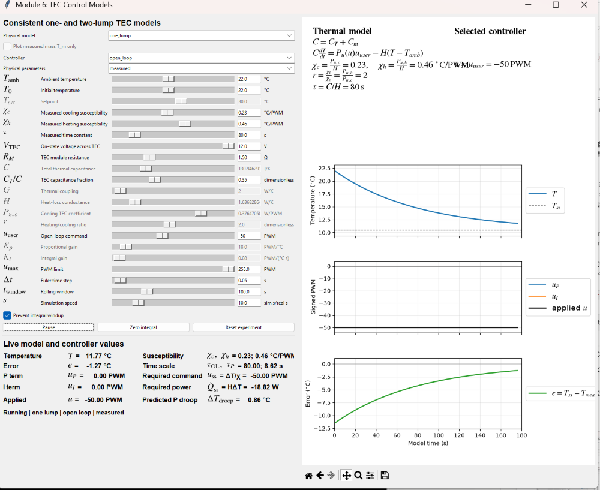

**1. Why do +25 PWM and −25 PWM produce unequal temperature changes?**
The same $|u|$ moves the temperature by +11.5 °C when heating but only −5.75 °C when
cooling, because the TEC delivers more heat to the block than it removes. The Joule
heat $I^2R$ always goes partly into the block face. When heating it adds to the
Peltier heat, and when cooling it opposes the Peltier cooling, so
$P_{u,h} = P_{u,c}\,(\dot Q_P + \dot Q_J)/(\dot Q_P - \dot Q_J)$. Since
$\chi = P_u/H$ with the same $H$ in both directions, $\chi_h/\chi_c = r$ = 2 here
(2.82 for our apparatus).

**2. Susceptibilities from the displayed values.**

$$
\chi_h = \frac{33.50 - 22}{25} = 0.46\ \frac{^\circ\mathrm{C}}{\mathrm{PWM}},
\qquad
\chi_c = \frac{16.25 - 22}{-25} = \frac{10.50 - 22}{-50} = 0.23\ \frac{^\circ\mathrm{C}}{\mathrm{PWM}},
\qquad
\frac{\chi_h}{\chi_c} = 2.0 ,
$$

the same as the displayed $\chi_c, \chi_h$ = 0.23; 0.46 °C/PWM and $r$ = 2. The
−50 PWM change is exactly twice the −25 PWM change: within one direction the model is
linear in $u$.

**Thermal mass.** With $u$ = +25 PWM fixed, the measured mode displayed
$C$ = 130.9 J/K. In `direct constants` mode $C$ was doubled to 261.9 J/K, with $H$
= 1.637 W/K, $P_{u,c}$ = 0.3765 W/PWM, and $r$ = 2 unchanged.

- *Prediction:* $T_{\mathrm{ss}} = T_{\mathrm{amb}} + P_{u,h}u/H$ does not contain $C$,
  so it stays at 33.50 °C, while $\tau = C/H$ doubles from 80 s to 160 s.
- *Result:* the displayed time constant was $\tau_{\mathrm{OL}}$ = 159.99 s and the
  temperature settled at 33.50 °C. At $t$ = 565 s the error was still 0.34 °C,
  as $11.5\ ^\circ\mathrm{C} \times e^{-565/160} = 0.34$ °C requires; with
  $\tau$ = 80 s it would have been 0.01 °C. The displayed P-control time constant
  doubled as well (8.62 → 17.24 s), while the predicted P droop stayed at 0.86 °C.

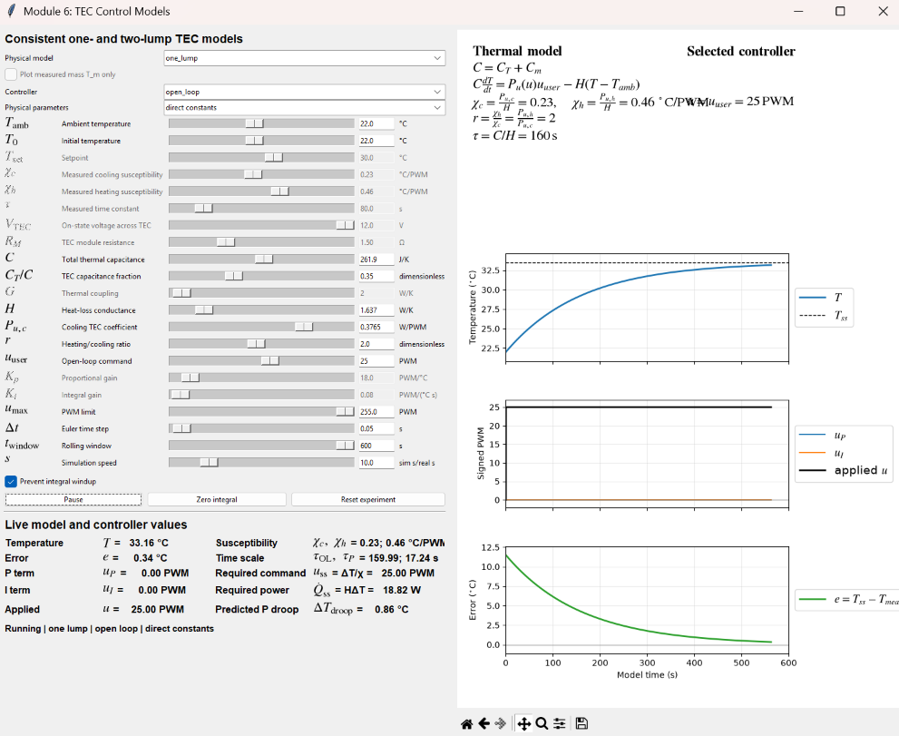

*Why thermal mass changes the transient but not the steady state.* At steady state
$dT/dt = 0$, so the storage term $C\,dT/dt$ vanishes and the balance
$P_u u = H(T_{\mathrm{ss}} - T_{\mathrm{amb}})$ is between the TEC power and the
loss to the room only. $C$ sets how much energy must be stored to change the
temperature, $\Delta U = C\,\Delta T$. With the same net power available, twice the
capacitance takes twice as long to reach the same temperature, so $\tau = C/H$ doubles
and the final temperature is unchanged. The simulation was returned to `measured`
afterwards.

### Our measured parameters in the simulation

**Settings.** `one_lump`, `measured`, `open_loop`, $\chi_c$ = 0.172 °C/PWM,
$\chi_h$ = 0.485 °C/PWM, $\tau$ = 70 s, $R_M$ = 1.50 Ω,
$T_{\mathrm{amb}} = T_0$ = 19.84 °C (the room before the heating step of Part 3),
$V_{\mathrm{TEC}}$ = 10.95 V, $\Delta t$ = 0.05 s. The simulation derived
$C$ = 70.1 J/K, $H$ = 1.00 W/K, $P_{u,c}$ = 0.1723 W/PWM, and $r$ = 2.82 (as in the
parameter table) and displayed $\tau_{\mathrm{OL}}$ = 70.00 s. The required power at
steady state was $H\Delta T$ = 12.14 W for heating and −4.31 W for cooling.

| Command | Predicted $T_{\mathrm{ss}}$ | Simulated $T_{\mathrm{ss}}$ | Measured (Part 3) |
| ---: | ---: | ---: | ---: |
| $u$ = +25 PWM | 19.84 + 0.485 × 25 = 31.96 °C | 31.96 °C | 31.70 °C |
| $u$ = −25 PWM | 19.84 + 0.172 × (−25) = 15.54 °C | 15.54 °C | 15.68 °C (from 19.93 °C) |

The cooling run in the simulation kept $T_{\mathrm{amb}}$ = 19.84 °C. The measured
cooling step started from 19.93 °C, so its prediction is 15.63 °C; the comparison
with the measured trace above uses that level. The simulated curves are the same
single exponentials with $\tau$ = 70 s that the script overlays on the measured
traces, so the differences listed above (2 % smaller heating step, 1.5–2 s start-up
lag, slow tail) are differences between the apparatus and the one-lump model, not
between the script and the simulation.

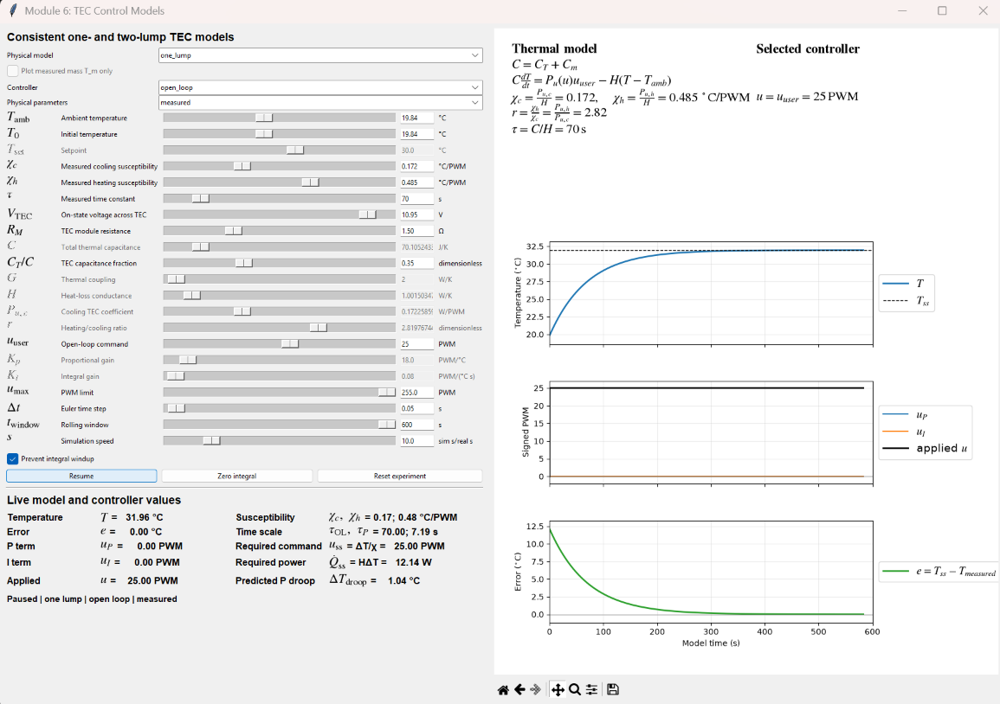

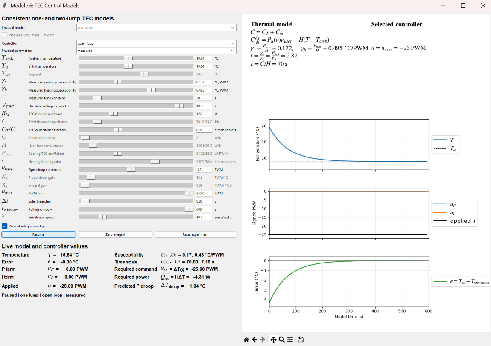

### P control in the simulation

**Settings.** `one_lump`, `measured`, controller `p`, our parameters as above,
$T_{\mathrm{amb}} = T_0$ = 19.84 °C, $T_{\mathrm{set}}$ = 30 °C ($e_0$ = 10.16 °C),
$u_{\max}$ = 255, $\Delta t$ = 0.05 s. Gains: $K_p$ = 8 PWM/°C (used in Module 5) and
the larger $K_p$ = 32 PWM/°C.

**Predictions before running** (Part 1 and Part 5 results):

- $K_p$ = 8: $L$ = 3.88, droop = 10.16/4.88 = 2.08 °C ($T_{\mathrm{ss}}$ = 27.92 °C),
  $\tau_{\mathrm{cl}}$ = 70 s/4.88 = 14.3 s.
- $K_p$ = 32: $L$ = 15.5, droop = 10.16/16.5 = 0.62 °C ($T_{\mathrm{ss}}$ = 29.38 °C),
  $\tau_{\mathrm{cl}}$ = 70 s/16.5 = 4.24 s.

**Agreement.** Both runs settled at the predicted temperature (27.92 °C with
$e$ = 2.08 °C, and 29.38 °C with $e$ = 0.62 °C), and the simulation displayed the
same droop and $\tau_P$ (14.34 s and 4.24 s). Increasing $K_p$ fourfold reduced the
droop and the response time by the same factor, $(1+L)$ = 4.88 → 16.5. Neither run
overshot: the temperature rose monotonically to $T_{\mathrm{ss}}$. At $K_p$ = 32 the
initial request $u_P = 32 \times 10.16 = 325$ PWM was clamped at 255 for about the
first 1 s, so the very start is slower than $\tau_{\mathrm{cl}}$ = 4.24 s predicts;
the steady state is unaffected. In the apparatus the same gain overshot by 2.70 °C and
rang (Module 5), which the one-lump model cannot produce (Part 5).

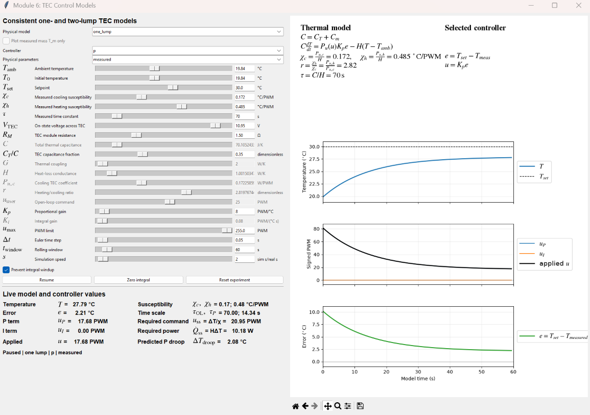

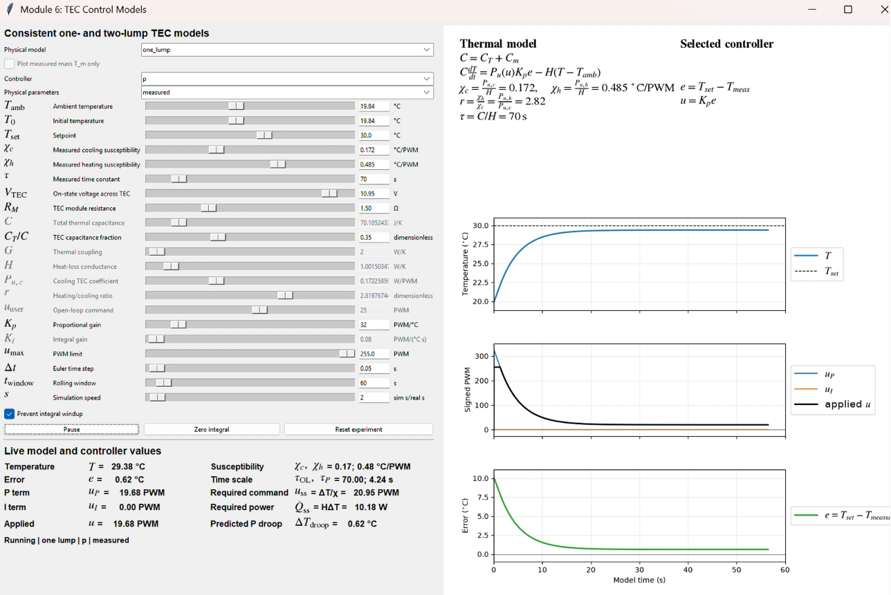

**Second pair of runs, closer to the Module 5 conditions.**

- $K_p$ = 8 from $T_{\mathrm{amb}} = T_0$ = 22.87 °C (the baseline of the Module 5
  $K_p$ = 8 run): predicted droop 7.13/4.88 = 1.46 °C ($T_{\mathrm{ss}}$ = 28.54 °C);
  the simulation settled at 28.54 °C with $e$ = 1.46 °C and $\tau_P$ = 14.34 s. The
  Module 5 run itself ended with a droop of 1.69 °C, larger than this prediction for
  the reason discussed in Part 1 (an overestimated $T_{\mathrm{amb}}$).
- $K_p$ = 32 from $T_{\mathrm{amb}} = T_0$ = 20.03 °C (entered instead of the Module 5
  value 22.03 °C): predicted droop 9.97/16.5 = 0.60 °C ($T_{\mathrm{ss}}$ = 29.40 °C);
  the simulation settled at 29.40 °C with $e$ = 0.60 °C and $\tau_P$ = 4.24 s, again
  without overshoot and with the PWM clamped at 255 for the first second.

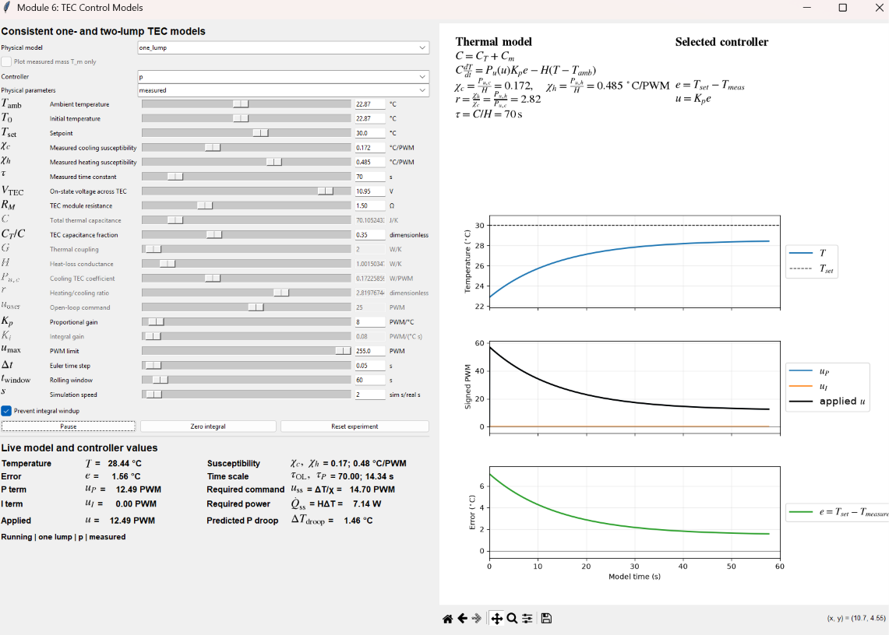

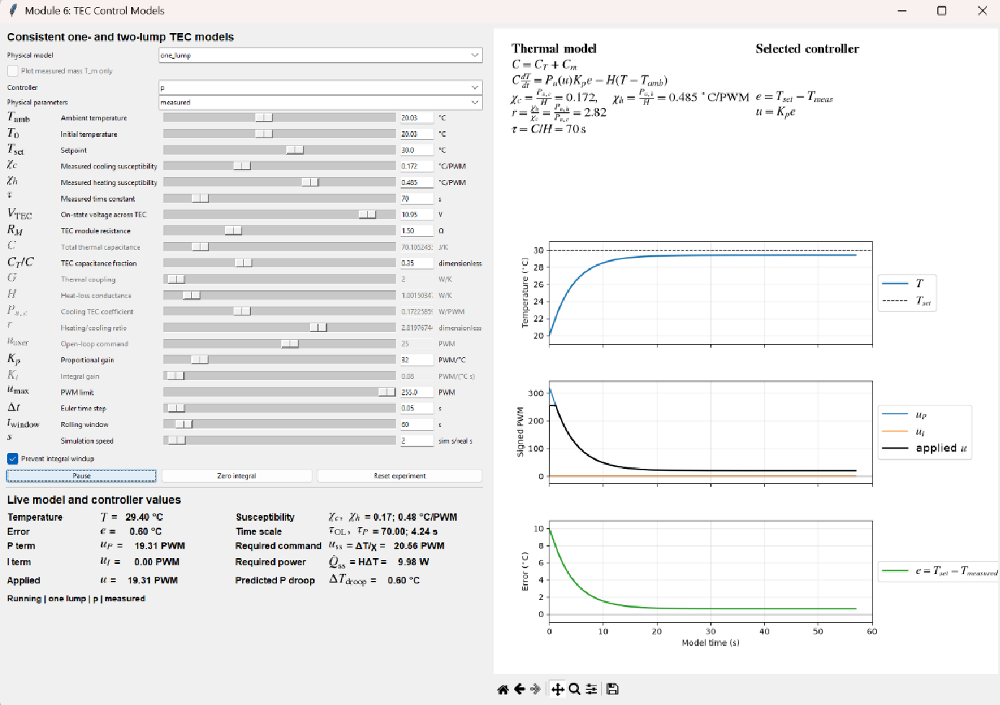

## Part 5: The one-lump P transient and its limit

### Closed-loop solution

Substituting the P law $u = K_p(T_{\mathrm{set}} - T)$ into the one-lump energy
balance gives

$$
C\frac{dT}{dt} = P_uK_pT_{\mathrm{set}} + HT_{\mathrm{amb}} - (H + P_uK_p)\,T .
$$

Its steady state is
$T_{\mathrm{ss}} = (P_uK_pT_{\mathrm{set}} + HT_{\mathrm{amb}})/(H + P_uK_p)$, which is
the droop result of Part 1. With the displacement $\theta = T - T_{\mathrm{ss}}$ the
constant terms cancel:

$$
C\frac{d\theta}{dt} = -(H + P_uK_p)\,\theta
\quad\Longrightarrow\quad
\frac{d\theta}{\theta} = -\frac{H + P_uK_p}{C}\,dt
\quad\Longrightarrow\quad
\ln\frac{\theta(t)}{\theta(0)} = -\frac{H + P_uK_p}{C}\,t .
$$

So

$$
\boxed{T(t) = T_{\mathrm{ss}} + \left[T(0) - T_{\mathrm{ss}}\right]e^{-t/\tau_{\mathrm{cl}}},
\qquad
\tau_{\mathrm{cl}} = \frac{C}{H + P_uK_p} = \frac{C/H}{1 + (P_u/H)K_p} = \frac{\tau}{1 + \chi K_p} = \frac{\tau}{1+L}}
$$

### Increasing the gain has two effects

$$
T_{\mathrm{set}} - T_{\mathrm{ss}} = \frac{T_{\mathrm{set}} - T_{\mathrm{amb}}}{1 + L},
\qquad
\tau_{\mathrm{cl}} = \frac{\tau}{1 + L},
\qquad L = \chi K_p .
$$

Both the droop and the response time are divided by the same factor $1 + L$. A larger
$K_p$ gives more corrective power per degree of error, so

1. the steady command needed to balance the loss to the room,
   $u_{\mathrm{ss}} \approx (T_{\mathrm{ss}} - T_{\mathrm{amb}})/\chi$, is reached with a
   smaller error $e = u_{\mathrm{ss}}/K_p$ (less droop); and
2. the feedback acts like an extra heat-loss conductance $P_uK_p$ added to $H$, so the
   stored energy $C\theta$ is removed faster (shorter $\tau_{\mathrm{cl}}$).

With our parameters (Part 4), going from $K_p$ = 8 to 32 PWM/°C raises $1 + L$ from
4.88 to 16.5: the droop falls from 2.08 to 0.62 °C and $\tau_{\mathrm{cl}}$ from 14.3 to
4.24 s. This holds while the PWM is not saturated.

### Mathematical proof of no oscillation

Substituting the P-control law $u = K_p(T_{\mathrm{set}} - T)$ into the one-lump energy
balance and defining the deviation from steady state $\theta(t) = T(t) - T_{\mathrm{ss}}$,
we obtain the homogeneous differential equation

$$
C\frac{d\theta}{dt} = -(H + P_uK_p)\,\theta .
$$

Trying an exponential solution $\theta(t) = \theta_0e^{\lambda t}$ yields the single
eigenvalue

$$
\lambda = -\frac{H + P_uK_p}{C} .
$$

Because all physical parameters ($C$, $H$, $P_u$, $K_p$) are positive, $\lambda$ is
purely real and negative. Consequently, the solution is a monotonically decaying
exponential: $\theta$ keeps the sign of $\theta(0)$ while it shrinks. The temperature
can only approach its steady state $T_{\mathrm{ss}}$ asymptotically; mathematically, it
cannot cross $T_{\mathrm{ss}}$, overshoot, or oscillate, at any gain. The ideal
one-lump P model is stable and non-oscillatory, as the Part 4 simulations at
$K_p$ = 8 and 32 show. Therefore, any observed overshoot or ringing (like the
$K_p$ = 32 run in Module 5, below) falsifies the one-lump model as a complete
description of the transient.

### The high-gain trace from Module 5

Run: Module 5, 14 Oct 2026, $K_p$ = 32 PWM/°C, $T_{\mathrm{set}}$ = 30 °C
([`p_20261014-120316_Tset30.0_Kp32.csv`](../../data/module_05/p_20261014-120316_Tset30.0_Kp32.csv)).
The red curve is the one-lump prediction with nothing fitted: $\chi_h$ = 0.485
°C/PWM, $\tau$ = 70 s, the baseline $T_{\mathrm{amb}}$ = 22.03 °C, $T(0)$ = 21.95 °C,
and the PWM clamped at 255. `python/module6_part5_highgain.py` makes the figure.

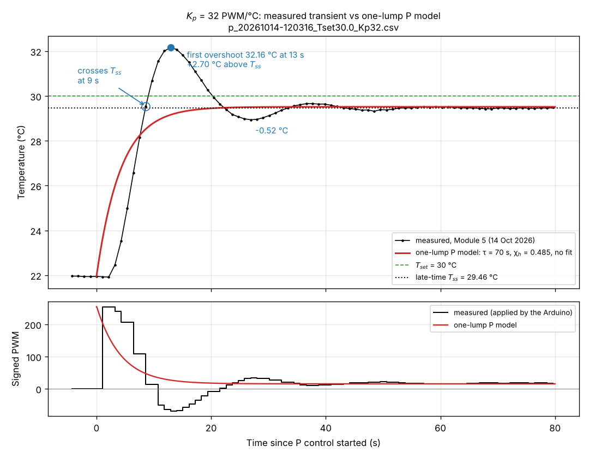

- **Late-time value:** $T_{\mathrm{ss}}$ = 29.46 °C (mean of the last 120 s). The model
  predicts 29.52 °C, so the steady state agrees within 0.06 °C.
- **First overshoot:** the measured temperature crosses $T_{\mathrm{ss}}$ at 9 s and
  reaches 32.16 °C at 13 s, **2.70 °C above $T_{\mathrm{ss}}$** (36 % of the step) and
  2.16 °C past the setpoint. It then rings with decaying amplitude: −0.52 °C at 27 s,
  +0.20 °C at 37 s, −0.14 °C at 48 s.
- **Model:** the one-lump curve rises with $\tau_{\mathrm{cl}}$ = 4.24 s and never
  exceeds its 29.52 °C.

**The contradiction.** The one-lump model predicts a monotonic exponential approach to
$T_{\mathrm{ss}}$; the apparatus shows an underdamped transient that crosses
$T_{\mathrm{ss}}$, overshoots by 2.70 °C, and rings. This behavior is incompatible with
the one-lump solution. It shows that the one-lump model is inadequate for the
transient, not that the exponential solution is wrong: the same model still predicts
the steady state.

### Physical interpretation and the missing state

Unlike a mechanical mass–spring system, a purely thermal one-lump system has no
"thermal inertia". Its only state variable is the temperature: if the net heat flow is
zero, $dT/dt = 0$ immediately, so it cannot "coast" past equilibrium. However, the
apparatus contains a hidden thermal state: **thermal lag**. The TEC heats the block, but
the thermistor measures the block's temperature $T_m$, not the TEC's surface
temperature. When $T_m$ reaches the setpoint, the TEC-side region can still be hotter
than the measured block. Stored heat continues to flow into the block, driving $T_m$
above the setpoint and causing an overshoot.

The measurements show this lag directly:

- In the $K_p$ = 32 run the controller was already cooling at the reading of 11.8 s
  (the first that reports COOL), yet the temperature kept rising until 12.9 s.
- The open-loop steps of Part 3 start 1.5–2 s late: the thermistor responds only
  after the heat has passed through the TEC ceramic, the paste, and the block.

**The two-lump model (qualitative).** To capture this behavior, the system must be
modeled as two coupled thermal masses, a second-order system:

- **Lump 1 (TEC side):** where heat is applied and stored.
- **Lump 2 (block/thermistor):** where temperature is measured.

The heat transfer between them acts as a phase lag. As the proportional gain $K_p$
increases, the controller reacts more aggressively to old information. The correction
arrives too late, causing the controller to overcorrect in the opposite direction,
which results in the underdamped (oscillatory) behavior observed in the experiments.
Part II develops this model quantitatively.

**Caveat for the Module 5 run.** In the Module 5 runs the commands also reached the
Arduino 0–3 s late because of a `SerialLink` locking bug, since fixed. A one-lump
simulation with a total loop delay of about 3 s reproduces the measured overshoot and
ringing (Module 5 note, "The Physical Origin of the High-Gain Overshoot"), so part of
that overshoot came from the serial delay and part from the thermal lag. With the fix,
only the thermal lag remains in the Module 6 runs.

## Part 6: Add integral action in simulation

### Guided simulation exercise: watch the integral contribution

**Settings.** `one_lump`, `measured`, our parameters, $T_{\mathrm{amb}} = T_0$ =
19.84 °C, $T_{\mathrm{set}}$ = 30 °C, $K_p$ = 8 PWM/°C, $K_i$ = 0.08 PWM/(°C s),
anti-windup on, $\Delta t$ = 0.05 s. (The $\chi_c$ field showed 0.170 instead of 0.172
because its slider moves in steps of 0.005. Only the heating side is used here, and the
derived $C$, $H$, and $P_u$ scale together, so the displayed damping ratio is unchanged.)
The simulation displayed the one-lump PI damping ratio $\zeta$ = 1.48 (overdamped).

**Sequence.** P control was run until the droop was visible. The controller was then
switched to `pi`, **Zero integral** was pressed, and the run continued from the
drooped state. After the PI steady state, **Zero integral** was pressed again.

| Stage | $T$ (°C) | $e$ (°C) | $u_P$ (PWM) | $u_I$ (PWM) | $u$ (PWM) |
| --- | ---: | ---: | ---: | ---: | ---: |
| P only, steady | 27.92 | 2.08 | 16.66 | 0 | 16.66 |
| PI, about 200 s after switching | 29.62 | 0.38 | 3.08 | 17.59 | 20.66 |
| PI, about 350 s after switching | 29.90 | 0.10 | 0.77 | 20.11 | 20.88 |
| PI, steady | 30.00 | 0.00 | 0.03 | 20.92 | 20.95 |
| just after the second Zero integral | 30.00 | 0.00 | 0.03 | 0.00 | 0.03 |
| 265 s later | 29.75 | 0.25 | 1.98 | 18.78 | 20.76 |

The PI steady command equals the displayed requirement
$u_{\mathrm{ss}} = \Delta T/\chi_h = 10.16/0.485 = 20.95$ PWM. After the second
**Zero integral** the temperature fell to 28.29 °C (largest error 1.71 °C) about 37 s
later and then recovered.

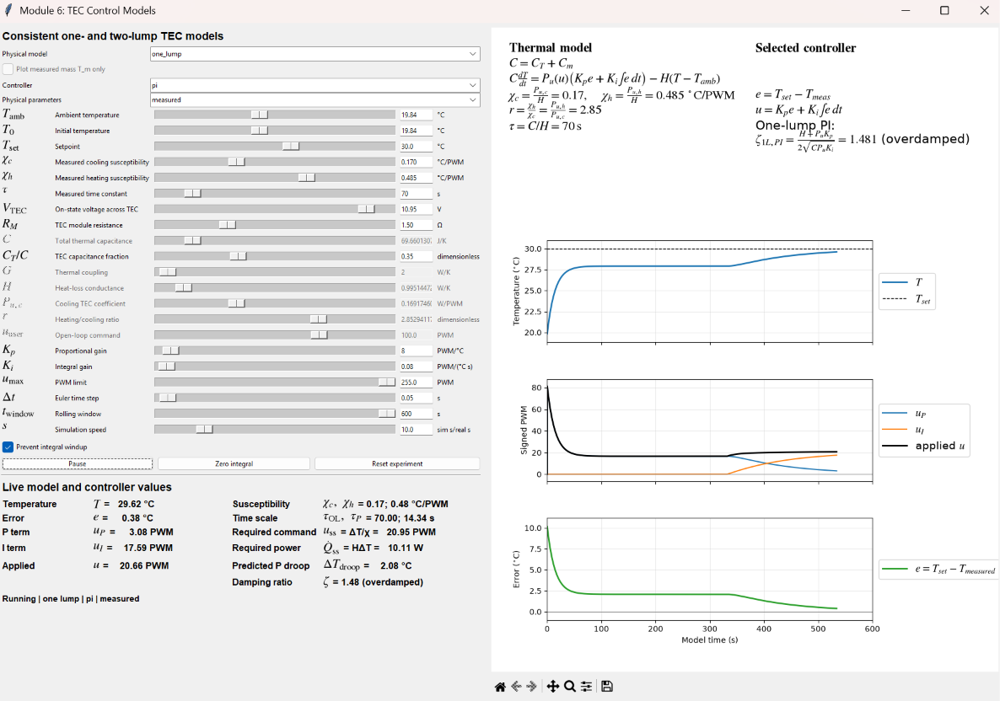

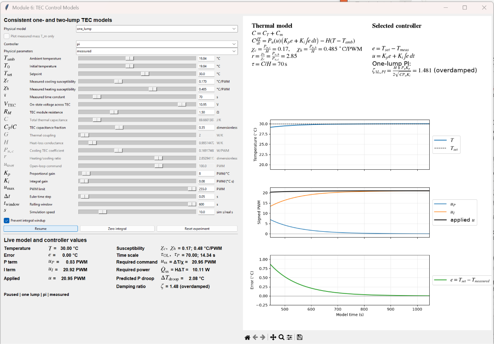

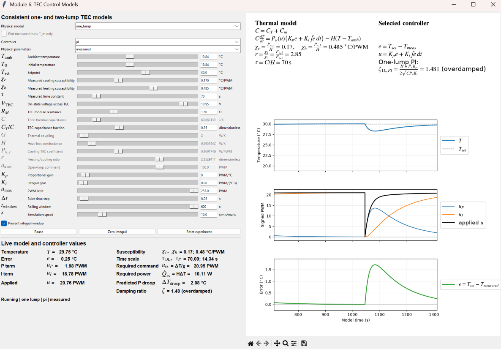

**1. Why does $u_I$ continue to grow while $e > 0$?**
Because $u_I = K_iq$ and the rate of change of the integral state is $dq/dt = e$. As
long as there is a positive error, the integral state $q$ continuously accumulates
this error, causing $u_I$ to grow.

**2. Why does $u_P$ approach zero as $T$ reaches the setpoint?**
Because $u_P = K_pe$. When the temperature reaches the setpoint, the error
$e \to 0$, so the proportional term vanishes.

**3. Why can $u_I$ remain nonzero when $e = 0$?**
To maintain a non-ambient setpoint, a steady-state power is still required to
counteract the passive heat loss. To maintain 30 °C with an ambient of 19.84 °C, the
required command is

$$
u_{\mathrm{ss}} = \frac{30 - 19.84}{0.485} \approx 20.95\ \mathrm{PWM}.
$$

When $e = 0$, $u_P = 0$, so the entire required command must be supplied by $u_I$.
The integral state stops growing ($dq/dt = e = 0$) but retains its accumulated value,

$$
q_{\mathrm{ss}} = \frac{u_{\mathrm{ss}}}{K_i} \approx \frac{20.95}{0.08} \approx 262\ ^\circ\mathrm{C\,s}.
$$

The integral term acts as the controller's "memory" of past errors, holding the
necessary nonzero command.

**4. After steady state, why does the temperature initially move away from the setpoint
if the integral is reset?**

1. *Command drops to zero:* resetting the integral makes $u_I = 0$. Since $e = 0$
   (so $u_P = 0$), the total command becomes $u = 0$, and the TEC stops heating.
2. *Block cools:* the block loses heat to the room on its time constant $\tau$, so
   $T$ drops (initially at about $-10.16/70 = -0.14$ °C/s).
3. *Error reappears:* as $T$ drops below the setpoint, $e$ becomes positive again.
   The P term responds immediately, and the integral term begins accumulating error
   once more to restore the temperature.

The steady integral contribution replaces the nonzero proportional error that P-only
control needed to supply the steady command: with P only, $u = 16.66$ PWM required
$e$ = 2.08 °C; with PI, the 20.95 PWM is held by $u_I$ at $e$ = 0.

### Exploring $K_i$: damping ratio

**Settings.** As above (`one_lump`, `measured`, our parameters,
$T_{\mathrm{amb}} = T_0$ = 19.84 °C, $T_{\mathrm{set}}$ = 30 °C, $K_p$ = 8 PWM/°C,
$u_{\max}$ = 255, anti-windup on, $\Delta t$ = 0.05 s). Each run started from
**Reset experiment** with only $K_i$ changed. $\zeta$ and $T_{\max}$ were read from the
simulation. The peak time, settling time, and smallest command were computed by
`python/module6_part6_ki_sweep.py`, which integrates the same equations and reproduces
every $T_{\max}$ to 0.01 °C. The settling time is the time after which $T$ stays within
±0.2 °C (2 % of the 10.16 °C step) of the setpoint.

| $K_i$ (PWM/(°C s)) | $\zeta$ | $T_{\max}$ (°C) | Overshoot (°C) | Peak at (s) | Settles in (s) | Smallest $u$ (PWM) |
| ---: | ---: | ---: | ---: | ---: | ---: | ---: |
| 0.08 | 1.48 | 30.00 | none | — | 178 | 20.7 |
| 0.18 | 0.99 | 30.44 | +0.44 | 76 | 127 | 20.7 |
| 0.28 | 0.79 | 31.02 | +1.02 | 58 | 114 | 19.4 |
| 0.36 | 0.70 | 31.39 | +1.39 | 52 | 100 | 18.0 |
| 0.70 | 0.50 | 32.48 | +2.48 | 38 | 109 | 9.8 |
| 2.0 | 0.30 | 34.33 | +4.33 | 24 | 121 | −36.8 |

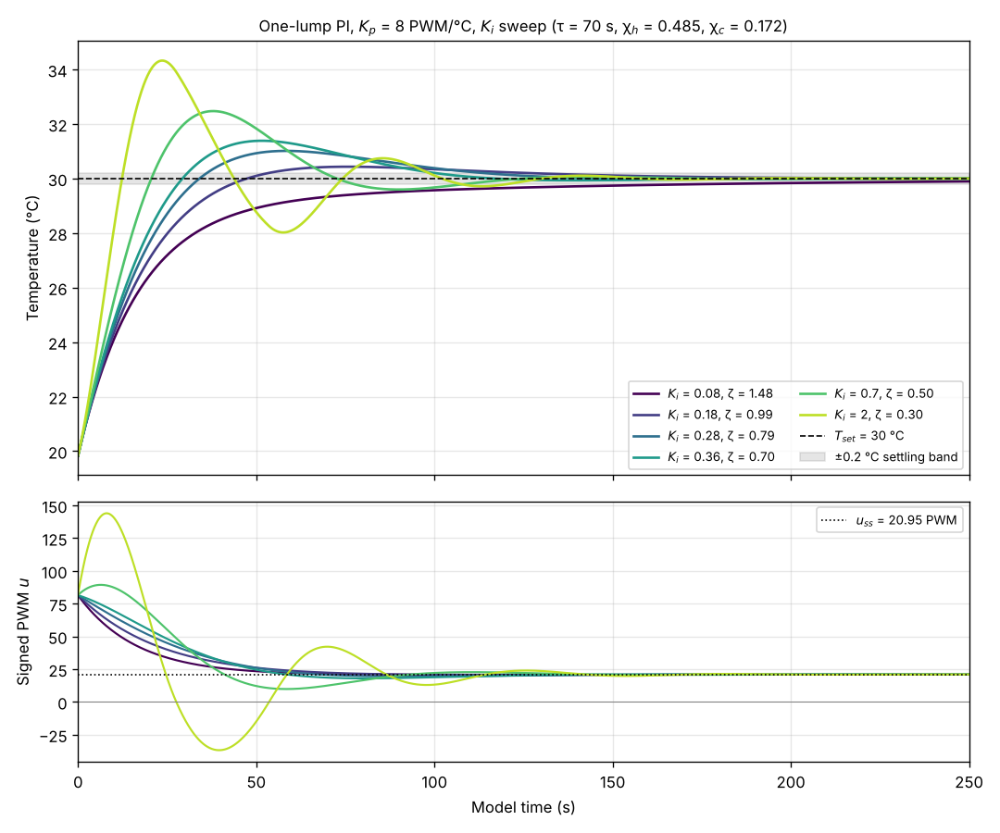

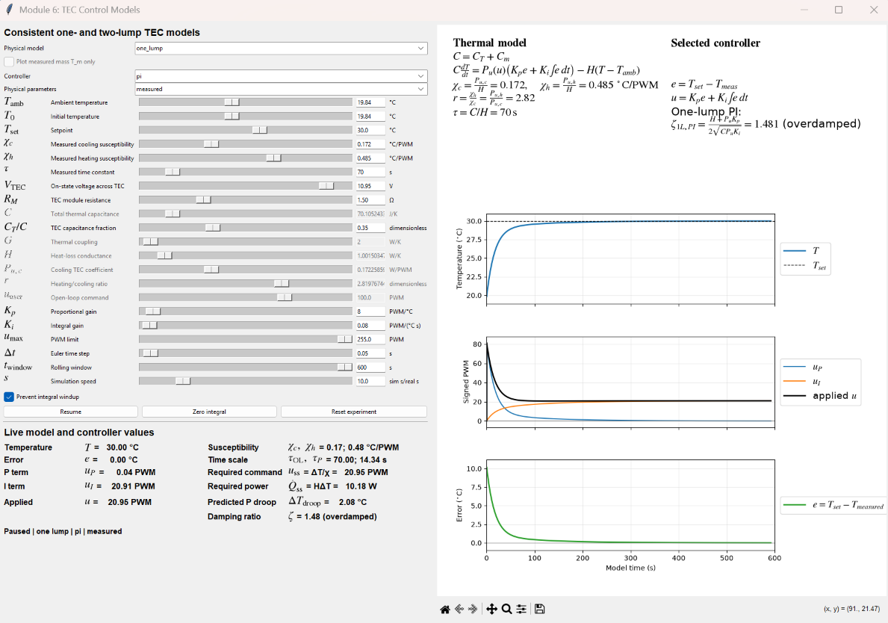

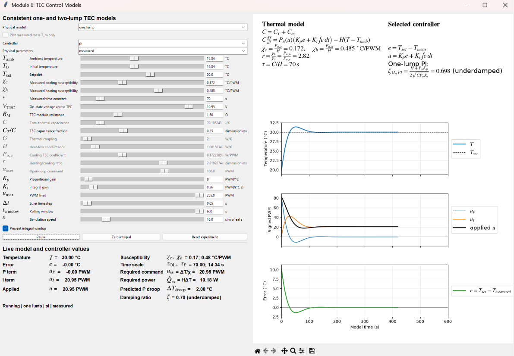

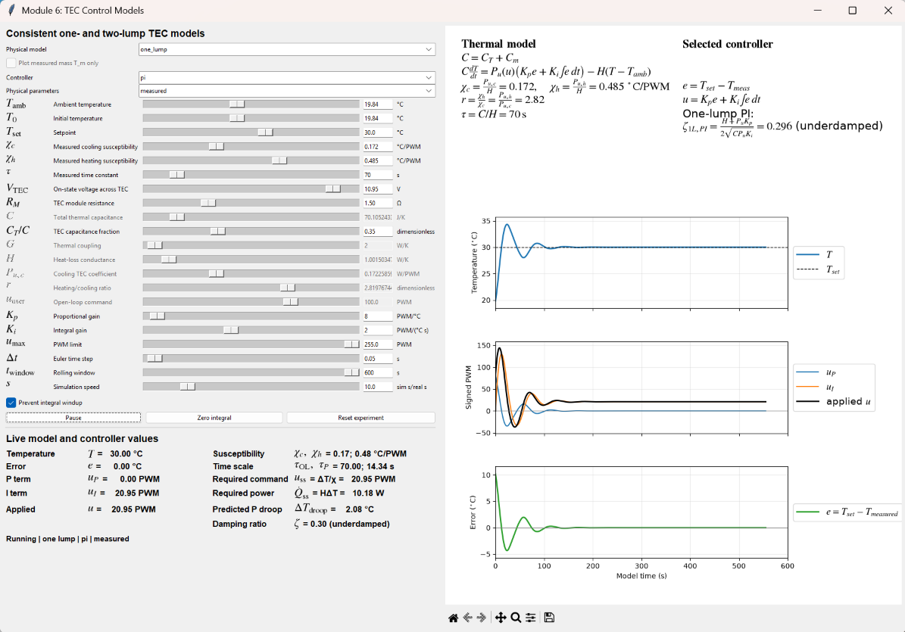

To explore how the integral gain $K_i$ affects the transient response, we kept $K_p$
fixed and tested six values of $K_i$ from 0.08 to 2.0 PWM/(°C s). The results follow
the one-lump second-order PI theory. At $K_i$ = 0.08 ($\zeta$ = 1.48) the system is
overdamped: there is no overshoot, but the response is slow (it settles only after
about 180 s). At $K_i$ = 0.36 ($\zeta$ = 0.70) the system reaches the best compromise:
the overshoot is +1.39 °C and the settling time is the shortest of the sweep (100 s).
When $K_i$ is raised aggressively to 2.0 ($\zeta$ = 0.30), the excessive integral
memory causes a strongly underdamped oscillation: the overshoot reaches +4.33 °C, and
the controller even outputs a negative PWM (down to −37 PWM, i.e. active cooling).
Too large an integral gain removes the damping of the closed loop.

**Stability.** In the one-lump model the loop stays stable for every $K_i > 0$. With
$\Delta T = T - T_{\mathrm{amb}}$ and $T_0 = T_{\mathrm{amb}}$, the closed loop is

$$
\frac{\Delta T(s)}{\Delta T_{\mathrm{set}}(s)}
= \frac{\chi_h\,(K_p s + K_i)}{\tau s^2 + (1 + \chi_h K_p)\,s + \chi_h K_i},
\qquad
\zeta = \frac{1 + \chi_h K_p}{2\sqrt{\tau\,\chi_h K_i}},
$$

and all three coefficients of the denominator are positive, so both poles have negative
real parts. Raising $K_i$ lowers $\zeta \propto 1/\sqrt{K_i}$, but the oscillation always
decays: the $K_i$ = 2.0 run still settles in 121 s. An oscillation that grows needs an
extra lag in the loop. The two-lump model has one, and the simulation gives its
Routh–Hurwitz limit: with its default two-lump values ($G$ = 2 W/K,
$C_T/C$ = 0.35, which we have not measured) the limit is $K_i \approx 1.5$ PWM/(°C s) at
$K_p$ = 8, so $K_i$ = 2.0 would be unstable there. Our apparatus has the 1.5–2 s lag seen
in Parts 3 and 5, so the hardware will ring more than this table shows, and the Part 7
runs should start from the low end of the sweep.

**Overshoot at $\zeta \approx 1$.** A second-order system with $\zeta$ = 0.99 and no
zero would not overshoot, but $K_i$ = 0.18 does (+0.44 °C). The PI controller adds the
zero at $s = -K_i/K_p$ in the transfer function above. The integral state gives a direct
way to see this. At the end $u_P = 0$ and $u_I = u_{\mathrm{ss}}$, so the total area
under $e(t)$ must equal $q_{\mathrm{ss}} = u_{\mathrm{ss}}/K_i$. If the rise to the
setpoint already accumulates more area than that, the excess can only be removed by
negative error, i.e. by an overshoot:

| $K_i$ | $\int e\,dt$ before $T$ first reaches 30 °C (°C s) | $q_{\mathrm{ss}} = 20.95/K_i$ (°C s) |
| ---: | ---: | ---: |
| 0.08 | never reaches it (261 by 600 s) | 262 |
| 0.18 | 150 | 116 |
| 0.36 | 119 | 58 |
| 2.0 | 65 | 10 |

At $K_i$ = 0.08 the error never accumulates more than $q_{\mathrm{ss}}$, so $T$
approaches 30 °C from below. At $K_i$ = 2.0 the 12 s rise accumulates more than six times
$q_{\mathrm{ss}}$, and the integral must be unwound by a large negative error. This is
the precise sense in which the integral memory is "too large".

The simulation integrates the same equations from which $\zeta$ is derived, so this
agreement checks our use of the formula, not the physics; the hardware check is
Part 7. The fastest settling depends on the band: within ±0.2 °C, $K_i$ = 0.28, 0.36,
and 0.70 all settle in 100–115 s.

#### Where the overshoot disappears: $K_i = K_p/\tau$

**$\zeta = 1$ is not the boundary.** Setting $\zeta = 1$ gives

$$
K_{i,\zeta=1} = \frac{(1 + \chi_hK_p)^2}{4\tau\chi_h} = \frac{4.88^2}{4 \times 70 \times 0.485}
\approx 0.175\ \mathrm{PWM/(^\circ C\,s)}.
$$

$K_i$ = 0.18 ($\zeta$ = 0.987) is within 1 % of it, and the model at 0.175 overshoots by
0.40 °C, almost the same as at 0.18.

**The boundary is set by the PI zero.** What matters is where the zero $-K_i/K_p$ sits
relative to the slow pole:

* zero slower than the slow pole (closer to the origin): overshoot;
* zero faster than the slow pole, or on it: no overshoot.

Write $z = K_i/K_p$. At $s = -z$ the denominator of the transfer function above
is $\tau z^2 - (1 + \chi_hK_p)z + \chi_hK_pz = z(\tau z - 1)$. This is negative for
$z < 1/\tau$, so $-z$ then lies between the two real poles. The step response is
then $1 - a\,e^{-p_1t} - b\,e^{-p_2t}$ with $a, b > 0$, which rises monotonically. The
two coincide when

$$
K_i = \frac{K_p}{\tau} = \frac{8}{70} \approx 0.114\ \mathrm{PWM/(^\circ C\,s)}
\qquad (\zeta \approx 1.24).
$$

The denominator then factors as
$\tau s^2 + (1 + \chi_hK_p)s + \chi_hK_p/\tau = (\tau s + \chi_hK_p)(s + 1/\tau)$, the zero
cancels the slow pole $-1/\tau$, and the response from setpoint to temperature is purely
first order:

$$
\frac{\Delta T}{\Delta T_{\mathrm{set}}} = \frac{\chi_hK_p}{\tau s + \chi_hK_p},
\qquad
\tau_{\mathrm{cl}} = \frac{\tau}{\chi_hK_p} \approx 18\ \mathrm{s}.
$$

This is the classic tuning rule that sets the integral time $K_p/K_i$ equal to the plant
time constant $\tau$. So the condition for no overshoot is $K_i \le K_p/\tau$, not
$\zeta \ge 1$.

**Check.** The $K_i$ field of the simulation moves in steps of 0.02, so 0.114 cannot be
entered; 0.12 is the nearest value. It is 5 % above $K_p/\tau$. Its zero
($-0.0150$ s⁻¹) is just slower than its slow pole ($-0.0153$ s⁻¹), and the simulation
showed $T_{\max}$ = 30.03 °C, an overshoot of 0.03 °C. (The **Prevent integral windup**
box was unchecked in this run, which makes no difference: the command never exceeds
81 PWM.)

The $K_p$ field moves in steps of 1, so an exact cancellation that the simulation does
accept is $K_p$ = 7, $K_i$ = 0.10 = 7/70. The simulation displayed $\zeta$ = 1.19, and
$T$ rose to 30.00 °C from below with no visible overshoot; the error approached zero
without changing sign. The model value is $\tau_{\mathrm{cl}} = 70/(0.485 \times 7)$ =
20.6 s. The script reproduces both runs and computes the exact values:

| $K_p$ (PWM/°C) | $K_i$ (PWM/(°C s)) | $\zeta$ | $T_{\max}$ (°C) | Settles within ±0.2 °C (s) |
| ---: | --- | ---: | ---: | ---: |
| 8 | $K_p/\tau$ = 0.114 | 1.24 | 30.00 (none) | 71 |
| 8 | 0.12 (simulation) | 1.21 | 30.03 | 66 |
| 7 | $K_p/\tau$ = 0.10 (simulation) | 1.19 | 30.00 (none) | 81 |
| 8 | 0.175 ($\zeta$ = 1) | 1.00 | 30.40 | 126 |
| 8 | 0.36 (from the sweep) | 0.70 | 31.39 | 100 |

At $K_i = K_p/\tau$ the trace follows the first-order curve to within 0.007 °C (the
Euler error) for both values of $K_p$. At $K_p$ = 8 it settles in
$18.0 \times \ln(10.16/0.2) = 71$ s (at $K_p$ = 7, $20.6 \times \ln(10.16/0.2) = 81$ s),
without overshoot and faster than $K_i$ = 0.36. For setpoint steps this beats the "best
compromise" of the sweep.

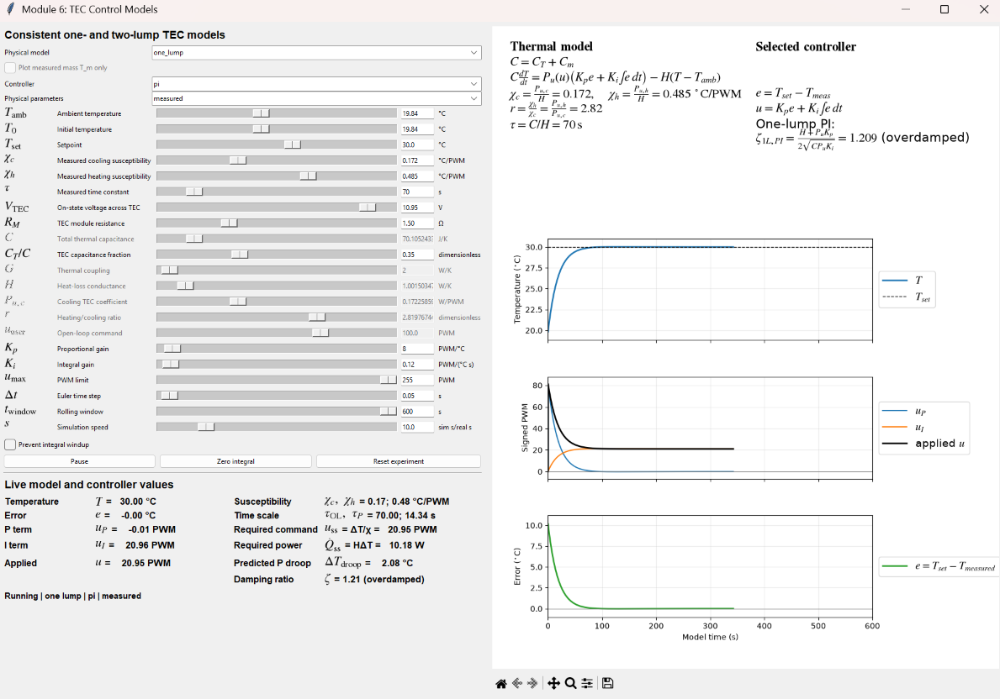

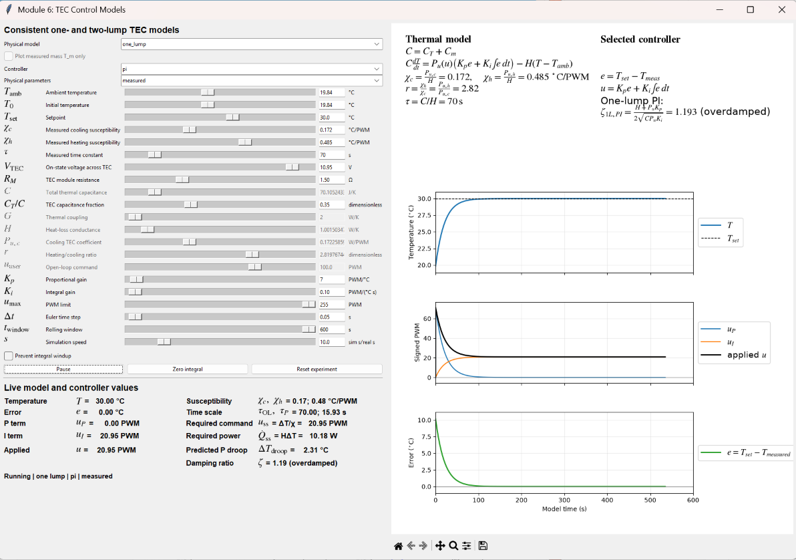

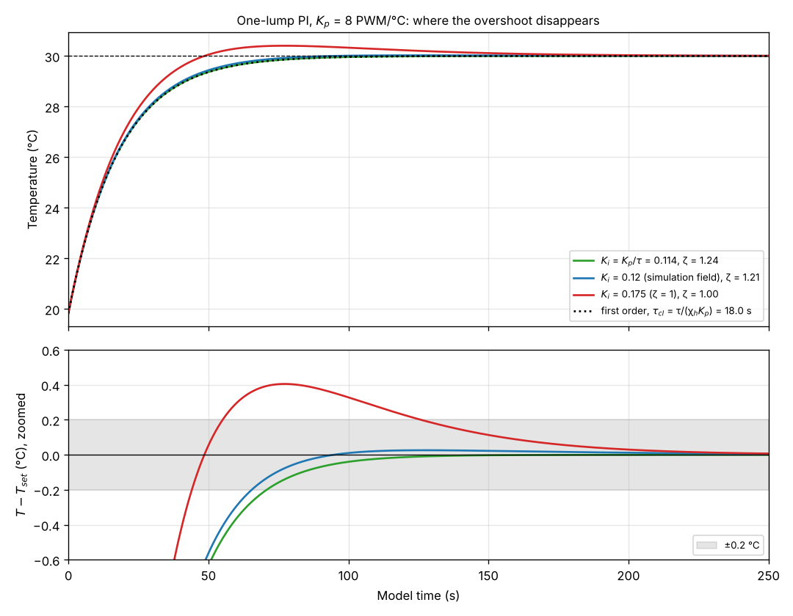

**The cost.** The cancelled pole $-1/\tau$ is still in the loop; it only disappears from
the setpoint response. A change of $T_{\mathrm{amb}}$, or **Zero integral** at the
steady state, excites it, and the recovery then runs on the 70 s open-loop time scale.
The script gives the following after **Zero integral** at the 30 °C steady state:

| $K_i$ | Dip | Back within ±0.2 °C |
| ---: | ---: | ---: |
| $K_p/\tau$ = 0.114 | 28.36 °C at 33 s | 201 s |
| 0.36 | 28.66 °C at 22 s | 71 s |
| 0.08 | 28.29 °C at 37 s | 289 s |

The 0.08 row reproduces the group E run above (28.29 °C at 37 s). On the hardware the
cancellation will not be exact. With $\tau = 70 \pm 3$ s the zero is misplaced by up to
4 %, which is harmless (0.12 is 5 % off and overshoots by 0.03 °C). The 1.5–2 s lag
matters more. $K_i \approx K_p/\tau$ is therefore a reasonable starting point for
choosing $K_i$ in Part 7.

### Windup demonstration: PWM limit 30

**Settings.** As in the $K_i$ sweep with $K_i$ = 0.36 PWM/(°C s) ($\zeta$ = 0.70),
but with $u_{\max}$ = 30 PWM. The initial request $K_pe = 8 \times 10.16 = 81$ PWM is
then far beyond the limit, while the steady command $u_{\mathrm{ss}}$ = 20.95 PWM is
still within it, so the setpoint can be reached. The run was made with
**Prevent integral windup** checked and unchecked, each from **Reset experiment**.
`python/module6_part6_windup.py` reproduces both runs ($T_{\max}$ to 0.01 °C) and gives
the times.

| | Anti-windup on | Anti-windup off |
| --- | ---: | ---: |
| $T_{\max}$ | 30.20 °C at 116 s | 33.27 °C at 180 s |
| Overshoot | +0.20 °C | +3.27 °C |
| Settles within ±0.2 °C | 86 s | 237 s |
| Largest $u_I$ | 24.0 PWM at 93 s | 123.5 PWM at 84 s |
| Largest $q$ ($q_{\mathrm{ss}}$ = 58 °C s) | 67 °C s | 343 °C s |
| Applied $u$ held at the limit until | 56 s | 178 s |

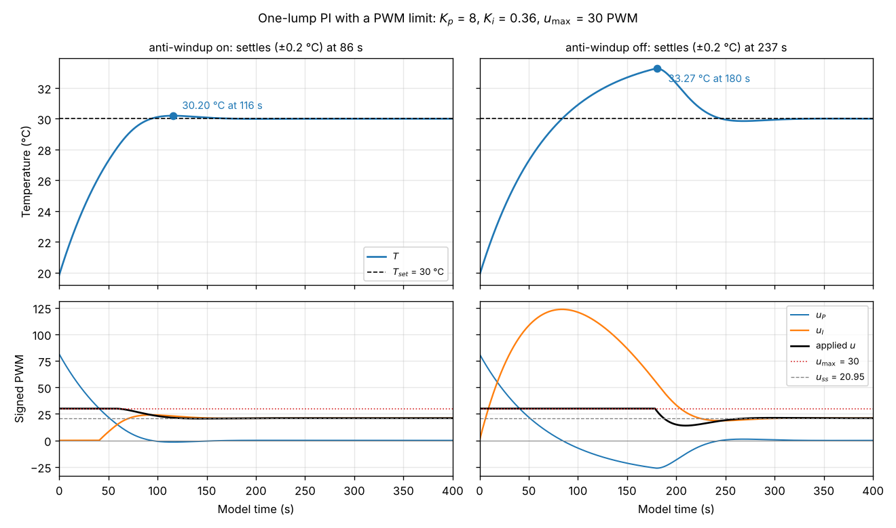

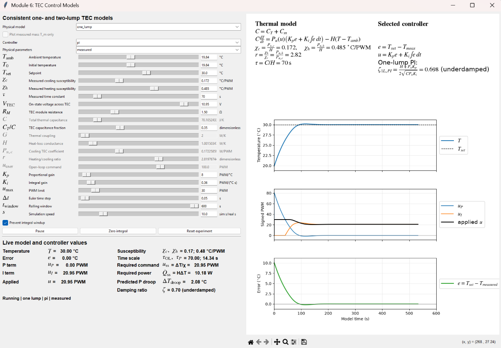

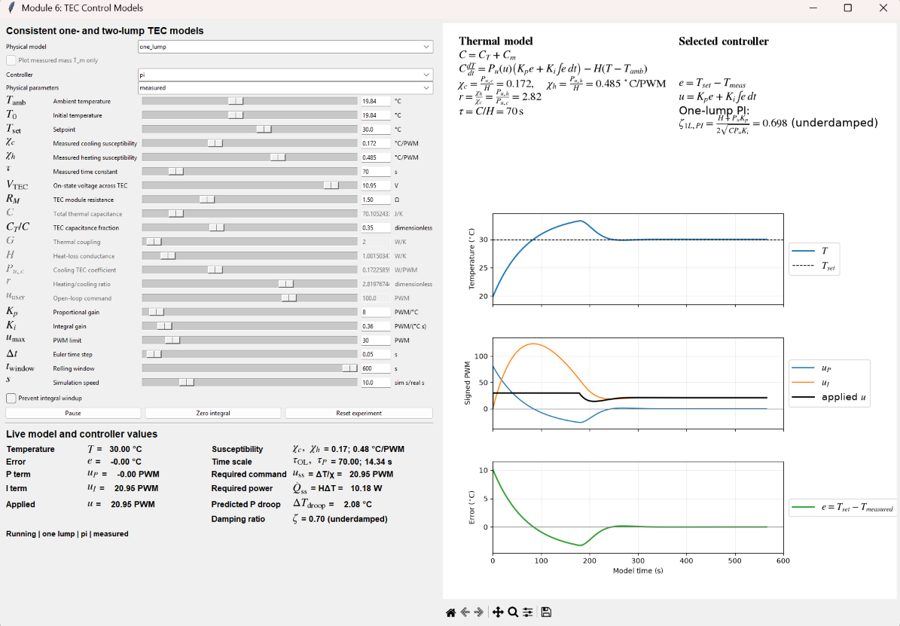

**Without anti-windup.** During the 84 s rise the applied command is stuck at
30 PWM, but $q$ keeps integrating the full error. The extra integral contribution has
no effect on the TEC, which is already at its limit; it is only stored. When $T$ first
reaches 30 °C, $u_P = 0$ but $u_I$ = 123.5 PWM, so the request is still far above the
limit and the TEC keeps heating at 30 PWM through the setpoint. Only negative error can
remove the stored integral: $q$ has to come down from 343 to 58 °C s, which takes
another 94 s at an error of about −3 °C. The temperature climbs to 33.27 °C during that
time, and the run needs 237 s to settle.

**With anti-windup (conditional integration).** While the request is above the limit
and $e > 0$, $q$ is held fixed. Integration starts at 40.8 s, when $K_pe$ alone falls
to 30 PWM ($e$ = 3.74 °C, $T$ = 26.26 °C). From then on $q$ grows only as far as the
request stays at the limit, so the applied command leaves 30 PWM at 56 s and settles
smoothly onto $u_{\mathrm{ss}}$. The largest $q$ is 67 °C s, barely above $q_{\mathrm{ss}}$
= 58 °C s, so by the integral-area argument above the overshoot is only 0.20 °C.

With anti-windup this run actually overshoots less than the same gains with
$u_{\max}$ = 255 (+1.39 °C, settling in 100 s): the integral starts accumulating only
near the setpoint, not during the whole rise. The three mechanisms do different jobs.
The PWM clamp protects the actuator, anti-windup keeps the controller's memory from
growing while the clamp is active, and **Zero integral** clears that memory
deliberately before a new comparison. The Part 7 hardware GUI uses the same
conditional-integration rule.
